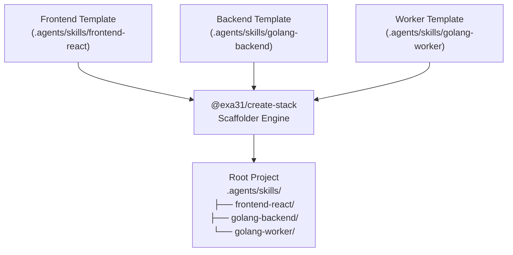

Salah satu keunggulan terbesar dari `@exa31/create-stack` adalah kemampuannya untuk mengotomatisasi konteks AI pada proyek multi-service.

---

## ⚡ Mekanisme Dynamic Skill Merging

Saat Anda menjalankan mode **Fullstack Project**:

1. **Ekstraksi Skill Service**: CLI memindai folder `.agents/skills/` pada setiap template yang Anda pilih (misalnya `frontend-react` dari React, `golang-backend` dari Golang, dan `golang-worker` dari Worker).
2. **Merge ke Root**: CLI menyalin seluruh skill tersebut ke folder root `.agents/skills/` di proyek baru Anda.
3. **Pembersihan Bersih**: File konfigurasi VCS dan temporary build dihapus tanpa merusak metadata skill AI.

---

## 🚀 Dampak Bagi Developer

Ketika Anda membuka folder proyek yang baru di-generate menggunakan AI Assistant (seperti Antigravity atau Cursor):
- AI langsung tahu cara membuat komponen UI React baru yang patuh skeleton loader.
- AI langsung tahu cara menambahkan endpoint Go Fiber dengan pure transaction `tx *sqlx.Tx`.
- AI langsung tahu cara membuat consumer worker RabbitMQ dengan QoS prefetch.

Semua tanpa perlu Anda menjelaskan aturan proyek berulang kali secara manual!
