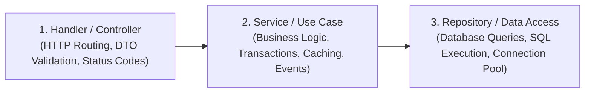

Semua service backend di monorepo ini dibangun dengan prinsip arsitektur yang seragam, terlepas dari bahasa pemrograman yang Anda pilih (Node.js/Express, Python/FastAPI, Go/Fiber, Java/Spring Boot, atau Rust/Axum).

---

## 🏛️ Clean Architecture Layers

Setiap backend membagi tanggung jawab kode ke dalam 3 layer utama:



1. **Handler / Controller**: Menerima request HTTP, memvalidasi input DTO (Zod / Pydantic / Go Validator / Jackson), dan mengembalikan response standar `BaseResponse`.
2. **Service / Use Case**: Tempat seluruh logika bisnis, orkestrasi transaksi database, caching Redis, dan publikasi event ke message broker (RabbitMQ/Kafka) atau realtime hub.
3. **Repository**: Tempat eksekusi query SQL mentah (*raw queries*) atau DAO. Repository tidak boleh mengurus HTTP context atau aturan bisnis, dan menerima koneksi/transaksi secara eksplisit.

---

## 📊 Matriks Fitur 5 Backend

| Template | Bahasa / Framework | Database & Transaksi | Realtime Engine | Distributed Bridge | Messaging | OpenAPI Doc | Port |
|---|---|---|---|---|---|---|---|
| `template-express` | TypeScript / Express | Postgres / MySQL (`withTransaction`) | SSE & Socket.IO | Redis & RabbitMQ | RabbitMQ & Kafka | `/docs` | `5000` |
| `template-fastapi-async` | Python / FastAPI | Postgres / MySQL (`@transactional`) | SSE & WebSocket | Redis Pub/Sub | RabbitMQ & Kafka | `/docs` | `8000` |
| `template-golang` | Go / Fiber v2 | Postgres / MySQL (`TransactionManager`) | SSE & WebSocket | Redis, RabbitMQ, Both | RabbitMQ & Kafka | `/docs` | `8080` |
| `template-java` | Java 17 / Spring Boot 4 | Postgres / MySQL (`@Transactional`) | SSE & STOMP /ws | Local, Redis, RabbitMQ | RabbitMQ & Kafka | `/swagger-ui.html` | `8080` |
| `template-rust` | Rust / Axum 0.7 | Postgres / MySQL (`&mut Transaction`) | SSE & WebSocket | Local, Redis, RabbitMQ, Both | RabbitMQ & Kafka | `/docs` | `8080` |

---

## 🛡️ 6 Pilar Standar Wajib Backend

### 1. Pure Parameter-Passing Database Transactions
Dilarang menyembunyikan atau menyimpan transaksi database di dalam `context.Context` (Go) atau task-local storage (Rust). Objek transaksi wajib dioper secara eksplisit sebagai argumen method/fungsi:
- **Go**: `s.tm.WithTransactionCtx(ctx, func(ctx context.Context, tx *sqlx.Tx) error { ... })`
- **Rust**: `async fn create_tx(&self, tx: &mut Transaction<'_, Postgres>, user: NewUser) -> Result<...>`
- **Express**: `await db.withTransaction(async (client) => { await userRepo.create(data, client) })`
- **FastAPI**: `@transactional` decorator dengan `db: AsyncSession`
- **Java**: `@Transactional` untuk mutasi data dan `@Transactional(readOnly = true)` untuk pembacaan data.

### 2. Standardized BaseResponse Envelope
Semua endpoint HTTP wajib mengembalikan envelope JSON flat top-level seragam:

```json title="Format Response Sukses"
{
  "success": true,
  "code": "SUCCESS",
  "message": "User registered successfully",
  "data": {
    "id": 1,
    "email": "user@example.com"
  },
  "timestamp": 1700000000000,
  "requestId": "req-9b1deb4d-3b7d-4bad-9bdd-2b0d7b3dcb6d"
}
```

```json title="Format Response Error Bisnis / Validasi"
{
  "success": false,
  "code": "EMAIL_ALREADY_EXISTS",
  "message": "The email address is already in use",
  "data": null,
  "timestamp": 1700000000000,
  "requestId": "req-9b1deb4d-3b7d-4bad-9bdd-2b0d7b3dcb6d"
}
```

### 3. Realtime Engine & Distributed Auto-Bridge
Semua backend menyediakan endpoint Server-Sent Events (SSE) dan WebSocket. Untuk penskalaan horizontal multi-pod Kubernetes, event di-broadcast lintas instans menggunakan Redis Pub/Sub atau RabbitMQ topic/fanout exchange via variabel `REALTIME_BRIDGE=redis|rabbitmq|both|local`.

### 4. Dual Message Brokers (RabbitMQ & Apache Kafka)
Setiap backend terintegrasi dengan client publisher RabbitMQ (AMQP 0.9.1) dan Apache Kafka untuk pengiriman event pipeline asynchronous ke worker background.

### 5. Idempotency Protection (`X-Idempotency-Key`)
Semua operasi mutasi penting diproteksi oleh middleware idempotency berbasis Redis dengan payload fingerprinting untuk mencegah double charging atau mutasi duplikat saat network retry.

### 6. Interactive OpenAPI 3.0 / Swagger UI
Semua backend menyajikan dokumentasi interaktif di `/docs` (atau `/swagger-ui.html`) dan skema raw JSON di `/docs/openapi.json` (atau `/v3/api-docs`).
