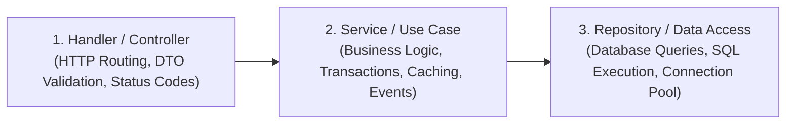

Semua service backend di monorepo ini dibangun dengan prinsip arsitektur yang seragam, terlepas dari bahasa pemrograman yang Anda pilih (Node.js, Python, Go, Java, atau Rust).

---

## 🏛️ Clean Architecture Layers

Setiap backend membagi tanggung jawab kode ke dalam 3 layer utama:



1. **Handler / Controller**: Menerima request HTTP, memvalidasi input DTO (Zod / Pydantic / Validator), dan mengembalikan response standar.
2. **Service / Use Case**: Tempat seluruh logika bisnis, orkestrasi transaksi database, caching Redis, dan publikasi event ke message broker.
3. **Repository**: Tempat eksekusi query SQL mentah (*raw queries*) atau DAO. Repository tidak boleh mengurus HTTP context atau aturan bisnis.

---

## 📊 Matriks Fitur 5 Backend

| Template | Bahasa / Framework | Database | Caching | Messaging | OpenAPI Doc | Port |
|---|---|---|---|---|---|---|
| `template-express` | TypeScript / Express | Postgres / MySQL | Redis | RabbitMQ & Kafka | `/docs` | `5000` |
| `template-fastapi-async` | Python / FastAPI | Postgres / MySQL | Redis | RabbitMQ & Kafka | `/docs` | `8000` |
| `template-golang` | Go / Fiber v2 | Postgres / MySQL | Redis | RabbitMQ & Kafka | `/docs` | `8080` |
| `template-java` | Java 17 / Spring Boot 4 | Postgres / MySQL | Redis | RabbitMQ & Kafka | `/swagger-ui.html` | `8080` |
| `template-rust` | Rust / Axum 0.7 | Postgres / MySQL | Redis | RabbitMQ & Kafka | `/docs` | `8080` |

---

## 🛡️ 4 Pilar Aturan Wajib Backend

### 1. Pure Parameter-Passing Database Transactions
Dilarang menyembunyikan atau menyimpan transaksi database di dalam `context.Context` (Go) atau task-local storage (Rust). Objek transaksi wajib dioper secara eksplisit sebagai argumen method/fungsi:
- **Go**: `func (r *Repo) CreateUser(ctx context.Context, tx *sqlx.Tx, user *User) error`
- **Rust**: `async fn create_user(&self, tx: &mut Transaction<'_, Postgres>, user: &User) -> Result<...>`

### 2. Standardized Response Envelope (`ApiResponse<T>`)
Semua endpoint mengembalikan struktur envelope standar:
```json
{
  "success": true,
  "message": "User created successfully",
  "data": {
    "id": "usr_123",
    "name": "Alex"
  },
  "error": null,
  "meta": {
    "page": 1,
    "limit": 10,
    "total": 100
  }
}
```

### 3. Semantic Error Codes
Semua error bisnis wajib menyertakan kode semantik eksplisit (contoh: `USER_NOT_FOUND`, `INVALID_CREDENTIALS`, `DUPLICATE_EMAIL`). Pesan error backend wajib berbahasa Inggris.

### 4. Interactive OpenAPI 3.0 / Swagger UI
Semua backend menyajikan dokumentasi interaktif di `/docs` (atau `/swagger-ui.html`) dan skema raw JSON di `/docs/openapi.json` (atau `/v3/api-docs`).
