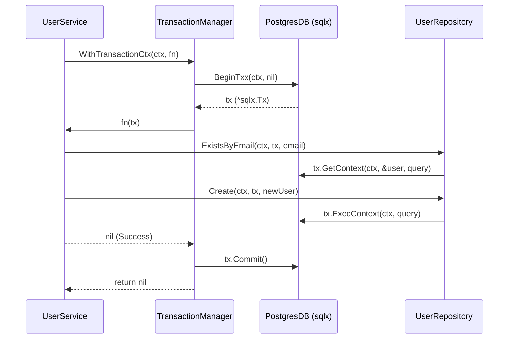

Template `template-golang` adalah backend REST API berkinerja tinggi yang ditulis dalam **Go 1.22+** dan framework **Fiber v2** (router berbasis Fasthttp dengan alokasi memori mendekati nol). Template ini dirancang untuk skala enterprise dengan Clean Architecture, penanganan transaksi database tanpa magic context, realtime messaging canggih, dan integrasi multi-broker.

---

## ✨ Fitur Arsitektur Utama

- **Fiber v2 Framework**: Router HTTP tercepat di ekosistem Go dengan zero-memory-allocation pipeline.
- **Pure Parameter-Passing Transactions**: Transaksi database wajib dioper secara terbuka via pointer `tx *sqlx.Tx`. Dilarang keras menyembunyikan transaksi di dalam `context.Context`.
- **Database TransactionManager**: Mengelola siklus hidup transaksi ACID secara otomatis (termasuk *panic recovery*, *context cancellation*, rollback, dan commit).
- **Real-time Hub (SSE & WebSocket)**: Streaming Server-Sent Events dan full-duplex WebSocket dengan dukungan dynamic channel subscription dan user-targeted messaging.
- **Distributed Realtime Auto-Bridge**: Menghubungkan banyak replica/pod server secara otomatis menggunakan **Redis Pub/Sub** atau **RabbitMQ Fanout Exchange** agar pesan tersinkronisasi di seluruh armada (fleet) server tanpa client kehilangan event.
- **Dual Message Broker**: Dukungan penuh untuk **RabbitMQ (AMQP 0.9.1)** dan **Apache Kafka Producer** (`segmentio/kafka-go`) dengan endpoint pengiriman langsung `/api/v1/kafka-send`.
- **Idempotency Protection Layer**: Middleware `X-Idempotency-Key` untuk mencegah mutasi ganda (double-spend/double-insert) dengan backend penyimpanan otomatis di Redis atau in-memory fallback.
- **Unified Request Body Binder**: Modul `pkg/validation` yang mampu mem-bind dan memvalidasi satu DTO untuk 3 format sekaligus: `application/json`, `application/x-www-form-urlencoded`, dan `multipart/form-data` (termasuk upload file).
- **Structured JSON Logging (slog)**: Modul `pkg/logging` berbasis standard library `log/slog` dengan correlation ID (`X-Request-ID`) dan masking otomatis data sensitif (password, JWT, token). Dilarang keras menggunakan raw `fmt.Println`.
- **Database Migrations**: Migrasi skema database versi terkelola menggunakan `golang-migrate/migrate` yang dapat dieksekusi secara otomatis saat boot aplikasi (`AUTO_MIGRATE=true`).
- **Interactive OpenAPI / Swagger**: Dokumentasi interaktif Swagger UI terintegrasi langsung di `/docs` dan skema mentah di `/docs/openapi.json`.

---

## ⚡ Transaksi Database (Pure Parameter Passing)

Aturan monorepo (`database-transactions.md`) melarang keras penggunaan "magic context" (seperti menyimpan transaksi di `context.WithValue` atau middleware tersembunyi). Di sisi lain, developer tidak perlu menulis ulang boilerplate `BeginTxx / defer tx.Rollback / Commit` di setiap usecase.

Sebagai gantinya, modul `database.TransactionManager` (`s.tm`) menyediakan pembungkus aman:



### 1. Operasi Pembacaan / Read-Only

Pada query pembacaan data, service memanfaatkan `WithReadOnlyTransactionCtx`:

```go title="internal/module/user/service.go"
func (s *userService) GetAll(ctx context.Context) ([]UserResponse, error) {
	var users []User
	err := s.tm.WithReadOnlyTransactionCtx(ctx, func(tx *sqlx.Tx) error {
		var err error
		users, err = s.repo.GetAll(ctx, tx) // tx dioper secara eksplisit
		return err
	})
	if err != nil {
		return nil, appErrors.DatabaseError("Failed to fetch users", err)
	}

	res := make([]UserResponse, 0, len(users))
	for i := range users {
		res = append(res, users[i].toResponse())
	}
	return res, nil
}
```

### 2. Operasi Mutasi Data & Atomic Rollback

Untuk penulisan data (`INSERT`, `UPDATE`, `DELETE`), alur bisnis dieksekusi di dalam `WithTransactionCtx`. Pointer `tx` dioper secara eksplisit ke setiap method repository:

```go title="internal/module/user/service.go"
func (s *userService) Create(ctx context.Context, req *CreateUserRequest) (*UserResponse, error) {
	var res *UserResponse
	err := s.tm.WithTransactionCtx(ctx, func(tx *sqlx.Tx) error {
		// 1. Validasi uniqueness via pointer tx eksplisit
		exists, err := s.repo.ExistsByEmail(ctx, tx, req.Email)
		if err != nil {
			return appErrors.DatabaseError("Gagal memeriksa email", err)
		}
		if exists {
			return appErrors.ConflictError("Email sudah terdaftar", nil)
		}

		// 2. Hash password
		hashed, err := password.Hash(req.Password)
		if err != nil {
			return appErrors.InternalError("Gagal memproses password", err)
		}

		user := &User{
			Name:         req.Name,
			Email:        req.Email,
			PasswordHash: hashed,
			Role:         RoleUser,
		}

		// 3. Mutasi data via tx eksplisit
		if err := s.repo.Create(ctx, tx, user); err != nil {
			return appErrors.DatabaseError("Gagal membuat user", err)
		}

		r := user.toResponse()
		res = &r
		return nil // Commit dieksekusi otomatis oleh TransactionManager
	})

	if err != nil {
		return nil, err
	}
	return res, nil
}
```

### 3. Layer Repository

Di layer repository, query wajib dieksekusi langsung pada objek `tx`:

```go title="internal/module/user/repository.go"
func (r *userRepository) Create(ctx context.Context, tx *sqlx.Tx, user *User) error {
	if tx == nil {
		return errors.New("repository method Create requires an active *sqlx.Tx")
	}

	query := `
		INSERT INTO users (name, email, password_hash, role, created_at, updated_at)
		VALUES ($1, $2, $3, $4, NOW(), NOW())
		RETURNING id, created_at, updated_at`

	return tx.QueryRowContext(ctx, query,
		user.Name,
		user.Email,
		user.PasswordHash,
		user.Role,
	).Scan(&user.ID, &user.CreatedAt, &user.UpdatedAt)
}
```

---

## 📡 Real-time Engine: SSE, WebSocket & Distributed Bridge

Template ini dilengkapi **Realtime Hub terpusat** (`internal/module/realtime/hub.go`) yang mengelola koneksi client, channel subscription, dan distribusi event.

```mermaid
flowchart TD
    ClientSSE["Client 1 (SSE EventSource)"] -->|GET /api/v1/sse| PodA["Pod Fiber A"]
    ClientWS["Client 2 (WebSocket)"] -->|ws:// /api/v1/ws| PodB["Pod Fiber B"]
    
    Publisher["REST API / Background Worker"] -->|Hub.Broadcast(event)| PodA
    PodA -->|Publish Event| Bridge{"Distributed Auto-Bridge\n(REALTIME_BRIDGE)"}
    
    Bridge -->|Redis Pub/Sub| PodA
    Bridge -->|Redis Pub/Sub| PodB
    
    PodA -->|Push stream| ClientSSE
    PodB -->|Push frame| ClientWS
```

### 1. Server-Sent Events (SSE)
- Endpoint: `GET /api/v1/sse?channel=news&userId=123`
- Headers yang dikirim otomatis:
  ```http
  Content-Type: text/event-stream
  Cache-Control: no-cache
  Connection: keep-alive
  Transfer-Encoding: chunked
  ```
- **Lifecycle Streaming**: Menggunakan `fasthttp.RequestCtx` dengan reader loop non-blocking dan pendeteksian diskoneksi melalui `c.Context().Done()`.

```javascript title="Contoh Client SSE (Browser)"
const sse = new EventSource("http://localhost:8080/api/v1/sse?channel=orders");
sse.onmessage = (event) => {
    const data = JSON.parse(event.data);
    console.log("Pesan baru:", data);
};
```

### 2. Full-Duplex WebSocket
- Endpoint: `GET /api/v1/ws?channel=room1&userId=123`
- Menggunakan `github.com/gofiber/contrib/websocket` dengan dua goroutine terisolasi:
  1. **Read Pump**: Membaca pesan masuk dari client, memproses heartbeat `ping/pong`, dan mem-forward pesan ke Hub.
  2. **Write Pump**: Mengirim frame data dari channel Go ke client dengan batas waktu (*write deadline*).

### 3. Distributed Auto-Bridge (Horizontal Scaling)
Ketika aplikasi dideploy dengan banyak pod di Kubernetes, client yang terhubung di Pod B harus tetap menerima pesan saat user lain mengirim pesan ke Pod A.
- Dikonfigurasi melalui environment variable `REALTIME_BRIDGE=redis` atau `rabbitmq` atau `both`.
- **Anti-Echo / Echo Prevention**: Setiap pesan membawa `SenderID` unik instans server agar pod pengirim tidak menduplikasi pesan ke subscriber lokalnya.
- **Graceful Fallback**: Jika Redis atau RabbitMQ terputus, sistem secara otomatis beralih ke mode standalone in-memory broadcast.

### 4. Daftar Endpoint Realtime

| Method | Endpoint | Deskripsi | Autentikasi |
|---|---|---|---|
| `GET` | `/api/v1/sse` | Membuka stream Server-Sent Events (`?channel=..&userId=..`) | Opsional |
| `WS` | `/api/v1/ws` | Membuka koneksi WebSocket dua arah | Opsional |
| `POST` | `/api/v1/realtime/broadcast` | Broadcast pesan ke seluruh subscriber | Wajib (Bearer) |
| `POST` | `/api/v1/realtime/channel/:channel` | Mengirim pesan ke channel tertentu | Wajib (Bearer) |

---

## 🐰⚡ Dual Message Broker: RabbitMQ & Apache Kafka

Template menyediakan dua teknologi message broker enterprise siap pakai:

### 1. RabbitMQ Producer & Consumer
- Dikelola oleh modul `pkg/queue/rabbitmq.go`.
- Mendukung deklarasi Queue, Exchange (`direct`, `topic`, `fanout`), dan Binding.
- Auto-reconnect dan penanganan channel pool yang thread-safe.

```go
// Contoh deklarasi dan pengiriman pesan RabbitMQ
broker, _ := queue.NewRabbitMQ(&cfg.RabbitMQ, logger)
_ = broker.Publish(ctx, "orders.exchange", "order.created", payloadBytes)
```

### 2. Apache Kafka Producer
- Dikelola oleh modul `pkg/queue/kafka.go` menggunakan pustaka `segmentio/kafka-go`.
- Menggunakan `LeastBytes` partition balancing dan batch timeout untuk performa throughput maksimal.
- Dilengkapi TCP connection health check mandiri ke broker.

### 3. Daftar Endpoint & Testing cURL

```bash title="Kirim Pesan ke Apache Kafka"
curl -X POST http://localhost:8080/api/v1/kafka-send \
  -H "Content-Type: application/json" \
  -d '{
    "topic": "app.events",
    "key": "order-123",
    "message": "{\"status\":\"PAID\",\"amount\":50000}"
  }'
```

---

## 🛡️ Proteksi Idempotency (X-Idempotency-Key)

Untuk endpoint mutasi krusial seperti pembayaran atau pembuatan resource (`POST`, `PATCH`), template menyertakan middleware idempotensi IETF draft di `pkg/idempotency`.

### 1. Konfigurasi Middleware & Storage

```go title="internal/app/http.go"
import "golang/pkg/idempotency"

// Pasang middleware idempotency pada rute mutasi sensitif
orders := api.Group("/orders", idempotency.New(idempotency.Config{
    Storage:     idempotency.NewRedisStorage(redisClient),
    Lifetime:    24 * time.Hour,
    LockTimeout: 30 * time.Second,
    Required:    true,
}))
orders.Post("/", orderHandler.CreateOrder)
```

### 2. Mekanisme Kunci, Fingerprint & Replay
1. **Header**: Client menyertakan header `Idempotency-Key` atau `X-Idempotency-Key`.
2. **Atomic Lock**: Status `in_progress` dikunci di Redis selama 30 detik. Request paralel yang bersamaan akan langsung ditolak dengan `409 Conflict`.
3. **Payload Fingerprint**: Hash SHA-256 diverifikasi terhadap path, method, dan request body. Jika payload berbeda, server mengembalikan `422 Unprocessable Entity`.
4. **Instant Replay**: Jika request berhasil sebelumnya, cached response dikembalikan seketika dengan header `Idempotent-Replayed: true`.
5. **Safety Unlock**: Jika terjadi kegagalan server (5xx), lock otomatis dihapus dari Redis.

---

## 📋 Validasi Input Request & Boundaries

Semua endpoint POST/PUT memakai binder `pkg/validation` yang menerima satu DTO untuk **tiga bentuk body sekaligus**:
1. `application/json`
2. `application/x-www-form-urlencoded`
3. `multipart/form-data` (termasuk upload file via field `*multipart.FileHeader`)

```go title="Contoh DTO Multi-Format"
type CreateUserRequest struct {
    Name   string                `json:"name" form:"name" validate:"required,min=3,max=100"`
    Email  string                `json:"email" form:"email" validate:"required,email"`
    Phone  string                `json:"phone" form:"phone" validate:"omitempty"`
    Avatar *multipart.FileHeader `json:"avatar" form:"avatar"` // Upload file otomatis di-bind
}
```

Di handler controller:
```go
req := new(CreateUserRequest)
if err := validation.BindAndValidate(c, req); err != nil {
    return response.ValidationErrorResponse(c, err)
}
```

---

## ⚙️ Variabel Lingkungan & Konfigurasi

| Variabel | Default | Keterangan |
|---|---|---|
| `APP_NAME` | `golang-api` | Nama aplikasi |
| `ENVIRONMENT` | `development` | `development` atau `production` (JSON logging aktif) |
| `SERVER_PORT` | `8080` | Port listening HTTP Fiber |
| `LOG_LEVEL` | `info` | Tingkat log: `debug`, `info`, `warn`, `error` |
| `DB_HOST` | `localhost` | Host PostgreSQL |
| `DB_PORT` | `5432` | Port PostgreSQL |
| `DB_USER` / `DB_PASSWORD` | `postgres` | Kredensial PostgreSQL |
| `DB_NAME` | `mydb` | Nama database |
| `AUTO_MIGRATE` | `true` | Jalankan migrasi database otomatis saat aplikasi boot |
| `REDIS_ENABLED` | `true` | Aktifkan integrasi Redis cache & token blacklist |
| `REDIS_HOST` / `REDIS_PORT`| `localhost:6379` | Alamat koneksi Redis |
| `RABBITMQ_ENABLED` | `true` | Aktifkan integrasi broker RabbitMQ |
| `RABBITMQ_HOST` / `PORT` | `localhost:5672` | Alamat koneksi RabbitMQ |
| `KAFKA_ENABLED` | `false` | Aktifkan native producer Kafka |
| `KAFKA_BROKERS` | `localhost:9092` | Alamat broker Kafka (pisahkan koma untuk multi-broker) |
| `REALTIME_ENABLED` | `true` | Master switch fitur realtime (SSE & WS) |
| `REALTIME_SSE_ENABLED` | `true` | Aktifkan endpoint Server-Sent Events |
| `REALTIME_WS_ENABLED` | `true` | Aktifkan endpoint WebSocket |
| `REALTIME_BRIDGE` | `redis` | Transport fan-out multi-pod: `redis`, `rabbitmq`, atau `both` |
| `IDEMPOTENCY_ENABLED` | `true` | Aktifkan proteksi idempotency key pada rute `/api/v1` |

---

## 🛠️ Perintah Pengembangan

```bash title="Terminal"
cd backend

# 1. Download modul dependensi
go mod download

# 2. Jalankan migrasi database manual
make migrate-up

# 3. Jalankan server development (port 8080)
make dev
# atau: go run cmd/api/main.go

# 4. Jalankan pengujian unit & integrasi
make test

# 5. Format & linter kode
make check
```
