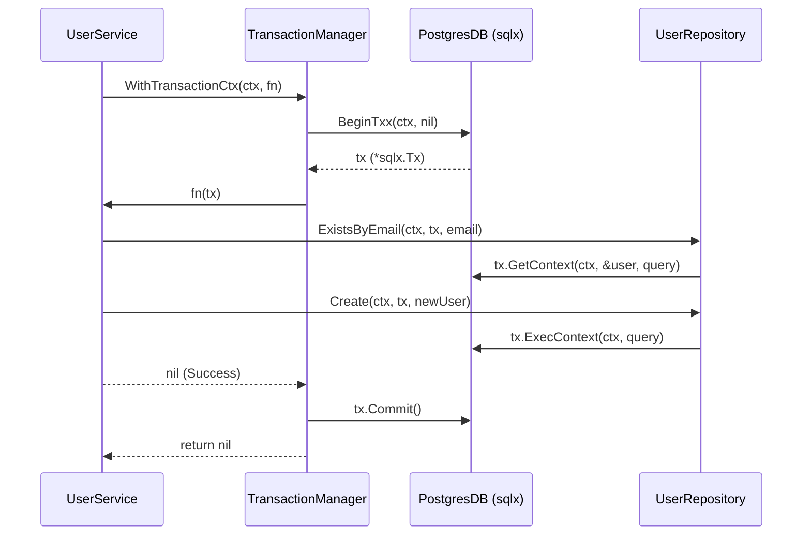

Template `template-golang` adalah backend REST API berkinerja tinggi yang ditulis dalam **Go 1.22+** dan framework **Fiber v2** (router berbasis Fasthttp dengan alokasi memori mendekati nol). Template ini dirancang untuk skala enterprise dengan Clean Architecture, penanganan transaksi database tanpa magic context, realtime messaging canggih, dan integrasi multi-broker.

---

## ✨ Fitur Arsitektur Utama

- **Fiber v2 Framework**: Router HTTP tercepat di ekosistem Go dengan zero-memory-allocation pipeline.
- **Pure Parameter-Passing Transactions**: Transaksi database wajib dioper secara terbuka via pointer `tx *sqlx.Tx`. Dilarang keras menyembunyikan transaksi di dalam `context.Context`.
- **Database TransactionManager**: Mengelola siklus hidup transaksi ACID secara otomatis (termasuk *panic recovery*, *context cancellation*, rollback, dan commit).
- **Real-time Hub (SSE & WebSocket)**: Streaming Server-Sent Events dan full-duplex WebSocket dengan dukungan dynamic channel subscription dan user-targeted messaging.
- **Distributed Realtime Auto-Bridge**: Menghubungkan banyak replica/pod server secara otomatis menggunakan **Redis Pub/Sub** atau **RabbitMQ Fanout Exchange** agar pesan tersinkronisasi di seluruh armada (fleet) server tanpa client kehilangan event.
- **Dual Message Broker**: Dukungan penuh untuk **RabbitMQ (AMQP 0.9.1)** dan **Apache Kafka Producer** (`segmentio/kafka-go`) dengan endpoint pengiriman langsung `/api/v1/kafka-send`.
- **Idempotency Protection Layer**: Middleware `X-Idempotency-Key` untuk mencegah mutasi ganda (double-spend/double-insert) dengan backend penyimpanan otomatis di Redis atau in-memory fallback.
- **Unified Request Body Binder**: Modul `pkg/validation` yang mampu mem-bind dan memvalidasi satu DTO untuk 3 format sekaligus: `application/json`, `application/x-www-form-urlencoded`, dan `multipart/form-data` (termasuk upload file).
- **Structured JSON Logging (slog)**: Modul `pkg/logging` berbasis standard library `log/slog` dengan correlation ID (`X-Request-ID`) dan masking otomatis data sensitif (password, JWT, token). Dilarang keras menggunakan raw `fmt.Println`.
- **Database Migrations**: Migrasi skema database versi terkelola menggunakan `golang-migrate/migrate` yang dapat dieksekusi secara otomatis saat boot aplikasi (`AUTO_MIGRATE=true`).
- **Interactive OpenAPI / Swagger**: Dokumentasi interaktif Swagger UI terintegrasi langsung di `/docs` dan skema mentah di `/docs/openapi.json`.

---

## ⚡ Transaksi Database (Pure Parameter Passing & TransactionManager)

Aturan monorepo (`database-transactions.md`) melarang keras penggunaan "magic context" (seperti menyimpan transaksi di `context.WithValue` atau middleware tersembunyi). Di sisi lain, developer tidak perlu menulis ulang boilerplate `BeginTxx / defer tx.Rollback / Commit` di setiap usecase.

Sebagai gantinya, modul `database.TransactionManager` (`s.tm`) menyediakan pembungkus aman:



### 1. Operasi Pembacaan / Read-Only (`GetAll`)
Pada query pembacaan data, service memanfaatkan `WithReadOnlyTransactionCtx`:

```go title="internal/module/user/service.go"
func (s *userService) GetAll(ctx context.Context) ([]UserResponse, error) {
	var users []User
	err := s.tm.WithReadOnlyTransactionCtx(ctx, func(tx *sqlx.Tx) error {
		var err error
		users, err = s.repo.GetAll(ctx, tx) // tx dioper secara eksplisit
		return err
	})
	if err != nil {
		return nil, appErrors.DatabaseError("Failed to fetch users", err)
	}

	res := make([]UserResponse, 0, len(users))
	for i := range users {
		res = append(res, users[i].toResponse())
	}
	return res, nil
}
```

### 2. Operasi Mutasi Data (`Create`)
Untuk penulisan data (`INSERT`, `UPDATE`, `DELETE`), alur bisnis dieksekusi di dalam `WithTransactionCtx`. Pointer `tx` dioper secara eksplisit ke setiap method repository:

```go title="internal/module/user/service.go"
func (s *userService) Create(ctx context.Context, req *CreateUserRequest) (*UserResponse, error) {
	var res *UserResponse
	err := s.tm.WithTransactionCtx(ctx, func(tx *sqlx.Tx) error {
		// Validasi keberadaan email dalam transaksi
		exists, err := s.repo.ExistsByEmail(ctx, tx, req.Email)
		if err != nil {
			return appErrors.DatabaseError("Failed to check email existence", err)
		}
		if exists {
			return appErrors.EmailAlreadyExists()
		}

		user := &User{
			ID:        uuid.New().String(),
			Name:      req.Name,
			Email:     req.Email,
			Role:      "user",
			IsActive:  true,
			CreatedAt: time.Now(),
			UpdatedAt: time.Now(),
		}

		// Oper tx secara eksplisit ke repository
		if err := s.repo.Create(ctx, tx, user); err != nil {
			return appErrors.ParseDatabaseError(err)
		}

		u := user.toResponse()
		res = &u
		return nil
	})
	if err != nil {
		return nil, err
	}
	return res, nil
}
```

### 3. Repository Layer (Validasi Transaksi Wajib)
Setiap method repository memvalidasi keberadaan `tx` dan mengeksekusi query langsung pada objek transaksi tersebut:

```go title="internal/module/user/repository.go"
func (r *userRepository) Create(ctx context.Context, tx *sqlx.Tx, user *User) error {
	if tx == nil {
		return errors.New("transaction is required")
	}
	query := `INSERT INTO users (id, name, email, phone, role, is_active, created_at, updated_at) 
	          VALUES ($1, $2, $3, $4, $5, $6, $7, $8)`
	_, err := tx.ExecContext(ctx, query, user.ID, user.Name, user.Email, user.Phone, user.Role, user.IsActive, user.CreatedAt, user.UpdatedAt)
	return err
}
```

---

## 📡 Real-time Engine: SSE, WebSocket & Distributed Auto-Bridge

`template-golang` dilengkapi modul real-time kelas produksi (`pkg/realtime`) yang mendukung protokol **Server-Sent Events (SSE)** dan **WebSocket** secara bersamaan atau independen.

```mermaid
flowchart TD
    Client1[Client A (Browser SSE)] -->|GET /realtime/sse/events| Pod1[Go Pod 1 / Replica 1]
    Client2[Client B (Mobile WS)] -->|GET /realtime/ws/connect| Pod2[Go Pod 2 / Replica 2]
    
    subgraph Multi_Pod_Sync [Distributed Auto-Bridge (REALTIME_BRIDGE)]
        Pod1 <-->|Publish / Subscribe| Bridge[(Redis Pub/Sub atau RabbitMQ Fanout)]
        Bridge <-->|Publish / Subscribe| Pod2
    end
    
    Pod1 -->|Local Fanout| Client1
    Pod2 -->|Local Fanout| Client2
```

### 1. Server-Sent Events (SSE)
Implementasi SSE di `internal/module/sse.go` dirancang khusus agar aman dari *context object pool recycling* Fiber:
- Mengambil channel pembatalan koneksi `notify := c.Context().Done()` **sebelum** fungsi handler me-return.
- Menggunakan `fasthttp.StreamWriter` dengan header `X-Accel-Buffering: no` untuk mencegah buffering oleh reverse proxy seperti Nginx atau Traefik.
- Mendukung dynamic query parameter: `?client_id=<uuid>&channels=orders,notifications`.

**Endpoint SSE:**
* `GET /api/v1/realtime/sse/events` - Endpoint streaming SSE untuk client.
* `GET /api/v1/realtime/sse/subscribe?channel=room1` - Menambahkan langganan channel ke client yang sedang terhubung.
* `POST /api/v1/realtime/sse/broadcast` - Mengirim pesan ke seluruh client atau channel tertentu.
* `POST /api/v1/realtime/sse/send` - Mengirim pesan langsung ke `user_id` spesifik.
* `GET /api/v1/realtime/sse/stats` - Statistik jumlah koneksi aktif dan daftar channel.

### 2. Full-Duplex WebSocket
Implementasi WebSocket di `internal/module/ws.go` menggunakan `@gofiber/websocket/v2`:
- Dilengkapi mekanisme read/write pump independen.
- Ping/Pong heartbeat otomatis dengan timeout 60 detik untuk mendeteksi dead connection.
- Integrasi otomatis unregister saat koneksi terputus (*graceful cleanup*).

**Endpoint WebSocket:**
* `GET /api/v1/realtime/ws/connect?client_id=<id>&channels=chat,alerts`
* `GET /api/v1/realtime/ws/stats`

### 3. Distributed Auto-Bridge (Horizontal Pod Scaling)
Pada lingkungan Kubernetes atau microservices multi-replica, client yang terkoneksi ke **Pod 1** biasanya tidak dapat menerima pesan yang di-broadcast oleh **Pod 2** jika hanya menggunakan memori lokal.

Modul `pkg/realtime/bridge.go` mengatasi masalah ini secara transparan lewat **Auto-Bridge**:

1. **Redis Pub/Sub Bridge (`REALTIME_BRIDGE=redis`)**:
   - Mempublikasikan pesan ke Redis dengan pola channel `realtime:channel:<channel_name>` atau `realtime:broadcast`.
   - Seluruh replica mendengarkan pola `realtime:*` dan meneruskannya ke subscriber lokal masing-masing.
2. **RabbitMQ Fanout Bridge (`REALTIME_BRIDGE=rabbitmq`)**:
   - Menggunakan satu exchange tipe **fanout** bernama `realtime.events`.
   - Setiap pod yang menyala membuat antrean eksklusif sementara (`realtime.<uuid>`) yang otomatis dihapus saat pod mati (*auto-delete*).
   - Seluruh instance menerima copy dari setiap pesan tanpa terjadi kompetisi antrean (*no competing consumers*).
3. **Dual Bridge (`REALTIME_BRIDGE=both`)**:
   - Menerbitkan event ke Redis dan RabbitMQ secara paralel untuk arsitektur hybrid.
4. **Proteksi Loopback / Anti-Echo**:
   - Setiap pesan diberi stempel ID pod pengirim (`msg.ID = h.id`). Ketika pesan kembali melalui bridge, pod pengirim mendeteksinya dan membuang duplikat lokal (`if message.ID == h.id continue`).
5. **Zero-Downtime Fallback**:
   - Jika broker atau Redis mati atau dimatikan via flag (`REDIS_ENABLED=false`), hub otomatis turun (*fallback*) ke mode single-instance (in-memory broadcast saja) tanpa menyebabkan aplikasi crash.

---

## 🐰⚡ Dual Message Broker: RabbitMQ & Apache Kafka

Template menyediakan dua teknologi message broker kelas dunia yang siap pakai out-of-the-box.

### 1. RabbitMQ (AMQP 0.9.1)
- Dikelola oleh modul `pkg/queue/rabbitmq.go`.
- Mendukung deklarasi Queue, Exchange (`direct`, `topic`, `fanout`), dan Binding.
- Auto-reconnect dan penanganan channel pool yang thread-safe.

```go
// Contoh deklarasi dan pengiriman pesan RabbitMQ
broker, _ := queue.NewRabbitMQ(&cfg.RabbitMQ, logger)
_ = broker.Publish(ctx, "orders.exchange", "order.created", payloadBytes)
```

### 2. Apache Kafka Native Producer
- Dikelola oleh modul `pkg/queue/kafka.go` menggunakan pustaka `segmentio/kafka-go`.
- Menggunakan `LeastBytes` partition balancing dan batch timeout untuk performa throughput maksimal.
- Dilengkapi TCP connection health check mandiri ke broker.

**Endpoint Pengujian Kafka Terpasang:**
```bash title="Kirim Pesan ke Kafka"
curl -X POST http://localhost:8080/api/v1/kafka-send \
  -H "Content-Type: application/json" \
  -d '{
    "topic": "app.events",
    "key": "order-123",
    "message": "{\"status\":\"PAID\",\"amount\":50000}"
  }'
```

---

## 🛡️ Idempotency Protection Layer

Untuk endpoint mutasi krusial seperti pembayaran atau pembuatan resource (`POST` / `PATCH`), template menyertakan middleware idempotensi di `pkg/idempotency`.

- **Cara Pakai**: Client menyertakan header `X-Idempotency-Key: <unique-uuid>`.
- **Backend Storage**:
  - Jika Redis aktif (`REDIS_ENABLED=true`), hasil response disimpan di Redis dengan TTL terkonfigurasi (`IDEMPOTENCY_LIFETIME_HOURS`).
  - Jika Redis nonaktif, middleware otomatis menggunakan *thread-safe in-memory storage* (`sync.Map`) sebagai fallback.
- Jika request dengan key yang sama dikirim ulang sebelum proses selesai, server mengembalikan status `409 Conflict`. Jika proses sudah selesai, server langsung mengembalikan hasil response cache sebelumnya tanpa mengeksekusi ulang usecase/database.

---

## 📋 Unified Request Body Binder (`pkg/validation`)

Semua endpoint POST/PUT memakai binder `pkg/validation` yang menerima satu DTO untuk **tiga bentuk body sekaligus**:
1. `application/json`
2. `application/x-www-form-urlencoded`
3. `multipart/form-data` (termasuk upload file via field `*multipart.FileHeader`)

```go title="Contoh DTO Multi-Format"
type CreateUserRequest struct {
    Name   string                `json:"name" form:"name" validate:"required,min=3,max=100"`
    Email  string                `json:"email" form:"email" validate:"required,email"`
    Phone  string                `json:"phone" form:"phone" validate:"omitempty"`
    Avatar *multipart.FileHeader `json:"avatar" form:"avatar"` // Upload file otomatis di-bind
}
```

Di handler controller:
```go
req := new(CreateUserRequest)
if err := validation.BindAndValidate(c, req); err != nil {
    return response.ValidationErrorResponse(c, err)
}
```

---

## ⚙️ Variabel Lingkungan (`.env`)

| Variabel | Default | Keterangan |
|---|---|---|
| `APP_NAME` | `golang-api` | Nama aplikasi |
| `ENVIRONMENT` | `development` | `development` atau `production` (JSON logging aktif) |
| `SERVER_PORT` | `8080` | Port listening HTTP Fiber |
| `LOG_LEVEL` | `info` | Tingkat log: `debug`, `info`, `warn`, `error` |
| `DB_HOST` | `localhost` | Host PostgreSQL |
| `DB_PORT` | `5432` | Port PostgreSQL |
| `DB_USER` / `DB_PASSWORD` | `postgres` | Kredensial PostgreSQL |
| `DB_NAME` | `mydb` | Nama database |
| `AUTO_MIGRATE` | `true` | Jalankan migrasi database otomatis saat aplikasi boot |
| `REDIS_ENABLED` | `true` | Aktifkan integrasi Redis cache & token blacklist |
| `REDIS_HOST` / `REDIS_PORT`| `localhost:6379` | Alamat koneksi Redis |
| `RABBITMQ_ENABLED` | `true` | Aktifkan integrasi broker RabbitMQ |
| `RABBITMQ_HOST` / `PORT` | `localhost:5672` | Alamat koneksi RabbitMQ |
| `KAFKA_ENABLED` | `false` | Aktifkan native producer Kafka |
| `KAFKA_BROKERS` | `localhost:9092` | Alamat broker Kafka (pisahkan koma untuk multi-broker) |
| `REALTIME_ENABLED` | `true` | Master switch fitur realtime (SSE & WS) |
| `REALTIME_SSE_ENABLED` | `true` | Aktifkan endpoint Server-Sent Events |
| `REALTIME_WS_ENABLED` | `true` | Aktifkan endpoint WebSocket |
| `REALTIME_BRIDGE` | `redis` | Transport fan-out multi-pod: `redis`, `rabbitmq`, atau `both` |
| `IDEMPOTENCY_ENABLED` | `true` | Aktifkan proteksi idempotency key pada rute `/api/v1` |

---

## 🛠️ Perintah Pengembangan

```bash title="Terminal"
cd backend

# 1. Download modul dependensi
go mod download

# 2. Jalankan migrasi database manual
make migrate-up

# 3. Jalankan server development (port 8080)
make dev
# atau: go run cmd/api/main.go

# 4. Jalankan pengujian unit & integrasi
make test

# 5. Format & linter kode
make check
```
