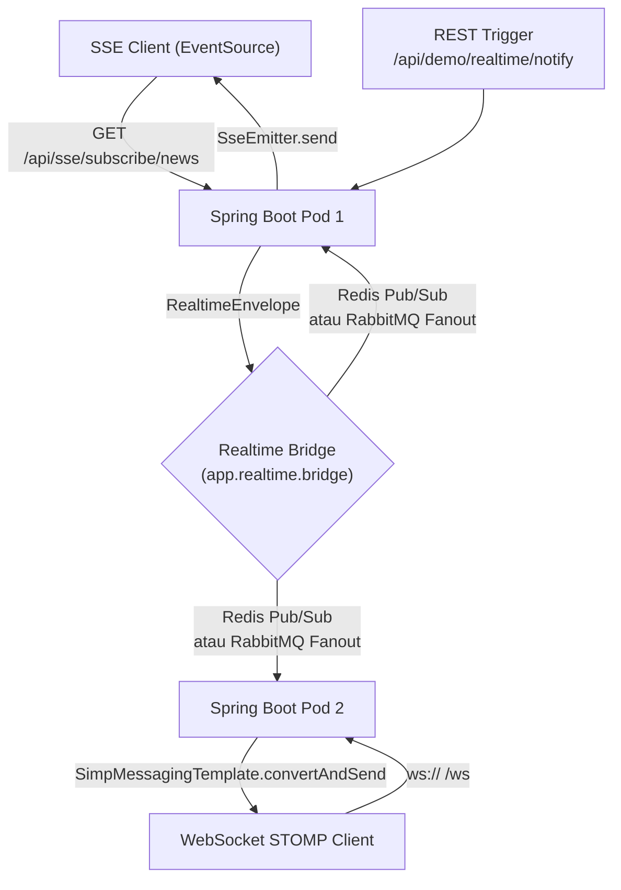

Template `template-java` adalah starter kit enterprise backend berbasis **Java 17+** dan **Spring Boot 4**, mengombinasikan keandalan ekosistem enterprise Java, migrasi skema Liquibase, sistem antrean ganda (RabbitMQ + Kafka), serta engine realtime terdistribusi dengan arsitektur bridge yang fleksibel.

---

## ✨ Fitur Arsitektur Utama

- **Spring Boot 4**: Framework backend enterprise de-facto dengan performa startup optimal dan integrasi ekosistem Spring Framework 6.
- **Liquibase Database Migrations**: Migrasi skema database deklaratif dan aman dengan dukungan penuh rollback (`UP`/`DOWN`).
- **Standard BaseResponse Envelope**: Format response terstandarisasi yang seragam dengan seluruh stack monorepo (`success`, `code`, `message`, `data`, `timestamp`, `requestId`).
- **`@RequireAuth` Annotation**: Interceptor JWT kustom untuk proteksi endpoint berbasis anotasi deklaratif tanpa overhead Spring Security yang rumit.
- **Realtime Engine (SSE & WebSocket STOMP)**:
  - **Server-Sent Events (SSE)** via `SseEmitter` pada `/api/sse/*`.
  - **WebSocket STOMP** dengan SockJS fallback pada `/ws`.
- **Pluggable Realtime Bridge (`app.realtime.bridge`)**: Bridge realtime terdistribusi yang dapat diganti secara deklaratif melalui konfigurasi (`local`, `redis`, atau `rabbitmq`).
- **Dual Message Brokers (RabbitMQ & Kafka)**:
  - RabbitMQ Producer & Consumer terintegrasi menggunakan Spring AMQP (`RabbitTemplate` & `@RabbitListener`).
  - Apache Kafka Producer terintegrasi menggunakan `KafkaTemplate`.
- **Idempotency Protection Layer**: `@RequireIdempotencyKey` didukung oleh `IdempotencyFilter` dengan penyimpanan Redis atau in-memory fallback.
- **Structured JSON Logging**: Logback + Logstash encoder menghasilkan streaming JSON terstruktur (dilarang keras menggunakan `System.out.println`).
- **Interactive Swagger**: Antarmuka Swagger UI interaktif di `http://localhost:8080/swagger-ui.html` dan OpenAPI 3.0 spec di `/v3/api-docs`.

---

## ⚡ Transaksi Database (Pure Parameter Passing)

Sesuai aturan monorepo (`database-transactions.md`), transaksi database dikelola secara deklaratif menggunakan anotasi Spring AOP `@Transactional`. Terdapat pemisahan tegas antara operasi mutasi data dan operasi pembacaan:

### 1. Operasi Pembacaan / Read-Only

Operasi pembacaan wajib menyertakan `readOnly = true` untuk mengoptimalkan performa dirty-checking Hibernate:

```java title="src/main/java/com/example/template/java/user/service/UserService.java"
@Transactional(readOnly = true)
public User getUserById(Long id) {
  return userRepository
      .findById(id)
      .orElseThrow(() -> new BusinessException("User not found", ApiCode.USER_NOT_FOUND));
}
```

### 2. Operasi Mutasi Data & Atomic Rollback

Operasi mutasi data (`INSERT`, `UPDATE`, `DELETE`) di-annotate dengan `@Transactional`. Setiap unchecked exception (`RuntimeException`) otomatis memicu pembatalan (rollback) transaksi secara instan:

```java title="src/main/java/com/example/template/java/user/service/UserService.java"
package com.example.template.java.user.service;

import com.example.template.java.common.constant.ApiCode;
import com.example.template.java.common.exception.BusinessException;
import com.example.template.java.user.dto.UserRequest;
import com.example.template.java.user.model.User;
import com.example.template.java.user.repository.UserRepository;
import java.util.Optional;
import lombok.extern.slf4j.Slf4j;
import org.springframework.beans.factory.annotation.Autowired;
import org.springframework.security.crypto.password.PasswordEncoder;
import org.springframework.stereotype.Service;
import org.springframework.transaction.annotation.Transactional;

@Slf4j
@Service
public class UserService {

  private final UserRepository userRepository;
  private final PasswordEncoder passwordEncoder;

  @Autowired
  public UserService(UserRepository userRepository, PasswordEncoder passwordEncoder) {
    this.userRepository = userRepository;
    this.passwordEncoder = passwordEncoder;
  }

  @Transactional
  public User createUser(UserRequest request) {
    Optional<User> existing = userRepository.findByEmail(request.getEmail());
    if (existing.isPresent()) {
      throw new BusinessException("Email already registered", ApiCode.EMAIL_ALREADY_EXISTS);
    }

    User user = new User();
    user.setEmail(request.getEmail());
    user.setPassword(passwordEncoder.encode(request.getPassword()));
    user.setName(request.getName());

    User savedUser = userRepository.save(user);
    log.info("Successfully registered user with ID: {}", savedUser.getId());
    return savedUser;
  }
}
```

### 3. Layer Repository

Layer repository mengimplementasikan `JpaRepository` dari Spring Data JPA, menjaga query database terisolasi rapi:

```java title="src/main/java/com/example/template/java/user/repository/UserRepository.java"
package com.example.template.java.user.repository;

import com.example.template.java.user.model.User;
import java.util.Optional;
import org.springframework.data.jpa.repository.JpaRepository;
import org.springframework.stereotype.Repository;

@Repository
public interface UserRepository extends JpaRepository<User, Long> {
  Optional<User> findByEmail(String email);
  boolean existsByEmail(String email);
}
```

---

## 📡 Real-time Engine: SSE, WebSocket & Distributed Bridge

`template-java` menyediakan infrastruktur realtime terdistribusi yang menghubungkan browser dengan kluster backend:



### 1. Server-Sent Events (SSE)
Dikelola oleh `SSEService` menggunakan Spring Web MVC `SseEmitter`:

```javascript title="Contoh Client SSE (Browser)"
const eventSource = new EventSource('/api/sse/subscribe/general');

eventSource.onmessage = (event) => {
  const data = JSON.parse(event.data);
  console.log('Received SSE Message:', data);
};

eventSource.onerror = (error) => {
  console.error('SSE connection error:', error);
  eventSource.close();
};
```

### 2. Full-Duplex WebSocket
Dikelola oleh `WebSocketConfig` dengan broker STOMP di `/ws`, prefix aplikasi `/app`, dan prefix broker `/topic` serta `/queue`:

```javascript title="Contoh Client STOMP (JavaScript / React)"
import SockJS from 'sockjs-client';
import { Stomp } from '@stomp/stompjs';

const socket = new SockJS('http://localhost:8080/ws');
const stompClient = Stomp.over(socket);

stompClient.connect({}, (frame) => {
  console.log('STOMP Connected:', frame);

  // Subscribe ke channel publik
  stompClient.subscribe('/topic/announcements', (message) => {
    console.log('Announcement:', JSON.parse(message.body));
  });

  // Subscribe ke antrean privat pengguna
  stompClient.subscribe('/user/queue/notifications', (message) => {
    console.log('Personal Notification:', JSON.parse(message.body));
  });
});
```

### 3. Distributed Auto-Bridge (Horizontal Scaling)
Untuk memastikan event tersampaikan ke semua instance pod:
- **`local`**: `LocalRealtimeBridge` menyebarkan event hanya di dalam JVM lokal (cocok untuk unit test & single node).
- **`redis`**: `RedisRealtimeBridge` menggunakan channel pub/sub Redis (`realtime:events`).
- **`rabbitmq`**: `RabbitRealtimeBridge` menggunakan fanout exchange RabbitMQ (`realtime.events`) dengan antrean unik non-durable per pod.

Pemilihan bridge diatur secara otomatis via Spring `@ConditionalOnProperty`:

```properties title="application.properties"
app.realtime.bridge=redis  # Opsi: local | redis | rabbitmq
```

### 4. Daftar Endpoint Realtime

| Method | Endpoint | Deskripsi | Autentikasi |
|---|---|---|---|
| `GET` | `/api/sse/subscribe/{channel}` | Langganan SSE channel publik via `SseEmitter` | Terbuka |
| `GET` | `/api/sse/user` | Langganan SSE personal berdasarkan email token | Wajib (`@RequireAuth`) |
| `POST` | `/api/sse/broadcast/{channel}` | Mengirim pesan SSE ke channel tertentu | Terbuka / Admin |
| `POST` | `/api/sse/user/{userId}` | Mengirim pesan SSE privat ke user tertentu | Terbuka / Admin |
| `WS` | `/ws` | Endpoint handshake WebSocket STOMP + SockJS | Terbuka |
| `POST` | `/api/demo/realtime/notify` | Trigger notifikasi real-time (SSE + WebSocket) | Terbuka |
| `POST` | `/api/demo/realtime/announcement` | Broadcast pengumuman global ke seluruh channel | Terbuka |
| `POST` | `/api/demo/realtime/channel` | Mengirim data ke channel realtime tertentu | Terbuka |

---

## 🐰⚡ Dual Message Broker: RabbitMQ & Apache Kafka

Template Spring Boot menyediakan producer dan consumer siap pakai untuk integrasi pipeline pesan:

### 1. RabbitMQ Producer & Consumer
Menggunakan Spring AMQP `RabbitTemplate` untuk pengiriman pesan, dan listener `@RabbitListener` untuk konsumsi otomatis:

```java title="Pengiriman Pesan (Producer)"
@Autowired
private RabbitMQProducerService rabbitProducer;

rabbitProducer.sendMessage("order.processed", Map.of("orderId", 1234, "status", "PAID"));
```

```java title="Penerimaan Pesan (Consumer Listener)"
@Slf4j
@Component
public class RabbitMQConsumerService {

  @RabbitListener(queues = "${app.rabbitmq.queue.name}")
  public void receiveMessage(Map<String, Object> payload) {
    log.info("Received RabbitMQ message from queue: {}", payload);
  }
}
```

### 2. Apache Kafka Producer
Menggunakan `KafkaTemplate<String, Object>` untuk streaming event bervolume tinggi:

```java title="Pengiriman Pesan ke Kafka"
@Autowired
private KafkaProducerService kafkaProducer;

kafkaProducer.sendMessage("app.events", "user-123", Map.of("action", "LOGIN", "timestamp", System.currentTimeMillis()));
```

### 3. Daftar Endpoint & Testing cURL

```bash title="Trigger Notifikasi Realtime via cURL"
curl -X POST "http://localhost:8080/api/demo/realtime/notify?userId=12&title=Update&message=Your+order+shipped&type=info"
```

---

## 🛡️ Proteksi Idempotency (X-Idempotency-Key)

Untuk mencegah mutasi berulang akibat retry jaringan, `template-java` menyediakan servlet filter `IdempotencyFilter` dan anotasi `@RequireIdempotencyKey`:

### 1. Konfigurasi Middleware & Storage

```java title="com/example/template/java/order/controller/OrderController.java"
@RestController
@RequestMapping("/api/orders")
public class OrderController {

  private final OrderService orderService;

  @PostMapping
  @RequireIdempotencyKey
  @Transactional
  public ResponseEntity<BaseResponse<OrderResponse>> createOrder(
      @Valid @RequestBody OrderRequest request) {
    OrderResponse response = orderService.createOrder(request);
    return ResponseEntity.ok(BaseResponse.success("Order created", response));
  }
}
```

### 2. Mekanisme Kunci, Fingerprint & Replay
1. **Header Extraction**: `IdempotencyFilter` membaca header `Idempotency-Key` atau `X-Idempotency-Key`.
2. **Distributed Redis Storage**: Menggunakan `RedisIdempotencyStorage` (atau fallback `MemoryIdempotencyStorage`) dengan TTL default 24 jam (`86400s`) dan lock timeout 30 detik.
3. **Deteksi Race Condition (409 Conflict)**: Jika request dengan key sama masih berjalan (`status=in_progress`), server langsung menolak dengan kode semantik `IDEMPOTENCY_CONFLICT` (HTTP 409).
4. **Payload Fingerprinting (SHA-256)**: Filter meng-hash path, HTTP method, dan request body JSON menggunakan SHA-256. Jika key sama digunakan untuk payload berbeda, server mengembalikan `422 Unprocessable Entity` (`IDEMPOTENCY_PAYLOAD_MISMATCH`).
5. **ContentCachingResponseWrapper & Replay**: Response berhasil dibungkus dan di-cache lengkap beserta HTTP status dan headers. Saat request di-replay, server menyematkan header `Idempotent-Replayed: true`.
6. **Auto Unlock on 5xx**: Jika terjadi exception internal atau rollback transaksi, lock dihapus dari Redis sehingga client dapat melakukan retry dengan aman.

---

## 🚦 Dual-Tier Rate Limiting & Proteksi DoS

`template-java` mengintegrasikan `RateLimitFilter` berbasis Spring `@Component` di `com.example.template.java.common.ratelimit`:

### 1. Tingkatan Proteksi: Global API vs Strict Auth

1. **Global Rate Limiter**:
   - Membatasi request umum dengan kuota `rate-limit.max` (default: 100 req / 60 detik per IP).
   - Dijalankan sebagai servlet filter prioritas tinggi (`@Order(Ordered.HIGHEST_PRECEDENCE + 15)`).
   - Mengabaikan (*whitelist*) route `/health`, `/`, `/swagger-ui/**`, dan `/v3/api-docs/**`.
2. **Strict Auth Limiter**:
   - Membatasi rute autentikasi (`/api/auth/login`, `/api/auth/register`) dari serangan *brute force*.
   - Kuota ketat `rate-limit.auth-max` (default: 5 req / 60 detik).
   - Key generator komposit: `rl:auth:{client_ip}:{path}`.

### 2. Header Standar RFC 6585 & Storage Hybrid

- **Header RFC 6585**: Menyertakan `X-RateLimit-Limit`, `X-RateLimit-Remaining`, `X-RateLimit-Reset`, dan `Retry-After` (saat HTTP 429).
- **Format Response**: Mengembalikan status `429 Too Many Requests` envelope `BaseResponse.error("Too many requests...", ApiCode.RATE_LIMIT_EXCEEDED)`.
- **Hybrid Storage**: Menggunakan `StringRedisTemplate` atomik (`opsForValue().increment()`) jika `rate-limit.storage=redis`, dan otomatis *fallback* ke `ConcurrentHashMap` lokal berbasis `AtomicLong` jika Redis tidak tersedia.

---

## 📋 Validasi Input Request & Boundaries

Validasi input menggunakan standard Jakarta Bean Validation (`@Valid`):

```java title="com/example/template/java/user/dto/UserRequest.java"
package com.example.template.java.user.dto;

import jakarta.validation.constraints.Email;
import jakarta.validation.constraints.NotBlank;
import jakarta.validation.constraints.Size;
import lombok.Data;

@Data
public class UserRequest {
  @NotBlank(message = "Name is required")
  @Size(min = 2, max = 100, message = "Name must be between 2 and 100 characters")
  private String name;

  @NotBlank(message = "Email is required")
  @Email(message = "Email must be valid")
  private String email;

  @NotBlank(message = "Password is required")
  @Size(min = 8, message = "Password must be at least 8 characters")
  private String password;
}
```

---

## ⚙️ Variabel Lingkungan & Konfigurasi

```properties title="src/main/resources/application.properties"
spring.application.name=template-java
server.port=8080

# Database Configuration (PostgreSQL)
spring.datasource.url=jdbc:postgresql://localhost:5432/template_java_db
spring.datasource.username=postgres
spring.datasource.password=postgres
spring.datasource.driver-class-name=org.postgresql.Driver
spring.jpa.hibernate.ddl-auto=validate
spring.liquibase.enabled=true

# JWT Configuration
app.jwt.secret=super-secret-jwt-key-minimum-32-chars-long
app.jwt.access-token-expiration-ms=900000
app.jwt.refresh-token-expiration-ms=604800000

# Feature Flags & Realtime Engine
app.features.sse=true
app.features.websocket=true
app.features.rabbitmq=true
app.features.kafka=true
app.realtime.bridge=redis  # Opsi: local | redis | rabbitmq

# Redis Configuration
spring.data.redis.host=localhost
spring.data.redis.port=6379

# RabbitMQ Configuration
spring.rabbitmq.host=localhost
spring.rabbitmq.port=5672
spring.rabbitmq.username=guest
spring.rabbitmq.password=guest
app.rabbitmq.queue.name=template.java.queue
app.rabbitmq.exchange.name=template.java.exchange
app.rabbitmq.routing.key=template.java.key

# Apache Kafka Configuration
spring.kafka.bootstrap-servers=localhost:9092
spring.kafka.producer.key-serializer=org.apache.kafka.common.serialization.StringSerializer
spring.kafka.producer.value-serializer=org.springframework.kafka.support.serializer.JsonSerializer
app.kafka.default-topic=app.events
```

---

## 🛠️ Perintah Pengembangan

```bash title="Terminal"
cd template-java

# Build proyek dan download dependencies (Maven Wrapper)
./mvnw clean compile

# Jalankan migrasi Liquibase
./mvnw liquibase:update

# Jalankan aplikasi Spring Boot (port 8080)
./mvnw spring-boot:run

# Jalankan unit & integration tests
./mvnw test

# Format kode sesuai standar Spotless monorepo
./mvnw spotless:apply
```
