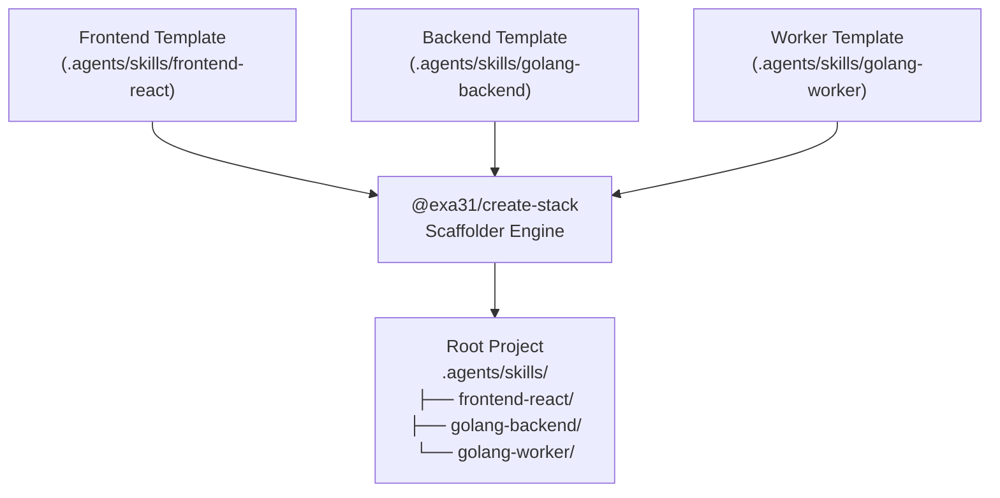

One of the defining innovations of `@exa31/create-stack` is automated AI context consolidation for multi-service architectures.

---

## ⚡ The Dynamic Skill Merging Engine

When scaffolding a **Fullstack Project (Mode 1)**:

1. **Service Skill Discovery**: The CLI inspects `.agents/skills/` across all selected services (e.g. `frontend-react`, `golang-backend`, and `golang-worker`).
2. **Root Consolidation**: It copies and merges the skill directories into the unified root `.agents/skills/` directory.
3. **Artifact Cleanup**: Internal VCS references are sanitized while maintaining intact markdown prompt instructions.

---

## 🚀 Developer Experience Impact

The moment you open the generated repository in an AI IDE (Antigravity, Cursor, Windsurf):
- The AI instantly understands how to author React components adhering to the skeleton rule.
- The AI immediately knows how to write Go Fiber endpoints with pure parameter passing `tx *sqlx.Tx`.
- The AI seamlessly crafts RabbitMQ consumers with QoS prefetch and manual DLQ acknowledgment.

Zero manual prompt engineering required!
