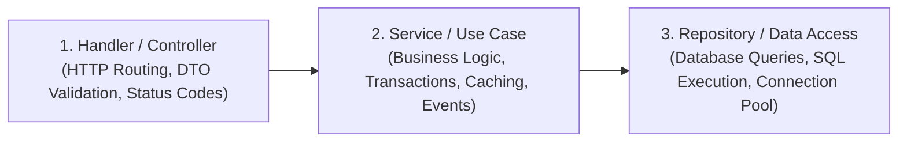

All backend services in this monorepo adhere to unified architectural principles, regardless of runtime or language (Node.js, Python, Go, Java, or Rust).

---

## 🏛️ Clean Architecture Layers

Every backend cleanly decouples responsibilities across three distinct layers:



1. **Handler / Controller**: Ingests HTTP requests, validates DTO inputs (Zod / Pydantic / Go Validator), and returns standardized envelopes.
2. **Service / Use Case**: Encapsulates business rules, transactional boundaries, Redis caching, and message broker event publishing.
3. **Repository**: Executes raw, optimized SQL queries or DAO interactions. Repositories must never handle HTTP context or business logic.

---

## 📊 Feature Matrix across 5 Backends

| Template | Language / Framework | Database | Caching | Messaging | OpenAPI Doc | Port |
|---|---|---|---|---|---|---|
| `template-express` | TypeScript / Express | Postgres / MySQL | Redis | RabbitMQ & Kafka | `/docs` | `5000` |
| `template-fastapi-async` | Python / FastAPI | Postgres / MySQL | Redis | RabbitMQ & Kafka | `/docs` | `8000` |
| `template-golang` | Go / Fiber v2 | Postgres / MySQL | Redis | RabbitMQ & Kafka | `/docs` | `8080` |
| `template-java` | Java 17 / Spring Boot 4 | Postgres / MySQL | Redis | RabbitMQ & Kafka | `/swagger-ui.html` | `8080` |
| `template-rust` | Rust / Axum 0.7 | Postgres / MySQL | Redis | RabbitMQ & Kafka | `/docs` | `8080` |

---

## 🛡️ 4 Core Backend Architectural Rules

### 1. Pure Parameter-Passing Database Transactions
Hiding database transactions inside `context.Context` (Go) or thread/task-local storage (Rust) is strictly prohibited. Transaction objects must be passed explicitly as function/method parameters:
- **Go**: `func (r *Repo) CreateUser(ctx context.Context, tx *sqlx.Tx, user *User) error`
- **Rust**: `async fn create_user(&self, tx: &mut Transaction<'_, Postgres>, user: &User) -> Result<...>`

### 2. Standardized Response Envelope (`ApiResponse<T>`)
Every endpoint returns a unified response envelope:
```json
{
  "success": true,
  "message": "User created successfully",
  "data": {
    "id": "usr_123",
    "name": "Alex"
  },
  "error": null,
  "meta": {
    "page": 1,
    "limit": 10,
    "total": 100
  }
}
```

### 3. Explicit Semantic Error Codes
Business and validation errors must include a semantic code (e.g. `USER_NOT_FOUND`, `INVALID_CREDENTIALS`, `DUPLICATE_EMAIL`). Backend default error messages must be in English.

### 4. Interactive OpenAPI 3.0 / Swagger UI
Every backend serves interactive documentation at `/docs` (or `/swagger-ui.html`) and the raw OpenAPI 3.0 schema at `/docs/openapi.json` (or `/v3/api-docs`).
