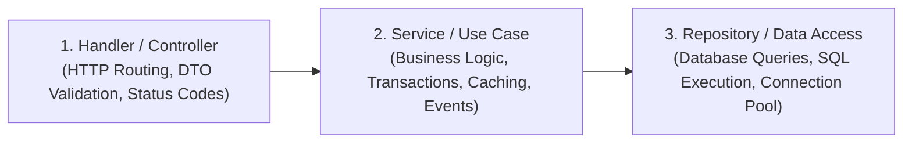

All backend services in this monorepo adhere to unified architectural principles, regardless of runtime or language (Node.js/Express, Python/FastAPI, Go/Fiber, Java/Spring Boot, or Rust/Axum).

---

## 🏛️ Clean Architecture Layers

Every backend cleanly decouples responsibilities across three distinct layers:



1. **Handler / Controller**: Ingests HTTP requests, validates DTO inputs (Zod / Pydantic / Go Validator / Jackson), and returns standardized `BaseResponse` envelopes.
2. **Service / Use Case**: Encapsulates business rules, transactional boundaries, Redis caching, and event dispatching to message brokers (RabbitMQ/Kafka) or realtime hubs.
3. **Repository**: Executes raw, optimized SQL queries or DAO interactions. Repositories must never handle HTTP context or business logic, receiving connection/transaction handles explicitly.

---

## 📊 Feature Matrix across 5 Backends

| Template | Language / Framework | Database & Transactions | Realtime Engine | Distributed Bridge | Messaging | Rate Limiter | OpenAPI Doc | Port |
|---|---|---|---|---|---|---|---|---|
| `template-express` | TypeScript / Express | Postgres / MySQL (`withTransaction`) | SSE & Socket.IO | Redis & RabbitMQ | RabbitMQ & Kafka | Dual-Tier (RFC 6585) | `/docs` | `5000` |
| `template-fastapi-async` | Python / FastAPI | Postgres / MySQL (`@transactional`) | SSE & WebSocket | Redis Pub/Sub | RabbitMQ & Kafka | Dual-Tier (RFC 6585) | `/docs` | `8000` |
| `template-golang` | Go / Fiber v2 | Postgres / MySQL (`TransactionManager`) | SSE & WebSocket | Redis, RabbitMQ, Both | RabbitMQ & Kafka | Dual-Tier (RFC 6585) | `/docs` | `8080` |
| `template-java` | Java 17 / Spring Boot 4 | Postgres / MySQL (`@Transactional`) | SSE & STOMP /ws | Local, Redis, RabbitMQ | RabbitMQ & Kafka | Dual-Tier (RFC 6585) | `/swagger-ui.html` | `8080` |
| `template-rust` | Rust / Axum 0.7 | Postgres / MySQL (`&mut Transaction`) | SSE & WebSocket | Local, Redis, RabbitMQ, Both | RabbitMQ & Kafka | Dual-Tier (RFC 6585) | `/docs` | `8080` |

---

## 🛡️ 7 Core Backend Architectural Rules

### 1. Pure Parameter-Passing Database Transactions
Hiding database transactions inside `context.Context` (Go) or thread/task-local storage (Rust) is strictly prohibited. Transaction objects must be passed explicitly as function/method parameters:
- **Go**: `s.tm.WithTransactionCtx(ctx, func(ctx context.Context, tx *sqlx.Tx) error { ... })`
- **Rust**: `async fn create_tx(&self, tx: &mut Transaction<'_, Postgres>, user: NewUser) -> Result<...>`
- **Express**: `await db.withTransaction(async (client) => { await userRepo.create(data, client) })`
- **FastAPI**: `@transactional` decorator with `db: AsyncSession`
- **Java**: `@Transactional` for mutations and `@Transactional(readOnly = true)` for read-only queries.

### 2. Standardized BaseResponse Envelope
Every endpoint returns a unified flat top-level JSON response envelope:

```json title="Success Response Format"
{
  "success": true,
  "code": "SUCCESS",
  "message": "User registered successfully",
  "data": {
    "id": 1,
    "email": "user@example.com"
  },
  "timestamp": 1700000000000,
  "requestId": "req-9b1deb4d-3b7d-4bad-9bdd-2b0d7b3dcb6d"
}
```

```json title="Business / Validation Error Format"
{
  "success": false,
  "code": "EMAIL_ALREADY_EXISTS",
  "message": "The email address is already in use",
  "data": null,
  "timestamp": 1700000000000,
  "requestId": "req-9b1deb4d-3b7d-4bad-9bdd-2b0d7b3dcb6d"
}
```

### 3. Realtime Engine & Distributed Auto-Bridge
All backends implement Server-Sent Events (SSE) and WebSocket endpoints. For horizontal multi-pod Kubernetes scaling, events are broadcast across instances using Redis Pub/Sub or RabbitMQ topic/fanout exchanges via `REALTIME_BRIDGE=redis|rabbitmq|both|local`.

### 4. Dual Message Brokers (RabbitMQ & Apache Kafka)
Each backend includes publisher integrations for RabbitMQ (AMQP 0.9.1) and Apache Kafka to stream events to background worker consumers.

### 5. Idempotency Protection (`X-Idempotency-Key`)
Critical mutating endpoints are guarded by Redis-backed idempotency filters with payload fingerprinting to prevent double mutations during network retries.

### 6. Interactive OpenAPI 3.0 / Swagger UI
Every backend serves interactive documentation at `/docs` (or `/swagger-ui.html`) and the raw OpenAPI 3.0 schema at `/docs/openapi.json` (or `/v3/api-docs`).

### 7. Dual-Tier Rate Limiting & DoS Protection (RFC 6585)
All backends implement dual-tier rate limiting (Global API 100 req/60s and Strict Auth 5-10 req/60s) emitting standard `X-RateLimit-*` and `Retry-After` headers, with hybrid Redis distributed storage and resilient in-memory local failover.
