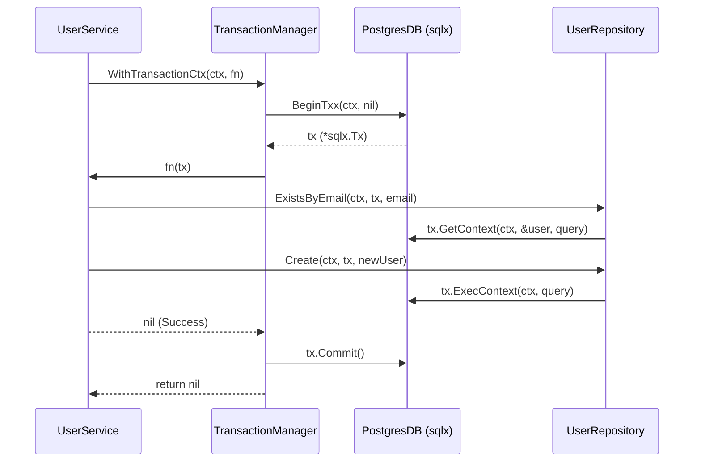

The `template-golang` template is a high-performance REST API backend written in **Go 1.22+** and the **Fiber v2** framework (built on Fasthttp with near-zero memory allocations). Designed for enterprise-scale workloads, it combines Clean Architecture, explicit database transaction management without context magic, advanced realtime messaging, and dual message brokers.

---

## ✨ Core Architectural Features

- **Fiber v2 Framework**: Blazing fast HTTP router on the Fasthttp zero-allocation pipeline.
- **Pure Parameter-Passing Transactions**: Explicit database transaction passing via `tx *sqlx.Tx`. Hiding transactions in `context.Context` is strictly forbidden.
- **Database TransactionManager**: Safely manages ACID lifecycles, automatic panics recovery, context cancellation, rollback, and commits.
- **Real-time Hub (SSE & WebSocket)**: Server-Sent Events streaming and full-duplex WebSocket connections with dynamic channel subscriptions and user-targeted delivery.
- **Distributed Realtime Auto-Bridge**: Interconnects Kubernetes pods automatically via **Redis Pub/Sub** or **RabbitMQ Fanout Exchanges** to synchronize events across cluster replicas.
- **Dual Message Brokers**: Out-of-the-box integrations for **RabbitMQ (AMQP 0.9.1)** and **Apache Kafka Producer** (`segmentio/kafka-go`) with built-in testing endpoint `/api/v1/kafka-send`.
- **Idempotency Protection Layer**: IETF draft-compliant `X-Idempotency-Key` middleware backed by Redis or in-memory fallback.
- **Unified Request Body Binder**: Custom `pkg/validation` binder handling JSON, urlencoded form data, and multipart file uploads into a single DTO.
- **Structured JSON Logging (slog)**: Standard library `log/slog` logging with correlation IDs (`X-Request-ID`) and automated credential masking. Raw `fmt.Println` is forbidden.
- **Database Migrations**: Version-controlled migrations powered by `golang-migrate/migrate` with automatic execution at startup (`AUTO_MIGRATE=true`).
- **Interactive OpenAPI / Swagger**: Built-in Swagger UI at `/docs` and raw spec at `/docs/openapi.json`.

---

## ⚡ Database Transactions (Pure Parameter Passing)

Monorepo rules (`database-transactions.md`) prohibit hiding transactions in context values. Instead, `database.TransactionManager` (`s.tm`) provides declarative safety:



### 1. Read-Only Operations

For queries, the service utilizes `WithReadOnlyTransactionCtx`:

```go title="internal/module/user/service.go"
func (s *userService) GetAll(ctx context.Context) ([]UserResponse, error) {
	var users []User
	err := s.tm.WithReadOnlyTransactionCtx(ctx, func(tx *sqlx.Tx) error {
		var err error
		users, err = s.repo.GetAll(ctx, tx) // tx passed explicitly
		return err
	})
	if err != nil {
		return nil, appErrors.DatabaseError("Failed to fetch users", err)
	}

	res := make([]UserResponse, 0, len(users))
	for i := range users {
		res = append(res, users[i].toResponse())
	}
	return res, nil
}
```

### 2. Data Mutations & Atomic Rollback

For write operations (`INSERT`, `UPDATE`, `DELETE`), business logic runs inside `WithTransactionCtx`. The `tx` pointer is explicitly passed to repository methods:

```go title="internal/module/user/service.go"
func (s *userService) Create(ctx context.Context, req *CreateUserRequest) (*UserResponse, error) {
	var res *UserResponse
	err := s.tm.WithTransactionCtx(ctx, func(tx *sqlx.Tx) error {
		// 1. Check uniqueness using explicit tx
		exists, err := s.repo.ExistsByEmail(ctx, tx, req.Email)
		if err != nil {
			return appErrors.DatabaseError("Failed to check email", err)
		}
		if exists {
			return appErrors.ConflictError("Email already registered", nil)
		}

		// 2. Hash password
		hashed, err := password.Hash(req.Password)
		if err != nil {
			return appErrors.InternalError("Failed to hash password", err)
		}

		user := &User{
			Name:         req.Name,
			Email:        req.Email,
			PasswordHash: hashed,
			Role:         RoleUser,
		}

		// 3. Mutate data via explicit tx
		if err := s.repo.Create(ctx, tx, user); err != nil {
			return appErrors.DatabaseError("Failed to create user", err)
		}

		r := user.toResponse()
		res = &r
		return nil // Auto-committed by TransactionManager
	})

	if err != nil {
		return nil, err
	}
	return res, nil
}
```

### 3. Repository Layer

At the repository layer, queries execute directly on `tx`:

```go title="internal/module/user/repository.go"
func (r *userRepository) Create(ctx context.Context, tx *sqlx.Tx, user *User) error {
	if tx == nil {
		return errors.New("repository method Create requires an active *sqlx.Tx")
	}

	query := `
		INSERT INTO users (name, email, password_hash, role, created_at, updated_at)
		VALUES ($1, $2, $3, $4, NOW(), NOW())
		RETURNING id, created_at, updated_at`

	return tx.QueryRowContext(ctx, query,
		user.Name,
		user.Email,
		user.PasswordHash,
		user.Role,
	).Scan(&user.ID, &user.CreatedAt, &user.UpdatedAt)
}
```

---

## 📡 Real-time Engine: SSE, WebSocket & Distributed Bridge

The centralized **Realtime Hub** (`internal/module/realtime/hub.go`) orchestrates client connections, dynamic channels, and cross-pod fanout.

```mermaid
flowchart TD
    ClientSSE["Client 1 (SSE EventSource)"] -->|GET /api/v1/sse| PodA["Pod Fiber A"]
    ClientWS["Client 2 (WebSocket)"] -->|ws:// /api/v1/ws| PodB["Pod Fiber B"]
    
    Publisher["REST API / Background Worker"] -->|Hub.Broadcast(event)| PodA
    PodA -->|Publish Event| Bridge{"Distributed Auto-Bridge\n(REALTIME_BRIDGE)"}
    
    Bridge -->|Redis Pub/Sub| PodA
    Bridge -->|Redis Pub/Sub| PodB
    
    PodA -->|Push stream| ClientSSE
    PodB -->|Push frame| ClientWS
```

### 1. Server-Sent Events (SSE)
- Endpoint: `GET /api/v1/sse?channel=news&userId=123`
- Headers:
  ```http
  Content-Type: text/event-stream
  Cache-Control: no-cache
  Connection: keep-alive
  Transfer-Encoding: chunked
  ```
- **Lifecycle Streaming**: Uses `fasthttp.RequestCtx` non-blocking streaming with disconnect detection via `c.Context().Done()`.

```javascript title="Client SSE Example (Browser)"
const sse = new EventSource("http://localhost:8080/api/v1/sse?channel=orders");
sse.onmessage = (event) => {
    const data = JSON.parse(event.data);
    console.log("New event:", data);
};
```

### 2. Full-Duplex WebSocket
- Endpoint: `GET /api/v1/ws?channel=room1&userId=123`
- Powered by `github.com/gofiber/contrib/websocket` with decoupled pump goroutines:
  1. **Read Pump**: Receives frames from client, evaluates `ping/pong` heartbeats, forwards to Hub.
  2. **Write Pump**: Dispatches queued frames to the socket with write deadlines.

### 3. Distributed Auto-Bridge (Horizontal Scaling)
Ensures events published on one pod reach clients connected to separate pods in Kubernetes:
- Configured via `REALTIME_BRIDGE=redis` or `rabbitmq` or `both`.
- **Anti-Echo Mechanism**: Messages contain a unique `SenderID` to prevent pods from echoing distributed messages back to their own local clients.
- **Graceful Fallback**: Automatically degrades to standalone in-memory broadcasting if external brokers disconnect.

### 4. Realtime API Endpoints

| Method | Endpoint | Description | Authentication |
|---|---|---|---|
| `GET` | `/api/v1/sse` | Subscribes to Server-Sent Events stream (`?channel=..&userId=..`) | Optional |
| `WS` | `/api/v1/ws` | Full-duplex WebSocket connection | Optional |
| `POST` | `/api/v1/realtime/broadcast` | Broadcast message to all active subscribers | Required (Bearer) |
| `POST` | `/api/v1/realtime/channel/:channel` | Send message to a specific room channel | Required (Bearer) |

---

## 🐰⚡ Dual Message Brokers: RabbitMQ & Apache Kafka

The template integrates two enterprise brokers out-of-the-box:

### 1. RabbitMQ Producer & Consumer
- Managed by `pkg/queue/rabbitmq.go`.
- Supports queues, exchanges (`direct`, `topic`, `fanout`), and binding configurations.
- Thread-safe channel pooling and auto-reconnection.

```go
broker, _ := queue.NewRabbitMQ(&cfg.RabbitMQ, logger)
_ = broker.Publish(ctx, "orders.exchange", "order.created", payloadBytes)
```

### 2. Apache Kafka Producer
- Managed by `pkg/queue/kafka.go` utilizing `segmentio/kafka-go`.
- Partition balancing with `LeastBytes` and batch timeouts for peak throughput.
- Independent TCP broker health checking.

### 3. Broker Endpoints & Testing cURL

```bash title="Send Message to Apache Kafka"
curl -X POST http://localhost:8080/api/v1/kafka-send \
  -H "Content-Type: application/json" \
  -d '{
    "topic": "app.events",
    "key": "order-123",
    "message": "{\"status\":\"PAID\",\"amount\":50000}"
  }'
```

---

## 🛡️ Idempotency Protection (X-Idempotency-Key)

For critical mutating endpoints (e.g. payments or resource creation), `pkg/idempotency` implements the IETF draft standard.

### 1. Middleware & Storage Configuration

```go title="internal/app/http.go"
import "golang/pkg/idempotency"

orders := api.Group("/orders", idempotency.New(idempotency.Config{
    Storage:     idempotency.NewRedisStorage(redisClient),
    Lifetime:    24 * time.Hour,
    LockTimeout: 30 * time.Second,
    Required:    true,
}))
orders.Post("/", orderHandler.CreateOrder)
```

### 2. Lock, Fingerprint & Replay Mechanics
1. **Header Evaluation**: Reads `Idempotency-Key` or `X-Idempotency-Key`.
2. **Atomic Lock**: Locks `in_progress` status in Redis for 30 seconds. Simultaneous parallel requests receive `409 Conflict`.
3. **Payload Fingerprint**: Computes SHA-256 of path, method, and body. Mismatched payloads return `422 Unprocessable Entity`.
4. **Instant Replay**: Completed entries replay cached status code, headers, and body with `Idempotent-Replayed: true`.
5. **Safety Unlock**: Unlocks on 5xx server errors, allowing clean retries.

---

## 🚦 Dual-Tier Rate Limiting & DoS Protection

`template-golang` implements dual-tier rate limiting middleware in `pkg/middleware/ratelimit/`:

### 1. Protection Tiers: Global API vs Strict Auth

1. **Global Rate Limiter (`NewGlobalLimiter`)**:
   - Limits traffic across general API routes with `RATE_LIMIT_MAX` (default: 100 req / 60 seconds per IP).
   - Mounted at Fiber root level in `internal/app/http.go`: `app.Use(ratelimit.NewGlobalLimiter(cfg.RateLimit, redisClient))`.
   - Whitelists health probes (`/health`, `/`) and documentation (`/docs`, `/swagger`).
2. **Strict Auth Limiter (`NewAuthLimiter`)**:
   - Thwarts brute-force attacks on authentication routes (`/api/v1/auth/login`, `/api/v1/auth/register`).
   - Enforces strict quota `RATE_LIMIT_AUTH_MAX` (default: 10 req / 60 seconds).
   - Composite key generator: `c.IP() + ":" + c.Path()`.

### 2. RFC 6585 Standard Headers & Hybrid Storage

- **RFC 6585 Headers**: Emits `X-RateLimit-Limit`, `X-RateLimit-Remaining`, `X-RateLimit-Reset`, and `Retry-After` (on HTTP 429).
- **Response Format**: Returns HTTP `429 Too Many Requests` envelope `response.ErrorResponse(c, fiber.StatusTooManyRequests, constants.MsgRateLimitExceeded, constants.CodeRateLimitExceeded)`.
- **Hybrid Storage**: Uses `NewRedisFiberStorage(redisClient, ...)` when `RATE_LIMIT_STORAGE=redis`, automatically failing over to Fiber in-memory storage if Redis is unavailable.

---

## 🧵 Request Context, Tracing & Correlation ID

`template-golang` implements standard Go `context.Context` request context management integrated directly into Fiber's UserContext and structured logger.

### 1. X-Request-ID & Context Propagation

- **ID Extraction & Generation**: `RequestIDMiddleware` (`pkg/logging/fiber.go`) extracts incoming `X-Request-ID` headers or generates a fresh UUID via `google/uuid`.
- **Response Header Injection**: The ID is echoed in response headers via `c.Set(HeaderRequestID, rid)` and retained in `c.Locals("request_id", rid)`.
- **Standard Go `context.Context` Binding**: The middleware invokes `ContextWithRequestID(c.UserContext(), rid)` and updates Fiber's context via `c.SetUserContext(ctx)`. Handlers and services pass `ctx := c.UserContext()` down into database queries (`db.GetContext(ctx, ...)`) and downstream RPC clients, ensuring seamless cancellation and deadline propagation.
- **Context Access Helpers**:
  ```go
  rid := logging.RequestIDFromFiber(c)
  logger := logging.LoggerFromFiber(c)
  ctx := logging.ContextFromFiber(c)
  ```

### 2. Structured Logging & OpenTelemetry Integration

- **Request-Scoped `slog.Logger`**: The middleware stores a request-scoped logger `Logger().With(slog.String("request_id", rid))` within the context. Every call to `logger.Info(...)` or `logger.Error(...)` across handlers and service layers carries the correlation ID automatically.
- **OpenTelemetry Span Correlation**: If an active W3C trace span exists in `c.UserContext()`, the middleware automatically binds `trace_id` and `span_id` to the logger attributes:
  ```go
  if spanCtx := trace.SpanContextFromContext(c.UserContext()); spanCtx.IsValid() {
      logAttrs = append(logAttrs, slog.String("trace_id", spanCtx.TraceID().String()), slog.String("span_id", spanCtx.SpanID().String()))
  }
  ```
- **Structured Access Logging**: `AccessLogMiddleware` records every completed request with microsecond latency precision (`latency_ms`), HTTP status, route path, client IP, and user agent.

---

## 📋 Request Validation & Boundaries

Endpoint requests use `pkg/validation` to bind and validate three payload formats into a single DTO:
1. `application/json`
2. `application/x-www-form-urlencoded`
3. `multipart/form-data` (including file uploads via `*multipart.FileHeader`)

```go title="Multi-Format DTO Example"
type CreateUserRequest struct {
    Name   string                `json:"name" form:"name" validate:"required,min=3,max=100"`
    Email  string                `json:"email" form:"email" validate:"required,email"`
    Phone  string                `json:"phone" form:"phone" validate:"omitempty"`
    Avatar *multipart.FileHeader `json:"avatar" form:"avatar"`
}
```

In controller handlers:
```go
req := new(CreateUserRequest)
if err := validation.BindAndValidate(c, req); err != nil {
    return response.ValidationErrorResponse(c, err)
}
```

---

## ⚙️ Environment Variables & Configuration

| Variable | Default | Description |
|---|---|---|
| `APP_NAME` | `golang-api` | Application name |
| `ENVIRONMENT` | `development` | `development` or `production` (JSON logging) |
| `SERVER_PORT` | `8080` | HTTP Fiber listening port |
| `LOG_LEVEL` | `info` | Log levels: `debug`, `info`, `warn`, `error` |
| `DB_HOST` | `localhost` | PostgreSQL host |
| `DB_PORT` | `5432` | PostgreSQL port |
| `DB_USER` / `DB_PASSWORD` | `postgres` | PostgreSQL credentials |
| `DB_NAME` | `mydb` | Database name |
| `AUTO_MIGRATE` | `true` | Auto-run migrations at startup |
| `REDIS_ENABLED` | `true` | Enable Redis cache & token storage |
| `REDIS_HOST` / `REDIS_PORT`| `localhost:6379` | Redis connection address |
| `RABBITMQ_ENABLED` | `true` | Enable RabbitMQ broker |
| `RABBITMQ_HOST` / `PORT` | `localhost:5672` | RabbitMQ connection address |
| `KAFKA_ENABLED` | `false` | Enable Apache Kafka producer |
| `KAFKA_BROKERS` | `localhost:9092` | Kafka broker endpoints |
| `REALTIME_ENABLED` | `true` | Realtime master toggle (SSE & WS) |
| `REALTIME_SSE_ENABLED` | `true` | Enable Server-Sent Events |
| `REALTIME_WS_ENABLED` | `true` | Enable WebSocket endpoints |
| `REALTIME_BRIDGE` | `redis` | Multi-pod bridge: `redis`, `rabbitmq`, or `both` |
| `IDEMPOTENCY_ENABLED` | `true` | Enable idempotency on `/api/v1` routes |

---

## 🛠️ Development Commands

```bash title="Terminal"
cd backend

# Download dependencies
go mod download

# Run database migrations
make migrate-up

# Start local dev server
make dev

# Run test suite
make test

# Format & lint code
make check
```
