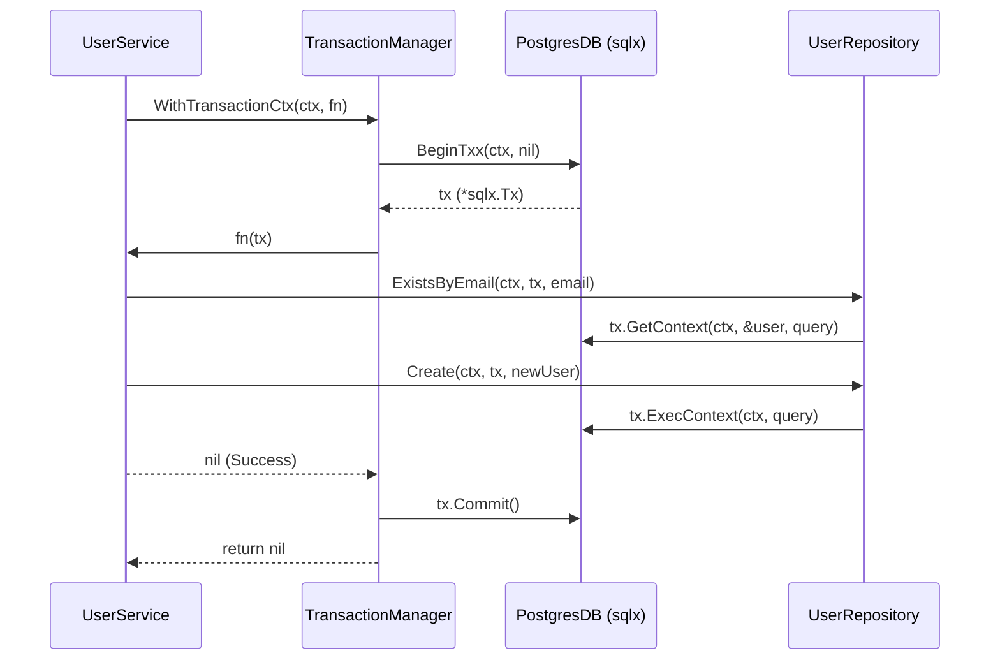

The `template-golang` template is an enterprise-grade, high-performance REST API backend built with **Go 1.22+** and the **Fiber v2** web framework (Fasthttp-powered router with near-zero memory allocation). It is engineered for enterprise scalability with strict Clean Architecture, safe database transactions without magic context, advanced real-time communication, and multi-broker event streaming.

---

## ✨ Key Architectural Features

- **Fiber v2 Framework**: Fastest HTTP engine in the Go ecosystem with a zero-memory-allocation pipeline.
- **Pure Parameter-Passing Transactions**: Database transactions must be passed explicitly via pointer `tx *sqlx.Tx`. Storing or resolving transactions via `context.Context` is strictly forbidden.
- **Database TransactionManager**: Safely manages ACID transaction lifecycles (automatic panic recovery, context cancellation, rollback, and commit).
- **Real-time Engine (SSE & WebSocket)**: Server-Sent Events streaming and full-duplex WebSocket with dynamic channel subscriptions and user-targeted messaging.
- **Distributed Realtime Auto-Bridge**: Automatically synchronizes real-time events across multiple Kubernetes pods or server replicas using **Redis Pub/Sub** or **RabbitMQ Fanout Exchanges** without losing messages.
- **Dual Message Broker**: Full support for **RabbitMQ (AMQP 0.9.1)** and an **Apache Kafka Native Producer** (`segmentio/kafka-go`) with built-in `/api/v1/kafka-send` test endpoint.
- **Idempotency Protection Layer**: Built-in middleware protecting mutating endpoints (`POST` / `PATCH`) via `X-Idempotency-Key`, backed by Redis or an in-memory fallback.
- **Unified Request Body Binder**: The `pkg/validation` module binds and validates a single DTO across 3 formats simultaneously: `application/json`, `application/x-www-form-urlencoded`, and `multipart/form-data` (including file uploads).
- **Structured JSON Logging (slog)**: Standard library `log/slog` logging module with correlation ID tracking (`X-Request-ID`) and automatic sensitive data masking. Raw `fmt.Println` is strictly prohibited.
- **Database Migrations**: Version-controlled SQL migrations using `golang-migrate/migrate` with automated boot execution (`AUTO_MIGRATE=true`).
- **Interactive OpenAPI / Swagger**: Built-in Swagger UI available at `/docs` with raw OpenAPI specification at `/docs/openapi.json`.

---

## ⚡ Database Transactions (Pure Parameter Passing & TransactionManager)

Monorepo rules (`database-transactions.md`) strictly forbid "magic context" transactions (e.g. `context.WithValue` or hidden middleware transactions). At the same time, developers do not need to repeat boilerplate `BeginTxx / defer tx.Rollback / Commit` in every service method.

Instead, `database.TransactionManager` (`s.tm`) provides safe, idiomatic orchestration:



### 1. Read-Only Operations (`GetAll`)
For data query operations, the service uses `WithReadOnlyTransactionCtx`:

```go title="internal/module/user/service.go"
func (s *userService) GetAll(ctx context.Context) ([]UserResponse, error) {
	var users []User
	err := s.tm.WithReadOnlyTransactionCtx(ctx, func(tx *sqlx.Tx) error {
		var err error
		users, err = s.repo.GetAll(ctx, tx) // tx is explicitly forwarded
		return err
	})
	if err != nil {
		return nil, appErrors.DatabaseError("Failed to fetch users", err)
	}

	res := make([]UserResponse, 0, len(users))
	for i := range users {
		res = append(res, users[i].toResponse())
	}
	return res, nil
}
```

### 2. Mutation Operations (`Create`)
For write operations (`INSERT`, `UPDATE`, `DELETE`), business logic is wrapped in `WithTransactionCtx`. The `tx` pointer is explicitly forwarded to each repository method:

```go title="internal/module/user/service.go"
func (s *userService) Create(ctx context.Context, req *CreateUserRequest) (*UserResponse, error) {
	var res *UserResponse
	err := s.tm.WithTransactionCtx(ctx, func(tx *sqlx.Tx) error {
		// Validate email uniqueness inside the transaction
		exists, err := s.repo.ExistsByEmail(ctx, tx, req.Email)
		if err != nil {
			return appErrors.DatabaseError("Failed to check email existence", err)
		}
		if exists {
			return appErrors.EmailAlreadyExists()
		}

		user := &User{
			ID:        uuid.New().String(),
			Name:      req.Name,
			Email:     req.Email,
			Role:      "user",
			IsActive:  true,
			CreatedAt: time.Now(),
			UpdatedAt: time.Now(),
		}

		// Explicitly pass tx to repository
		if err := s.repo.Create(ctx, tx, user); err != nil {
			return appErrors.ParseDatabaseError(err)
		}

		u := user.toResponse()
		res = &u
		return nil
	})
	if err != nil {
		return nil, err
	}
	return res, nil
}
```

### 3. Repository Layer (Enforcing Mandatory Transaction)
Every repository method validates that `tx` is non-nil and runs queries directly on the transaction:

```go title="internal/module/user/repository.go"
func (r *userRepository) Create(ctx context.Context, tx *sqlx.Tx, user *User) error {
	if tx == nil {
		return errors.New("transaction is required")
	}
	query := `INSERT INTO users (id, name, email, phone, role, is_active, created_at, updated_at) 
	          VALUES ($1, $2, $3, $4, $5, $6, $7, $8)`
	_, err := tx.ExecContext(ctx, query, user.ID, user.Name, user.Email, user.Phone, user.Role, user.IsActive, user.CreatedAt, user.UpdatedAt)
	return err
}
```

---

## 📡 Real-time Engine: SSE, WebSocket & Distributed Auto-Bridge

The `template-golang` includes a production-grade real-time system (`pkg/realtime`) supporting both **Server-Sent Events (SSE)** and **WebSocket** protocols.

```mermaid
flowchart TD
    Client1[Client A (Browser SSE)] -->|GET /realtime/sse/events| Pod1[Go Pod 1 / Replica 1]
    Client2[Client B (Mobile WS)] -->|GET /realtime/ws/connect| Pod2[Go Pod 2 / Replica 2]
    
    subgraph Multi_Pod_Sync [Distributed Auto-Bridge (REALTIME_BRIDGE)]
        Pod1 <-->|Publish / Subscribe| Bridge[(Redis Pub/Sub or RabbitMQ Fanout)]
        Bridge <-->|Publish / Subscribe| Pod2
    end
    
    Pod1 -->|Local Fanout| Client1
    Pod2 -->|Local Fanout| Client2
```

### 1. Server-Sent Events (SSE)
The SSE implementation in `internal/module/sse.go` is designed to be immune to Fiber's context pool recycling:
- Captures cancellation channel `notify := c.Context().Done()` **before** the handler function returns.
- Utilizes `fasthttp.StreamWriter` with `X-Accel-Buffering: no` header to prevent reverse proxy buffering (e.g. Nginx, Traefik, Cloudflare).
- Supports dynamic query parameters: `?client_id=<uuid>&channels=orders,notifications`.

**Available SSE Endpoints:**
* `GET /api/v1/realtime/sse/events` - SSE streaming endpoint for clients.
* `GET /api/v1/realtime/sse/subscribe?channel=room1` - Subscribes an active client to a new channel.
* `POST /api/v1/realtime/sse/broadcast` - Broadcasts an event to all clients or a specific channel.
* `POST /api/v1/realtime/sse/send` - Sends an event directly to a targeted `user_id`.
* `GET /api/v1/realtime/sse/stats` - Connection count and active channel metrics.

### 2. Full-Duplex WebSocket
WebSocket implementation in `internal/module/ws.go` uses `@gofiber/websocket/v2`:
- Independent read and write pump goroutines.
- Ping/Pong heartbeat with 60-second timeouts to prune dead connections.
- Automatic unregistration on disconnection (*graceful cleanup*).

**Available WebSocket Endpoints:**
* `GET /api/v1/realtime/ws/connect?client_id=<id>&channels=chat,alerts`
* `GET /api/v1/realtime/ws/stats`

### 3. Distributed Auto-Bridge (Horizontal Pod Scaling)
In a multi-replica Kubernetes cluster, a client connected to **Pod 1** cannot receive messages broadcast by **Pod 2** if only in-memory hubs are used.

The `pkg/realtime/bridge.go` module solves this transparently:

1. **Redis Pub/Sub Bridge (`REALTIME_BRIDGE=redis`)**:
   - Publishes messages to Redis channels using `realtime:channel:<channel_name>` or `realtime:broadcast`.
   - All replicas listen to `realtime:*` and relay messages to their local connected clients.
2. **RabbitMQ Fanout Bridge (`REALTIME_BRIDGE=rabbitmq`)**:
   - Uses a single **fanout exchange** named `realtime.events`.
   - Each pod declares a temporary, exclusive auto-delete queue (`realtime.<uuid>`) bound to this exchange.
   - Every pod replica receives a full copy of every event with zero competing-consumer conflicts.
3. **Dual Bridge (`REALTIME_BRIDGE=both`)**:
   - Publishes to both Redis and RabbitMQ simultaneously for hybrid network topologies.
4. **Loopback & Self-Echo Prevention**:
   - Every message is stamped with the publishing pod ID (`msg.ID = h.id`). When a message loops back from the bridge, the originating pod drops it locally to prevent duplicate delivery.
5. **Zero-Downtime Fallback**:
   - If Redis or RabbitMQ becomes unavailable, the hub automatically degrades to local single-instance mode without crashing the service.

---

## 🐰⚡ Dual Message Broker: RabbitMQ & Apache Kafka

The template provides two enterprise message streaming backends ready for production.

### 1. RabbitMQ (AMQP 0.9.1)
- Managed by `pkg/queue/rabbitmq.go`.
- Full queue and exchange declaration (`direct`, `topic`, `fanout`) and queue binding.
- Thread-safe connection and channel pooling with auto-reconnection.

```go
// Example publishing a message to RabbitMQ
broker, _ := queue.NewRabbitMQ(&cfg.RabbitMQ, logger)
_ = broker.Publish(ctx, "orders.exchange", "order.created", payloadBytes)
```

### 2. Apache Kafka Native Producer
- Managed by `pkg/queue/kafka.go` powered by `segmentio/kafka-go`.
- Configured with `LeastBytes` partition balancing and batch timeouts for maximum throughput.
- Integrated TCP health check for broker connectivity monitoring.

**Built-in Kafka Send Endpoint:**
```bash title="Send Message to Kafka"
curl -X POST http://localhost:8080/api/v1/kafka-send \
  -H "Content-Type: application/json" \
  -d '{
    "topic": "app.events",
    "key": "order-123",
    "message": "{\"status\":\"PAID\",\"amount\":50000}"
  }'
```

---

## 🛡️ Idempotency Protection Layer

For critical mutating endpoints (e.g. payment processing, order creation via `POST` or `PATCH`), the template includes idempotency middleware in `pkg/idempotency`.

- **Usage**: Clients include the header `X-Idempotency-Key: <unique-uuid>`.
- **Storage**:
  - If Redis is enabled (`REDIS_ENABLED=true`), responses are stored in Redis with a configurable TTL (`IDEMPOTENCY_LIFETIME_HOURS`).
  - If Redis is disabled, the middleware automatically falls back to thread-safe in-memory storage (`sync.Map`).
- If a duplicate request with the same key arrives while the previous request is in-flight, it returns `409 Conflict`. Once complete, the cached response is served immediately without re-executing business logic.

---

## 📋 Unified Request Body Binder (`pkg/validation`)

All POST/PUT endpoints utilize `pkg/validation`, binding and validating a single DTO across **three formats at once**:
1. `application/json`
2. `application/x-www-form-urlencoded`
3. `multipart/form-data` (including file uploads via `*multipart.FileHeader`)

```go title="Multi-Format DTO Example"
type CreateUserRequest struct {
    Name   string                `json:"name" form:"name" validate:"required,min=3,max=100"`
    Email  string                `json:"email" form:"email" validate:"required,email"`
    Phone  string                `json:"phone" form:"phone" validate:"omitempty"`
    Avatar *multipart.FileHeader `json:"avatar" form:"avatar"` // Automatically bound upload
}
```

In controller handlers:
```go
req := new(CreateUserRequest)
if err := validation.BindAndValidate(c, req); err != nil {
    return response.ValidationErrorResponse(c, err)
}
```

---

## ⚙️ Environment Variables (`.env`)

| Variable | Default | Description |
|---|---|---|
| `APP_NAME` | `golang-api` | Application name |
| `ENVIRONMENT` | `development` | `development` or `production` (JSON logging enforced) |
| `SERVER_PORT` | `8080` | Fiber HTTP listening port |
| `LOG_LEVEL` | `info` | Logging verbosity: `debug`, `info`, `warn`, `error` |
| `DB_HOST` | `localhost` | PostgreSQL host |
| `DB_PORT` | `5432` | PostgreSQL port |
| `DB_USER` / `DB_PASSWORD` | `postgres` | PostgreSQL credentials |
| `DB_NAME` | `mydb` | Database name |
| `AUTO_MIGRATE` | `true` | Automatically run database migrations on boot |
| `REDIS_ENABLED` | `true` | Enables Redis caching, token revocation & bridge |
| `REDIS_HOST` / `REDIS_PORT`| `localhost:6379` | Redis connection endpoint |
| `RABBITMQ_ENABLED` | `true` | Enables RabbitMQ message broker |
| `RABBITMQ_HOST` / `PORT` | `localhost:5672` | RabbitMQ connection endpoint |
| `KAFKA_ENABLED` | `false` | Enables native Kafka producer |
| `KAFKA_BROKERS` | `localhost:9092` | Kafka broker endpoints (comma-separated) |
| `REALTIME_ENABLED` | `true` | Master switch for realtime capabilities (SSE & WS) |
| `REALTIME_SSE_ENABLED` | `true` | Enables Server-Sent Events endpoints |
| `REALTIME_WS_ENABLED` | `true` | Enables WebSocket endpoint |
| `REALTIME_BRIDGE` | `redis` | Multi-pod fan-out transport: `redis`, `rabbitmq`, or `both` |
| `IDEMPOTENCY_ENABLED` | `true` | Enables idempotency key middleware on `/api/v1` routes |

---

## 🛠️ Development Workflow

```bash title="Terminal"
cd backend

# 1. Download dependencies
go mod download

# 2. Run database migrations
make migrate-up

# 3. Start development server (port 8080)
make dev
# or: go run cmd/api/main.go

# 4. Run test suites
make test

# 5. Format and run linters
make check
```
