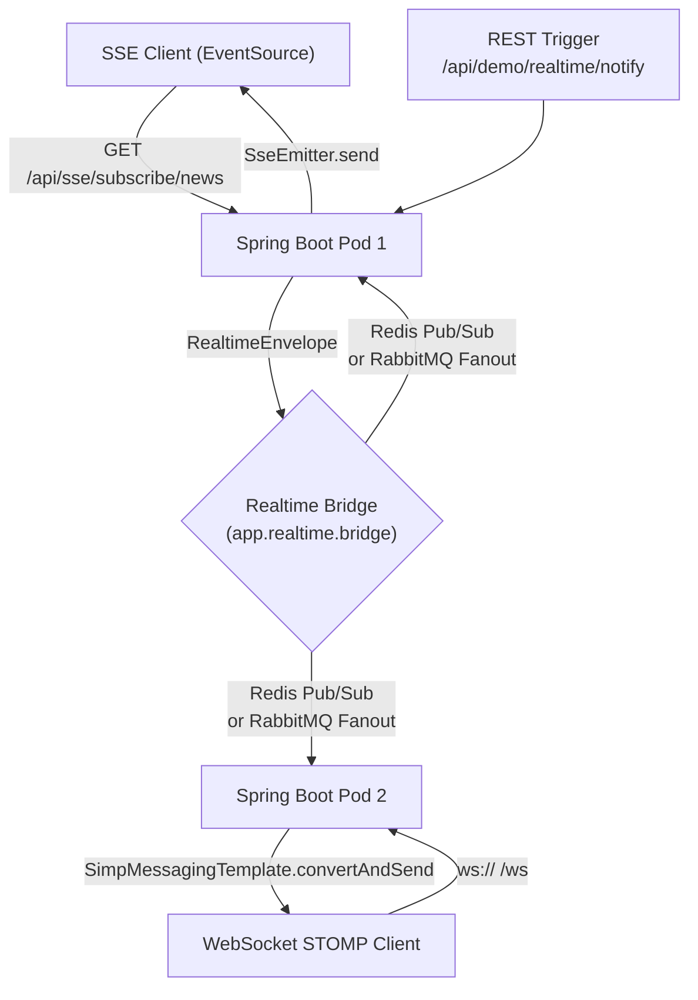

The `template-java` template is an enterprise backend starter kit built on **Java 17+** and **Spring Boot 4**, combining the robustness of the modern Java ecosystem, Liquibase schema management, dual message brokers (RabbitMQ + Kafka), and a distributed realtime engine with pluggable bridging.

---

## ✨ Core Architectural Features

- **Spring Boot 4**: Enterprise standard backend framework offering optimized JVM startup performance and Spring Framework 6 integrations.
- **Liquibase Database Migrations**: Declarative schema migrations with complete rollback support (`UP`/`DOWN`).
- **Standard BaseResponse Envelope**: Unified response format matching all templates across the monorepo (`success`, `code`, `message`, `data`, `timestamp`, `requestId`).
- **`@RequireAuth` Annotation**: Custom declarative JWT authentication interceptor eliminating boilerplate Spring Security complexity.
- **Realtime Engine (SSE & WebSocket STOMP)**:
  - **Server-Sent Events (SSE)** via `SseEmitter` at `/api/sse/*`.
  - **WebSocket STOMP** with SockJS fallback at `/ws`.
- **Pluggable Realtime Bridge (`app.realtime.bridge`)**: Declaratively swappable distributed bridge (`local`, `redis`, or `rabbitmq`).
- **Dual Message Brokers (RabbitMQ & Kafka)**:
  - Built-in RabbitMQ Producer & Consumer using Spring AMQP (`RabbitTemplate` & `@RabbitListener`).
  - Built-in Apache Kafka Producer using `KafkaTemplate`.
- **Idempotency Protection Layer**: `@RequireIdempotencyKey` powered by `IdempotencyFilter` with Redis or in-memory fallback.
- **Structured JSON Logging**: Logback + Logstash encoder outputting one JSON log line per event (raw `System.out.println` is forbidden).
- **Interactive Swagger**: Interactive Swagger UI at `http://localhost:8080/swagger-ui.html` and OpenAPI 3.0 spec at `/v3/api-docs`.

---

## ⚡ Database Transactions (`@Transactional` Declarative Boundaries)

As mandated by monorepo guidelines (`database-transactions.md`), database transactions are declaratively managed using Spring AOP `@Transactional`. A clear distinction is made between mutations (automatic rollback on unchecked exceptions) and read operations (`readOnly = true`) to bypass Hibernate dirty-checking overhead:

```java title="src/main/java/com/example/template/java/user/service/UserService.java"
package com.example.template.java.user.service;

import com.example.template.java.common.constant.ApiCode;
import com.example.template.java.common.exception.BusinessException;
import com.example.template.java.user.dto.UserRequest;
import com.example.template.java.user.model.User;
import com.example.template.java.user.repository.UserRepository;
import java.util.Optional;
import lombok.extern.slf4j.Slf4j;
import org.springframework.beans.factory.annotation.Autowired;
import org.springframework.security.crypto.password.PasswordEncoder;
import org.springframework.stereotype.Service;
import org.springframework.transaction.annotation.Transactional;

@Slf4j
@Service
public class UserService {

  private final UserRepository userRepository;
  private final PasswordEncoder passwordEncoder;

  @Autowired
  public UserService(UserRepository userRepository, PasswordEncoder passwordEncoder) {
    this.userRepository = userRepository;
    this.passwordEncoder = passwordEncoder;
  }

  /**
   * Data mutations MUST use @Transactional.
   * Any unchecked exception (RuntimeException) automatically triggers a transaction rollback.
   */
  @Transactional
  public User createUser(UserRequest request) {
    Optional<User> existing = userRepository.findByEmail(request.getEmail());
    if (existing.isPresent()) {
      throw new BusinessException("Email already registered", ApiCode.EMAIL_ALREADY_EXISTS);
    }

    User user = new User();
    user.setEmail(request.getEmail());
    user.setPassword(passwordEncoder.encode(request.getPassword()));
    user.setName(request.getName());

    User savedUser = userRepository.save(user);
    log.info("Successfully registered user with ID: {}", savedUser.getId());
    return savedUser;
  }

  /**
   * Read queries MUST use @Transactional(readOnly = true)
   */
  @Transactional(readOnly = true)
  public User getUserById(Long id) {
    return userRepository
        .findById(id)
        .orElseThrow(() -> new BusinessException("User not found", ApiCode.USER_NOT_FOUND));
  }
}
```

---

## 📡 Real-time Engine: SSE, WebSocket STOMP & Pluggable Bridge

`template-java` offers a distributed realtime engine bridging browser clients across Kubernetes cluster pods:



### 1. Server-Sent Events (SSE)
Managed via `SSEService` leveraging Spring Web MVC `SseEmitter`:

```javascript title="Client SSE Example (Browser)"
const eventSource = new EventSource('/api/sse/subscribe/general');

eventSource.onmessage = (event) => {
  const data = JSON.parse(event.data);
  console.log('Received SSE Message:', data);
};

eventSource.onerror = (error) => {
  console.error('SSE connection error:', error);
  eventSource.close();
};
```

### 2. WebSocket STOMP & SockJS
Orchestrated by `WebSocketConfig` exposing STOMP endpoints at `/ws`, application prefix `/app`, and broker destinations `/topic` and `/queue`:

```javascript title="Client STOMP Example (JavaScript / React)"
import SockJS from 'sockjs-client';
import { Stomp } from '@stomp/stompjs';

const socket = new SockJS('http://localhost:8080/ws');
const stompClient = Stomp.over(socket);

stompClient.connect({}, (frame) => {
  console.log('STOMP Connected:', frame);

  // Subscribe to a public topic channel
  stompClient.subscribe('/topic/announcements', (message) => {
    console.log('Announcement:', JSON.parse(message.body));
  });

  // Subscribe to personal user notifications
  stompClient.subscribe('/user/queue/notifications', (message) => {
    console.log('Personal Notification:', JSON.parse(message.body));
  });
});
```

### 3. Pluggable Realtime Bridge (`app.realtime.bridge`)
Guarantees inter-pod message propagation:
- **`local`**: `LocalRealtimeBridge` limits distribution to the local JVM process (ideal for testing and standalone dev).
- **`redis`**: `RedisRealtimeBridge` uses Redis pub/sub channel `realtime:events`.
- **`rabbitmq`**: `RabbitRealtimeBridge` uses RabbitMQ fanout exchange `realtime.events` with auto-delete exclusive queues.

Bridge selection is driven via Spring `@ConditionalOnProperty`:

```properties title="application.properties"
app.realtime.bridge=redis  # Options: local | redis | rabbitmq
```

### 4. Realtime API Endpoints

| Method | Endpoint | Description | Authentication |
|---|---|---|---|
| `GET` | `/api/sse/subscribe/{channel}` | Subscribe to public SSE channel via `SseEmitter` | Public |
| `GET` | `/api/sse/user` | Subscribe to private user SSE stream | Required (`@RequireAuth`) |
| `POST` | `/api/sse/broadcast/{channel}` | Broadcast SSE message to a specific channel | Public / Admin |
| `POST` | `/api/sse/user/{userId}` | Send private SSE message to a specific user | Public / Admin |
| `WS` | `/ws` | STOMP + SockJS WebSocket handshake endpoint | Public |
| `POST` | `/api/demo/realtime/notify` | Dispatches real-time notification (SSE + WebSocket) | Public |
| `POST` | `/api/demo/realtime/announcement` | Broadcasts global announcement across all listeners | Public |
| `POST` | `/api/demo/realtime/channel` | Sends data to a specific realtime topic channel | Public |

```bash title="cURL Dispatch Realtime Notification"
curl -X POST "http://localhost:8080/api/demo/realtime/notify?userId=12&title=Update&message=Your+order+shipped&type=info"
```

---

## 🐰⚡ Dual Message Brokers: RabbitMQ & Apache Kafka

The Spring Boot backend includes enterprise publisher and consumer implementations:

### 1. RabbitMQ Producer & Consumer (`messaging/rabbit/`)
Uses `RabbitTemplate` for sending and `@RabbitListener` for automatic consumer processing:

```java title="Producer Example"
@Autowired
private RabbitMQProducerService rabbitProducer;

rabbitProducer.sendMessage("order.processed", Map.of("orderId", 1234, "status", "PAID"));
```

```java title="Consumer Listener Example"
@Slf4j
@Component
public class RabbitMQConsumerService {

  @RabbitListener(queues = "${app.rabbitmq.queue.name}")
  public void receiveMessage(Map<String, Object> payload) {
    log.info("Received RabbitMQ message from queue: {}", payload);
    // Execute background business logic
  }
}
```

### 2. Apache Kafka Producer (`messaging/kafka/`)
Powered by `KafkaTemplate<String, Object>` for high-throughput streaming:

```java title="Kafka Producer Example"
@Autowired
private KafkaProducerService kafkaProducer;

kafkaProducer.sendMessage("app.events", "user-123", Map.of("action", "LOGIN", "timestamp", System.currentTimeMillis()));
```

---

## 🛡️ Idempotency Protection Layer (Redis & Memory Storage)

To prevent duplicate mutation processing during client retries, `template-java` provides the servlet filter `IdempotencyFilter` and custom annotation `@RequireIdempotencyKey` implementing the IETF draft standard:

```java title="com/example/template/java/order/controller/OrderController.java"
package com.example.template.java.order.controller;

import com.example.template.java.common.dto.BaseResponse;
import com.example.template.java.common.idempotency.RequireIdempotencyKey;
import com.example.template.java.order.dto.OrderRequest;
import com.example.template.java.order.dto.OrderResponse;
import com.example.template.java.order.service.OrderService;
import jakarta.validation.Valid;
import org.springframework.http.ResponseEntity;
import org.springframework.transaction.annotation.Transactional;
import org.springframework.web.bind.annotation.PostMapping;
import org.springframework.web.bind.annotation.RequestBody;
import org.springframework.web.bind.annotation.RequestMapping;
import org.springframework.web.bind.annotation.RestController;

@RestController
@RequestMapping("/api/orders")
public class OrderController {

  private final OrderService orderService;

  @PostMapping
  @RequireIdempotencyKey
  @Transactional
  public ResponseEntity<BaseResponse<OrderResponse>> createOrder(
      @Valid @RequestBody OrderRequest request) {
    OrderResponse response = orderService.createOrder(request);
    return ResponseEntity.ok(BaseResponse.success("Order created", response));
  }
}
```

### Idempotency Mechanics in Spring Boot:
1. **Header Extraction**: `IdempotencyFilter` reads `Idempotency-Key` or `X-Idempotency-Key`.
2. **Distributed Redis Storage**: Backed by `RedisIdempotencyStorage` (with `MemoryIdempotencyStorage` fallback) storing responses for 24 hours (`86400s`) with 30-second locks.
3. **Race Condition Prevention (409 Conflict)**: When an active concurrent request with the same key is in-flight (`status=in_progress`), the filter rejects it with `409 Conflict` (`IDEMPOTENCY_CONFLICT`).
4. **Payload Fingerprinting (SHA-256)**: Computes a SHA-256 hash of the request path, method, and raw body. Reusing a key with mismatched parameters returns `422 Unprocessable Entity` (`IDEMPOTENCY_PAYLOAD_MISMATCH`).
5. **ContentCachingResponseWrapper & Replay**: Successful responses are captured and cached alongside HTTP headers and status codes. Cached responses replay with `Idempotent-Replayed: true`.
6. **Auto Unlock on 5xx**: Server errors or rollbacks automatically release the key in Redis so clients can retry safely.

---

## ⚙️ Configuration Properties (`application.properties`)

```properties title="src/main/resources/application.properties"
spring.application.name=template-java
server.port=8080

# Database Configuration (PostgreSQL)
spring.datasource.url=jdbc:postgresql://localhost:5432/template_java_db
spring.datasource.username=postgres
spring.datasource.password=postgres
spring.datasource.driver-class-name=org.postgresql.Driver
spring.jpa.hibernate.ddl-auto=validate
spring.liquibase.enabled=true

# JWT Configuration
app.jwt.secret=super-secret-jwt-key-minimum-32-chars-long
app.jwt.access-token-expiration-ms=900000
app.jwt.refresh-token-expiration-ms=604800000

# Feature Flags & Realtime Engine
app.features.sse=true
app.features.websocket=true
app.features.rabbitmq=true
app.features.kafka=true
app.realtime.bridge=redis  # Options: local | redis | rabbitmq

# Redis Configuration
spring.data.redis.host=localhost
spring.data.redis.port=6379

# RabbitMQ Configuration
spring.rabbitmq.host=localhost
spring.rabbitmq.port=5672
spring.rabbitmq.username=guest
spring.rabbitmq.password=guest
app.rabbitmq.queue.name=template.java.queue
app.rabbitmq.exchange.name=template.java.exchange
app.rabbitmq.routing.key=template.java.key

# Apache Kafka Configuration
spring.kafka.bootstrap-servers=localhost:9092
spring.kafka.producer.key-serializer=org.apache.kafka.common.serialization.StringSerializer
spring.kafka.producer.value-serializer=org.springframework.kafka.support.serializer.JsonSerializer
app.kafka.default-topic=app.events
```

---

## 🛠️ Development Commands

```bash title="Terminal"
cd template-java

# Build project and download dependencies (Maven Wrapper)
./mvnw clean compile

# Run Liquibase schema migrations
./mvnw liquibase:update

# Start Spring Boot application (port 8080)
./mvnw spring-boot:run

# Run unit & integration test suites
./mvnw test

# Format source code per monorepo Spotless standard
./mvnw spotless:apply
```
