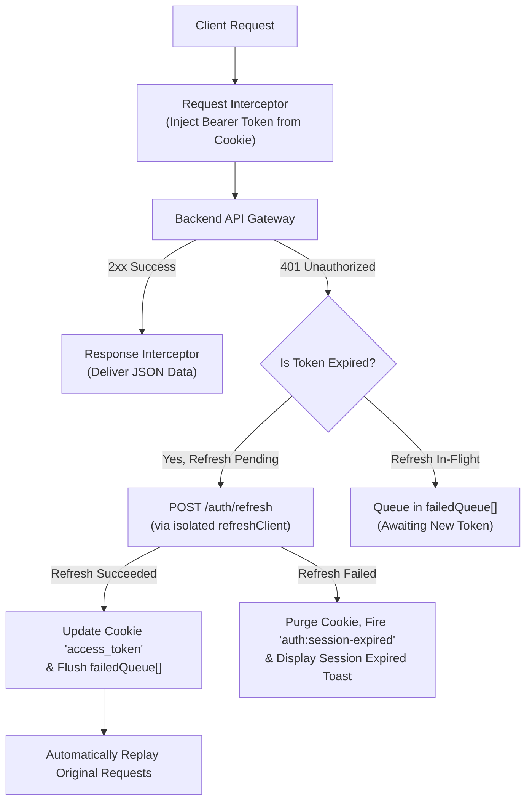

The `template-react` template is an enterprise-grade SaaS dashboard starter kit built on **React 19** and **Vite**, engineered for high rendering performance, domain-driven modularity (*feature-driven modules*), resilient authentication handling via Axios interceptors, and strict adherence to monorepo design and code quality gates.

---

## 🚀 Tech Stack & Core Specifications

| Component | Technology | Description & Version |
|---|---|---|
| **UI Framework** | React 19 | Concurrent features, modern hooks, compiler optimizations (`19.2+`) |
| **Build Tool & Bundler** | Vite 8 | Lightning-fast HMR, native ES module bundling (`8.1+`) |
| **Language & Compiler** | TypeScript 6 | Strict type-safety, path aliases (`@/*`), `tsc -b` (`~6.0`) |
| **Styling Engine** | Tailwind CSS v4 | Zero-config CSS build via `@tailwindcss/vite` (`4.3+`) |
| **Enterprise UI Kit** | PrimeReact 10 | DataTable, Dialog, Toast, Form Inputs, Button (`10.9+`) |
| **UI Theme Preset** | Aura (`@primeuix/themes`) | Modern minimalist enterprise design with CSS cascade layers |
| **State Management** | Zustand 5 | Atomic, zero-boilerplate store with isolated re-renders (`5.0+`) |
| **Client Routing** | React Router v7 | Nested layouts, data loaders, protected route wrappers (`7.18+`) |
| **HTTP Client** | Axios 1.21+ | Auto-refresh token on 401, concurrent request queue, global toast |
| **Development Port** | `5173` | Default URL: [http://localhost:5173](http://localhost:5173) |

---

## 🌐 Enterprise HTTP Client (Axios & Token Refresh)

REST API communication is centralized in `src/api/client.ts`. This Axios client is engineered to manage JWT lifecycle transparently, including request queuing during active token rotation cycles.



### 1. Client Setup & Base Configuration

Configured with `withCredentials: true` for secure cookie transmission (*HTTP-only refresh token*):

```typescript title="src/api/client.ts"
import axios, { AxiosInstance } from 'axios';

const BASE_URL =
  import.meta.env.VITE_API_BASE_URL ||
  import.meta.env.VITE_API_URL ||
  'http://localhost:3000';

export const api: AxiosInstance = axios.create({
  baseURL: BASE_URL,
  timeout: 15000,
  withCredentials: true,
  headers: {
    Accept: 'application/json',
    'Content-Type': 'application/json',
  },
});

// Dedicated unintercepted client for refresh requests to prevent recursion
const refreshClient: AxiosInstance = axios.create({
  baseURL: BASE_URL,
  timeout: 10000,
  withCredentials: true,
  headers: {
    Accept: 'application/json',
    'Content-Type': 'application/json',
  },
});
```

### 2. Request Interceptor: Bearer Token Injection

Every outgoing request automatically attaches the browser access token cookie if the `Authorization` header is not explicitly present:

```typescript title="src/api/client.ts"
api.interceptors.request.use(
  (config) => {
    if (!config.headers.Authorization) {
      const accessToken = getCookie('access_token');
      if (accessToken) {
        config.headers.Authorization = `Bearer ${accessToken}`;
      }
    }
    return config;
  },
  (error) => Promise.reject(error)
);
```

### 3. Response Interceptor: 401 Queue & Auto-Refresh

Upon receiving an HTTP `401 Unauthorized` response, the interceptor locks the refresh cycle, appends incoming parallel requests to `failedQueue`, requests a new access token from `/auth/refresh`, and transparently replays all pending calls:

```typescript title="src/api/client.ts"
let isRefreshing = false;
let failedQueue: Array<{ resolve: (token: string | null) => void; reject: (err: unknown) => void }> = [];

const processQueue = (error: unknown, token: string | null = null) => {
  failedQueue.forEach((prom) => (error ? prom.reject(error) : prom.resolve(token)));
  failedQueue = [];
};

api.interceptors.response.use(
  (response) => response,
  async (error: AxiosError) => {
    const originalRequest = error.config as CustomAxiosRequestConfig | undefined;
    if (!originalRequest) return Promise.reject(error);

    const is401 = error.response?.status === 401;
    const isAuthEndpoint = originalRequest.url?.includes('/auth/refresh') || originalRequest.url?.includes('/auth/login');

    if (!is401 || originalRequest._retry || isAuthEndpoint) {
      return Promise.reject(error);
    }

    if (isRefreshing) {
      return new Promise<string | null>((resolve, reject) => {
        failedQueue.push({ resolve, reject });
      })
        .then((token) => {
          if (token && originalRequest.headers) {
            originalRequest.headers.Authorization = `Bearer ${token}`;
          }
          return api(originalRequest);
        })
        .catch((err) => Promise.reject(err));
    }

    originalRequest._retry = true;
    isRefreshing = true;

    try {
      const refreshResponse = await refreshClient.post('/auth/refresh');
      const newAccessToken = refreshResponse.data?.data?.tokens?.accessToken || getCookie('access_token');

      if (newAccessToken) {
        setCookie('access_token', newAccessToken);
        api.defaults.headers.common.Authorization = `Bearer ${newAccessToken}`;
        if (originalRequest.headers) {
          originalRequest.headers.Authorization = `Bearer ${newAccessToken}`;
        }
      }

      processQueue(null, newAccessToken);
      return api(originalRequest);
    } catch (refreshError) {
      processQueue(refreshError, null);
      removeCookie('access_token');
      window.dispatchEvent(new CustomEvent('auth:session-expired', { detail: refreshError }));
      return Promise.reject(refreshError);
    } finally {
      isRefreshing = false;
    }
  }
);
```

### 4. Global Toast Bridge & Error Handling

To avoid redundant UI toast boilerplate across API calls, the Axios interceptor dispatches a window event `api:toast` upon network disconnects or 4xx/5xx HTTP errors:

- **HTTP 429 Rate Limit Handling**: When rate limits are breached, the interceptor parses the `Retry-After` header from the response and surfaces a warning toast: `"Too many requests. Please try again after <seconds> seconds."` with the semantic code `RATE_LIMIT_EXCEEDED`.
- **Network / Offline Detection**: Triggers a `Network Error` toast when the client device is offline or the server is unreachable.
- **The `skipToast` Option**: For requests requiring custom inline error handling without global notifications, pass `{ skipToast: true }`:
  ```typescript
  await apiClient.get('/users/check-email', { skipToast: true });
  ```

```typescript title="src/utils/toast.ts"
export interface ApiToastDetail {
  severity?: 'success' | 'info' | 'warn' | 'error';
  summary?: string;
  detail: string;
  life?: number;
}

export function dispatchToast(detail: ApiToastDetail): void {
  if (typeof window !== 'undefined') {
    window.dispatchEvent(new CustomEvent<ApiToastDetail>('api:toast', { detail }));
  }
}
```

> **The `skipToast` Option**: For requests requiring custom inline error handling without global notifications, pass `{ skipToast: true }`:
> ```typescript
> await apiClient.get('/users/check-email', { skipToast: true });
> ```

---

## ⚡ Global State Management

The application leverages **Zustand 5** for lightweight centralized state with zero boilerplate and isolated re-rendering characteristics.

### 1. Store Definition (Zustand / Pinia)

```typescript title="src/modules/auth/stores/authStore.ts"
import { create } from 'zustand';
import type { User } from '@/modules/users';
import { removeCookie } from '@/utils';
import type { AuthState } from '../types';

export const useAuthStore = create<AuthState>((set) => ({
  user: null,
  isAuthenticated: false,

  login: (userData: User) => {
    set({ user: userData, isAuthenticated: true });
  },

  logout: () => {
    removeCookie('access_token');
    set({ user: null, isAuthenticated: false });
  },
}));
```

### 2. Store Consumption in Components

React components subscribe to specific slices of state to eliminate unnecessary parent-child cascading updates:

```tsx title="src/components/layout/Header.tsx"
import React from 'react';
import { useAuthStore } from '@/modules/auth';

export const Header = () => {
  const user = useAuthStore((state) => state.user);
  const logout = useAuthStore((state) => state.logout);

  return (
    <header className="flex items-center justify-between p-4 border-b border-slate-200 dark:border-slate-800">
      <span className="text-sm font-medium">Logged in as: {user?.name || 'Guest'}</span>
      <button onClick={logout} className="text-sm text-red-500 hover:underline">
        Sign Out
      </button>
    </header>
  );
};
```

---

## 🧭 Declarative Routing & Layout Modules

### 1. Router Configuration & Nested Layouts

Configured with `createBrowserRouter` from **React Router v7** using nested layout hierarchies:

```tsx title="src/main.tsx"
import { createBrowserRouter, RouterProvider } from 'react-router-dom';
import App from './App.tsx';
import AuthLayout from './layouts/AuthLayout.tsx';
import DashboardLayout from './layouts/DashboardLayout.tsx';
import { LoginPage } from './modules/auth';
import { DashboardPage } from './modules/dashboard';
import { UsersPage } from './modules/users';
import NotFound from './pages/NotFound.tsx';

const router = createBrowserRouter([
  {
    path: '/',
    element: <App />,
    children: [
      {
        path: '/',
        element: <DashboardLayout />,
        children: [
          { index: true, element: <DashboardPage /> },
          { path: 'users', element: <UsersPage /> }
        ]
      },
      {
        path: 'auth',
        element: <AuthLayout />,
        children: [
          { path: 'login', element: <LoginPage /> }
        ]
      },
      {
        path: '*',
        element: <NotFound />
      }
    ]
  }
]);
```

### 2. Feature-Driven Module Structure

All feature domains are encapsulated under `src/modules/<feature-name>/`:

```text
src/modules/users/
├── api/
│   └── usersApi.ts       # Domain-scoped Axios methods
├── components/
│   └── UserAvatar.tsx    # User UI widgets
├── pages/
│   └── UsersPage.tsx     # View route endpoint
├── types/
│   └── index.ts          # TypeScript entities
└── index.ts              # Public module barrel export
```

Example module API client using the enterprise Axios wrapper:

```typescript title="src/modules/users/api/usersApi.ts"
import { apiClient } from '@/api/client';
import type { PaginatedResponse } from '@/types';
import type { User } from '../types';

export const usersApi = {
  getAll: (page = 1, pageSize = 10) =>
    apiClient.get<PaginatedResponse<User>>(`/users?page=${page}&pageSize=${pageSize}`),

  getById: (id: string) =>
    apiClient.get<User>(`/users/${id}`),

  create: (data: Omit<User, 'id'>) =>
    apiClient.post<User>('/users', data),

  update: (id: string, data: Partial<User>) =>
    apiClient.put<User>(`/users/${id}`, data),

  delete: (id: string) =>
    apiClient.delete<void>(`/users/${id}`)
};
```

---

## 🎨 UI System: PrimeUI & Tailwind CSS v4

### 1. Aura Theme Preset & CSS Layer Order

PrimeReact integrates the modern **Aura** preset from `@primeuix/themes`. Cascade layer orders are configured so that Tailwind v4 utilities retain highest precedence:

```tsx title="src/main.tsx"
import Aura from '@primeuix/themes/aura';
import { PrimeReactProvider } from 'primereact/api';

<PrimeReactProvider
  value={{
    theme: {
      preset: Aura,
      options: {
        darkModeSelector: '.dark',
        cssLayer: {
          name: 'primereact',
          order: 'tailwind-base, primereact, tailwind-utilities',
        },
      },
    },
  }}
>
  <RouterProvider router={router} />
</PrimeReactProvider>
```

### 2. Dark Mode Selector

Dark mode is driven by the `.dark` class on the root `<html>` element. All PrimeReact components (such as `DataTable`, `Dialog`, and `InputText`) adapt color schemes dynamically.

---

## 🛡️ Loading Patterns: Skeleton Loaders vs Action Buttons

Adhering strictly to monorepo loading guidelines (`frontend-loading.md`):

### 1. Mandatory Skeleton Loaders for Async Data

❌ **STRICTLY FORBIDDEN**: Using circular spinners ("loading muter") for page transitions, `DataTable` loading, cards, or user lists.
✅ **MANDATORY SKELETON**: All asynchronous data fetching states must render geometrically proportional **Skeleton** placeholders:

```tsx title="DataTable Skeleton Loader"
import React from 'react';
import { DataTable } from 'primereact/datatable';
import { Column } from 'primereact/column';
import { Skeleton } from 'primereact/skeleton';

export const UserTableSkeleton = () => {
  const dummyRows = Array.from({ length: 5 }, (_, i) => ({ id: String(i) }));

  return (
    <DataTable value={dummyRows} className="p-datatable-sm">
      <Column header="Name" body={() => <Skeleton width="70%" height="1.25rem" />} />
      <Column header="Email" body={() => <Skeleton width="90%" height="1.25rem" />} />
      <Column header="Role" body={() => <Skeleton width="40%" height="1.25rem" />} />
      <Column header="Actions" body={() => <Skeleton shape="circle" size="2rem" />} />
    </DataTable>
  );
};
```

### 2. Interactive Button Spinners (Only Allowed Spinner)

✅ Circular spinners are permitted **EXCLUSIVELY** inside `<Button loading={isSubmitting}>` while processing an interactive user mutation (Form submit, Save, Delete):

```tsx title="src/modules/auth/pages/LoginPage.tsx"
import { Button } from 'primereact/button';

<Button 
  type="submit" 
  label="Sign in" 
  loading={isSubmitting} 
  className="w-full bg-indigo-600 hover:bg-indigo-700 border-none mt-2" 
/>
```

---

## ⚙️ Environment Variables & Configuration

```ini title=".env"
# REST API Gateway Endpoint
VITE_API_BASE_URL=http://localhost:3000
```

---

## 🛠️ Development Commands & Quality Gates

```bash title="Terminal"
cd template-react

# Install dependencies
npm install

# Run preflight security checks & launch local dev server (port 5173)
npm run dev

# Run TypeScript typecheck (tsc -b)
npm run typecheck

# Run ESLint with auto-fix
npm run lint

# Format code with Prettier
npm run format

# Run standalone preflight security audit (npm audit + typecheck)
npm run preflight

# Build optimized production bundle
npm run build

# Preview production build locally
npm run preview
```
