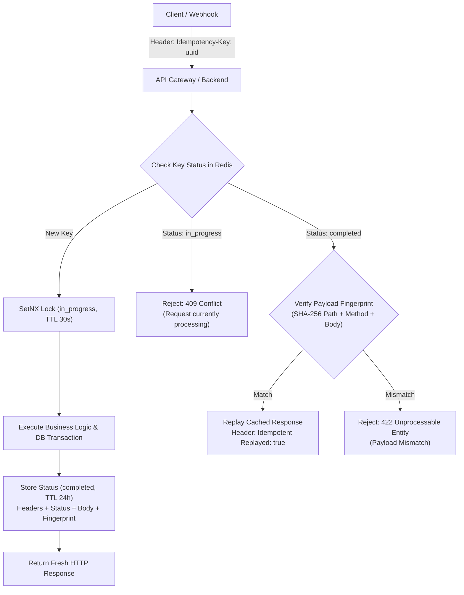

In distributed architectures, transient network failures or client timeouts frequently trigger automatic retries from mobile clients, web browsers, or webhook dispatchers. Without robust idempotency safeguards, retrying mutating actions (such as payment checkouts, account balance deductions, order creation, or fund transfers) can lead to critical **double charges** or duplicate records.

All 5 backend templates in this monorepo (`template-golang`, `template-express`, `template-fastapi-async`, `template-java`, and `template-rust`) implement a unified idempotency standard adhering strictly to the **IETF draft-ietf-httpapi-idempotency-key-header** specification.

---

## 🎯 Idempotent Request Lifecycle



---

## 📋 Standard HTTP Headers

| Header | Type | Description |
|---|---|---|
| `Idempotency-Key` | Request Header | Unique string identifier (UUID v4 recommended, 1–256 characters) generated by the client. |
| `X-Idempotency-Key` | Request Header | Legacy fallback compatibility header for clients without standard header support. |
| `Idempotent-Replayed` | Response Header | Set to `true` whenever the response is served from the cached replay rather than re-executed. |
| `X-Idempotency-Replayed` | Response Header | Alternative legacy response replay indicator. |

---

## 🛡️ 4 Core Architectural Safeguards

### 1. Atomic Distributed Locking (`in_progress`)
Prior to executing business logic or acquiring database transactions, the backend invokes an atomic Redis operation:
```text
SET idempotency:{userId}:{key} {"status":"in_progress", ...} NX EX 30
```
- If the key exists with `in_progress` status, the server immediately responds with **`409 Conflict`** (`IDEMPOTENCY_CONFLICT` / `CODE_IDEMPOTENCY_IN_FLIGHT`) to block simultaneous concurrent executions (*race conditions*).
- The `in_progress` lock carries a short TTL (30 seconds). If network drops cause the client to disconnect, the lock automatically expires.

### 2. Payload Fingerprinting (SHA-256)
To protect against malicious spoofing or client bugs where an identical key is reused with mismatched payloads:
- The backend computes a cryptographic SHA-256 digest:
  $$\text{Fingerprint} = \text{SHA256}(\text{userId} + \text{method} + \text{path} + \text{rawBody})$$
- If a request supplies a key marked as `completed` but its data payload differs from the recorded fingerprint, the server rejects it with **`422 Unprocessable Entity`** (`IDEMPOTENCY_PAYLOAD_MISMATCH`).

### 3. Automatic Response Replay
When a completed key matches the payload fingerprint 100%:
- The server **bypasses all database transactions and service execution**.
- The server replays the original status code, headers (e.g. `Content-Type`), and response body verbatim.
- The server appends the header `Idempotent-Replayed: true`.

### 4. Response Caching Policy & Automatic Unlock on Transient Errors
In compliance with IETF draft standards and distributed systems best practices, **not all HTTP statuses may be cached**:

| Category | Status Code | Idempotency Action | Reason |
|---|---|---|---|
| **Success** | `200`, `201`, `204` | **Cache & Replay** | Business mutation completed. Replay cached response to prevent duplicate execution. |
| **Deterministic Client Errors** | `400`, `404`, `422` | **Cache & Replay** | Business/validation logic deterministically rejects payload. Prevents redundant DB queries. |
| **Server Failures** | `500`, `502`, `503`, `504` | **UNLOCK (Release Key)** | Server crashes and timeouts are transient; clients must be permitted to retry. |
| **Rate Limiting** | `429` | **UNLOCK (Release Key)** | Caching 429 would poison the key permanently, preventing execution even after rate limit expires! |
| **Auth Expiration** | `401` | **UNLOCK (Release Key)** | Access token expired; frontend will refresh token and retry with the same key. |
| **Network & Concurrency** | `408`, `409`, `425` | **UNLOCK (Release Key)** | Request timeout or in-flight concurrency locks are transient states. |

---

## 💻 Implementation Across All 5 Backends

### 1. Go (`template-golang`)
Configured using Fiber middleware `idempotency.New()`:

```go title="internal/app/http.go"
import "golang/pkg/idempotency"

// Protect sensitive mutating routes with idempotency
orders := api.Group("/orders", idempotency.New(idempotency.Config{
    Storage:     idempotency.NewRedisStorage(redisClient),
    Lifetime:    24 * time.Hour,
    LockTimeout: 30 * time.Second,
    Required:    true,
}))
orders.Post("/", orderHandler.CreateOrder)
```

### 2. Express.js (`template-express`)
Enforced via router middleware `idempotency()`:

```typescript title="src/modules/orders/routes.ts"
import { Router } from 'express'
import { idempotency, RedisIdempotencyStorage } from '../../middleware/idempotency'
import { orderController } from './controller'

const router = Router()

// Protect mutations with mandatory Idempotency-Key
router.post(
  '/',
  idempotency({
    storage: new RedisIdempotencyStorage(),
    required: true,
    lifetimeSeconds: 86400,
    lockTimeoutSeconds: 30
  }),
  orderController.createOrder
)

export default router
```

### 3. FastAPI (`template-fastapi-async`)
Enforced via global `IdempotencyMiddleware` or endpoint dependency `require_idempotency_key`:

```python title="main.py"
from middleware.idempotency import IdempotencyMiddleware, RedisIdempotencyStorage

# Register distributed idempotency middleware
app.add_middleware(
    IdempotencyMiddleware,
    storage=RedisIdempotencyStorage(),
    lifetime_seconds=86400,
    timeout_seconds=30
)
```

For mandatory enforcement on specific routes:

```python title="modules/orders/routes.py"
from fastapi import APIRouter, Depends
from middleware.idempotency import require_idempotency_key

router = APIRouter(prefix="/orders", tags=["Orders"])

@router.post("", dependencies=[Depends(require_idempotency_key)])
async def create_order(request: OrderCreate):
    return await order_service.create_order(request)
```

### 4. Spring Boot (`template-java`)
Enforced via servlet filter `IdempotencyFilter` and custom annotation `@RequireIdempotencyKey`:

```java title="com/example/template/java/order/controller/OrderController.java"
@RestController
@RequestMapping("/api/orders")
public class OrderController {

  @PostMapping
  @RequireIdempotencyKey
  @Transactional
  public ResponseEntity<BaseResponse<OrderResponse>> createOrder(
      @Valid @RequestBody OrderRequest request) {
    OrderResponse response = orderService.createOrder(request);
    return ResponseEntity.ok(BaseResponse.success("Order created", response));
  }
}
```

### 5. Rust Axum (`template-rust`)
Enforced via middleware `idempotency_layer` with `IdempotencyStore`:

```rust title="src/main.rs"
use axum::{middleware, routing::post, Router};
use std::sync::Arc;
use template_rust::pkg::idempotency::{idempotency_layer, IdempotencyStore};

let idempotency_store = Arc::new(IdempotencyStore::default());

let app = Router::new()
    .route("/api/orders", post(create_order))
    .layer(middleware::from_fn(move |req, next| {
        idempotency_layer(idempotency_store.clone(), req, next)
    }));
```

---

## 🌐 Frontend Implementation (`template-react` & `template-vue`)

On the client side, blindly auto-generating an `Idempotency-Key` on every single mutating HTTP request (`POST`/`PUT`/`PATCH`) is an **anti-pattern** because:
1. **Page Refresh Failures:** If a form is reloaded (F5/browser refresh) while an order is in-flight or before submit, pure in-memory state is erased and generates a new key. Submitting again results in double charging!
2. **Timeout & Retry Failures:** If a request times out (e.g. 15s network timeout), subsequent retries **must reuse the exact same key** so the server recognizes the idempotent replay or ongoing `in_progress` lock rather than creating duplicate mutations.
3. **Non-Critical Endpoints:** Lightweight mutation requests (e.g., telemetry, analytics, search tracking) do not warrant distributed locking overhead in Redis.

Thus, both frontend templates implement a **Session-Persisted, Scope-Based Idempotency Architecture**:

### 1. Zero-Bloat Key Generator & Persistence (`src/utils/idempotency.ts`)
Uses the browser's native Web Crypto API (`crypto.randomUUID()` with a cryptographically secure fallback using `crypto.getRandomValues()`), and a `sessionStorage` persistence layer with TTL (30 minutes):

```typescript
import { generateIdempotencyKey, getOrCreateIdempotencyKey } from '@/utils'

// Survives browser page reload (F5) during the active transaction session
const key = getOrCreateIdempotencyKey('checkout-form')
```

### 2. Axios Request Config & In-Place Key Retention (`src/api/client.ts`)
The Axios interceptor mutates `config.idempotencyKey` in-place into the generated string key. If a **network timeout** or **retry** happens on that config, Axios uses the **exact same key**:

```typescript
// Option A: Automatically generate & retain key across retries / timeout
await api.post('/api/orders', orderData, { idempotencyKey: true })

// Option B: Provide a scoped key from hook / form session
await api.post('/api/orders', orderData, { idempotencyKey: orderKey })

// Option C: Use ergonomic apiClient.idempotent shortcuts
await apiClient.idempotent.post('/api/orders', orderData)
```

### 3. Lifecycle-Aware Hook in React (`useIdempotencyKey`)
Supports `scope` for `sessionStorage` persistence (F5 reload-safe) and an `execute()` wrapper that refreshes the key only on success (2xx) while preserving the key on error or timeout:

```tsx
import React, { useState } from 'react'
import { apiClient } from '@/api/client'
import { useIdempotencyKey } from '@/hooks'

export const CheckoutForm: React.FC = () => {
  // Key stored in sessionStorage for 'checkout-order' scope (survives F5 refresh)
  const { key, execute } = useIdempotencyKey('checkout-order')
  const [loading, setLoading] = useState(false)

  const handleCheckout = async () => {
    setLoading(true)
    try {
      // execute() automatically:
      // 1. Sends request with the active key
      // 2. On timeout / network error: RETAINS the key for safe retry
      // 3. On success (2xx): automatically refreshes key for next order
      await execute(async (activeKey) => {
        return await apiClient.idempotent.post('/api/orders', { amount: 150000 }, activeKey)
      })
      alert('Order placed successfully!')
    } catch (error) {
      // Key remains intact in sessionStorage; user can safely click retry
      console.error('Checkout failed:', error)
    } finally {
      setLoading(false)
    }
  }

  return (
    <button onClick={handleCheckout} disabled={loading}>
      {loading ? 'Processing...' : 'Pay Now'}
    </button>
  )
}
```

### 4. Lifecycle-Aware Composable in Vue (`useIdempotencyKey`)
The equivalent composable in Vue 3:

```vue
<script setup lang="ts">
import { ref } from 'vue'
import { apiClient } from '@/api/client'
import { useIdempotencyKey } from '@/composables'

// Scoped key survives browser refresh
const { key, execute } = useIdempotencyKey('checkout-order')
const loading = ref(false)

const handleCheckout = async () => {
  loading.value = true
  try {
    await execute(async (activeKey) => {
      return await apiClient.idempotent.post('/api/orders', { amount: 150000 }, activeKey)
    })
    alert('Order placed successfully!')
  } catch (error) {
    // Key is preserved for safe retry
  } finally {
    loading.value = false
  }
}
</script>
```
