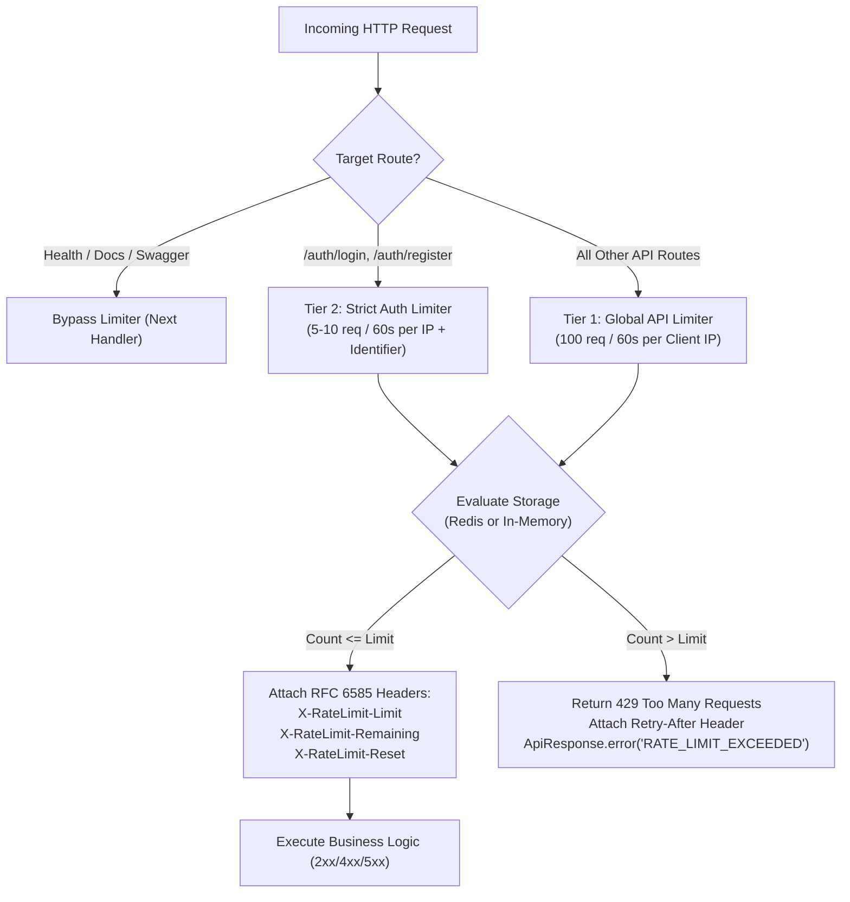

To defend against *Denial of Service (DoS)* attacks, brute force password attempts, and credential stuffing, all backend templates (`template-express`, `template-fastapi-async`, `template-golang`, `template-java`, `template-rust`) enforce a unified **Dual-Tier Rate Limiter** adhering to the **RFC 6585** standard.

---

## 🚦 Dual-Tier Rate Limiting Architecture



---

## ⚡ Two Protection Tiers

### 1. Tier 1: Global API Limiter
- **Purpose**: Prevents sudden traffic surges, runaway client polling, and general DoS attempts on open endpoints.
- **Default Baseline**: `100 requests / 60 seconds` per client IP.
- **Whitelist Exclusions**:
  - System readiness probes: `/health`, `/`
  - Interactive API documentation: `/docs`, `/swagger`, `/openapi.json`, `/v3/api-docs`

### 2. Tier 2: Strict Auth Limiter
- **Purpose**: Thwarts credential stuffing and dictionary brute-force attacks on authentication flows.
- **Default Baseline**: `5 - 10 requests / 60 seconds`.
- **Target Endpoints**: `/auth/login`, `/auth/register`.
- **Composite Key Generator**: Combines IP + Path/Email (e.g. `rl:auth:<ip>:<path>` or `<ip>:<email>`) to isolate repeated authentication failures quickly.

---

## 📋 RFC 6585 Standard Headers

Every HTTP response evaluated by rate limiting middleware includes standard quota metadata headers:

| Header | Description | Example Value |
|---|---|---|
| `X-RateLimit-Limit` | Maximum quota allowed within the active window | `100` |
| `X-RateLimit-Remaining` | Remaining requests available before reset | `84` |
| `X-RateLimit-Reset` | Unix Epoch timestamp (seconds) when window resets | `1732093560` |
| `Retry-After` | Number of seconds the client must wait (*sent only on HTTP 429*) | `45` |

---

## 📦 Standard HTTP 429 Error Response

When a client breaches rate limits, the backend returns HTTP status `429 Too Many Requests` formatted with the standard `ApiResponse` envelope:

```json
{
  "success": false,
  "message": "Too many requests. Please try again after 45 seconds.",
  "error": {
    "code": "RATE_LIMIT_EXCEEDED"
  },
  "data": null
}
```

Frontend clients (React and Vue) intercept this `Retry-After` header automatically, displaying a user-friendly warning toast with a cooldown countdown.

---

## 🛡️ Hybrid Storage (Redis + In-Memory Fallback)

1. **Distributed Mode (Redis)**:
   - Active when `RATE_LIMIT_STORAGE=redis` and Redis is reachable.
   - Leverages atomic `INCR` and `EXPIRE` primitives across multi-pod Kubernetes clusters.
2. **In-Memory Fallback**:
   - If Redis connection drops, the service **MUST NEVER CRASH**.
   - The middleware automatically fails over to an in-memory map backed by thread-safe concurrency locks and periodic eviction of expired records.

---

## ⚙️ Environment Variables Summary

```ini title=".env"
# Enable/disable rate limiting middleware
RATE_LIMIT_ENABLED=true

# Storage driver: memory or redis
RATE_LIMIT_STORAGE=memory

# Global Limiter: 100 requests per 60 seconds
RATE_LIMIT_MAX=100
RATE_LIMIT_WINDOW_SECONDS=60

# Strict Auth Limiter: 5-10 requests per 60 seconds
RATE_LIMIT_AUTH_MAX=5
RATE_LIMIT_AUTH_WINDOW_SECONDS=60
```
