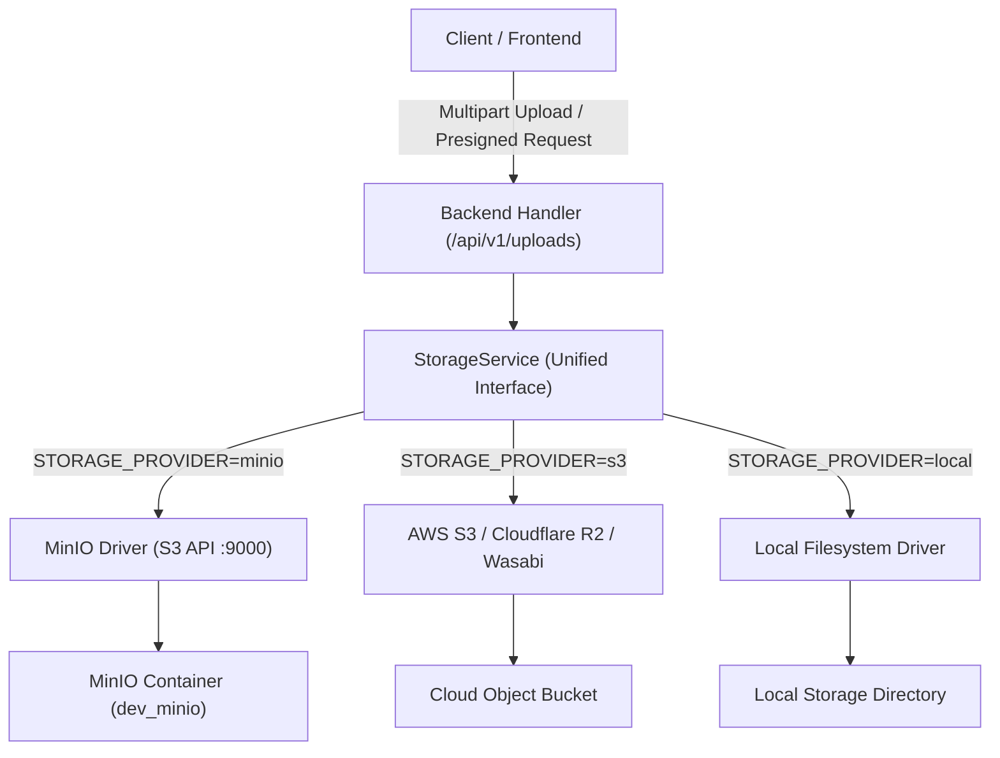

All backend templates in this monorepo (`template-express`, `template-fastapi-async`, `template-golang`, `template-java`, `template-rust`) enforce a **Unified Object Storage Driver** architecture. This enables applications to switch between MinIO, AWS S3, Cloudflare R2, and local disk storage strictly through environment variables without touching business logic.

---

## 🏛️ Architecture & Driver Agnosticism



---

## 📋 Standard Storage Contract

Every backend service exposes a uniform storage interface:

1. **`upload(key, content, contentType, isPublic)`**:
   - Uploads binary content to the target path/bucket.
   - Returns uniform object metadata:
     ```json
     {
       "key": "avatars/usr-123.png",
       "url": "http://localhost:9000/app-uploads/avatars/usr-123.png",
       "size": 15420,
       "contentType": "image/png"
     }
     ```
2. **`download(key)`**:
   - Retrieves file content as a binary buffer or stream.
   - Emits a semantic `FILE_NOT_FOUND` error if the object does not exist.
3. **`delete(key)`**:
   - Safely and idempotently removes the object from storage.
4. **`getUrl(key)`**:
   - Returns the permanent public URL (direct S3 URL or CDN endpoint).
5. **`getPresignedUploadUrl(key, contentType, expiresInSeconds)`**:
   - Generates a time-limited pre-signed URL for direct browser-to-S3 uploads.
   - Prevents backend server bandwidth exhaustion when uploading large assets (videos, datasets, audio).
6. **`getPresignedDownloadUrl(key, expiresInSeconds)`**:
   - Generates a secure, temporary download link for private assets.
7. **`exists(key)`**:
   - Efficiently checks object presence via a lightweight HEAD request.

---

## 🛡️ Security & Path Traversal Prevention

The `local` storage driver strictly validates that requested file paths do not escape the designated storage root:
- Enforces canonical path resolution (`Path.canonicalize()` / `path.resolve()` / `filepath.Clean()`).
- Rejects any attempt containing directory traversal sequences (`../`, `..\`) with HTTP `400 Bad Request` (`VALIDATION_ERROR`).

---

## ⚙️ Standard Environment Variables

| Variable | Values / Default | Description |
|---|---|---|
| `STORAGE_PROVIDER` | `minio` \| `s3` \| `local` | Active storage provider driver |
| `STORAGE_LOCAL_PATH` | `storage/uploads` | Filesystem root directory for `local` driver |
| `S3_ENDPOINT` | `http://localhost:9000` | S3 / MinIO API endpoint URL |
| `S3_REGION` | `us-east-1` | S3 bucket region |
| `S3_BUCKET` | `app-uploads` | Target object bucket name |
| `S3_ACCESS_KEY` | `minioadmin` | API access key credential |
| `S3_SECRET_KEY` | `minioadminpassword` | API secret key credential |
| `S3_FORCE_PATH_STYLE` | `true` | Required `true` for MinIO & local S3 emulators |
| `S3_USE_SSL` | `false` | Enable `true` for HTTPS in production |
| `STORAGE_PUBLIC_URL` | `http://localhost:9000/app-uploads` | Base URL for accessing public files |

---

## 🧪 Isolated Testing with Testcontainers

To guarantee compatibility with production object storage environments:
- Each template includes integration tests (`storage.test`) powered by real **Testcontainers MinIO** instances.
- Tests automatically create ephemeral buckets, perform uploads, verify presigned URLs, and test deletions.
- If the Docker daemon is unreachable, the test suite gracefully falls back to mocks or skips container spin-up without breaking builds.
