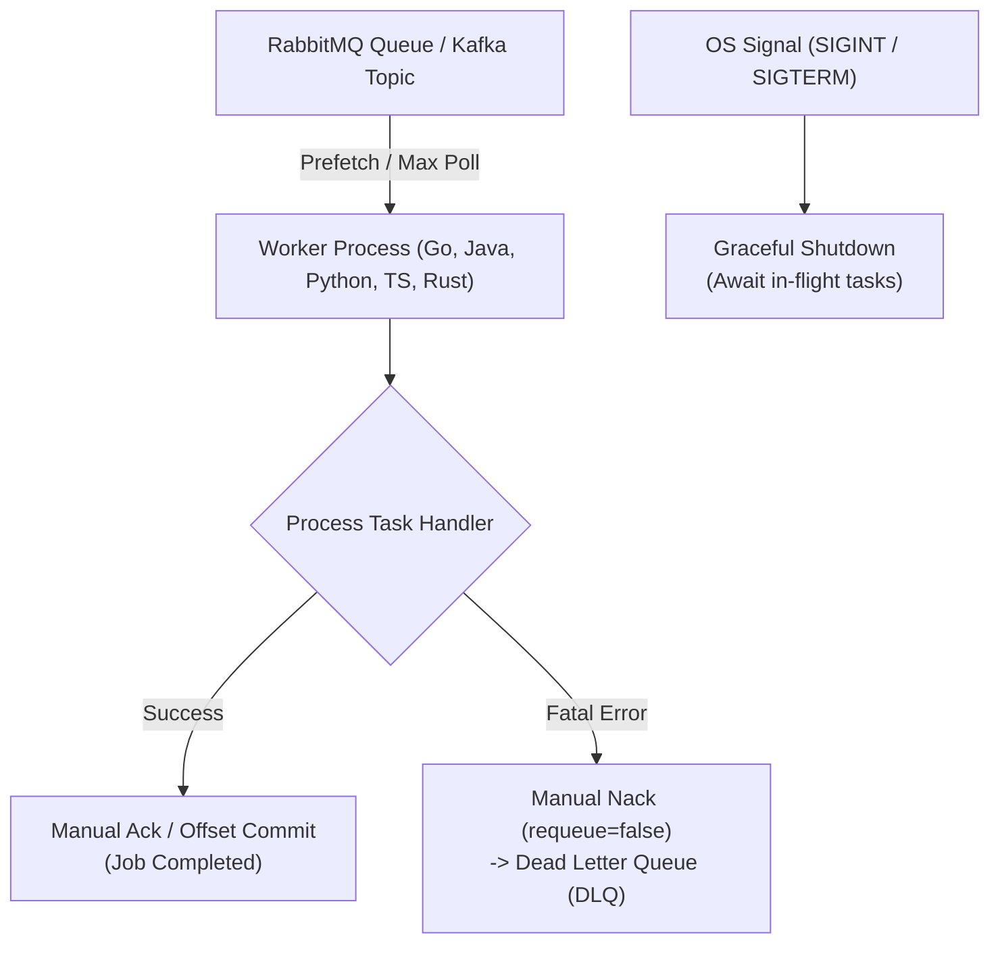

This monorepo provides 5 dedicated worker implementations engineered for intensive asynchronous background processing, such as sending emails, analytics batch processing, media transcoding, and inter-service synchronization.

Every worker supports a **Dual Message Broker Architecture**: you can effortlessly swap between **RabbitMQ (AMQP 0.9.1)** queuing and **Apache Kafka** event streaming simply by toggling `MESSAGE_BROKER=rabbitmq` or `MESSAGE_BROKER=kafka` in your environment.

---

## 🎯 4 Core Design Pillars

Each worker template strictly adheres to 4 standardized architectural design pillars:



### 1. Quality of Service (QoS / Fair Dispatch)
Each worker enforces strict unacknowledged message limits (typically 1 to 10 messages). This fair dispatch strategy prevents worker processes from running out of memory when large job bursts flood the queue.

### 2. Manual Message Acknowledgment (Ack / Nack) & Offset Commit
- ✅ **Ack / Commit**: Sent exclusively when the message payload has been completely processed by the business task handler without exceptions.
- ❌ **Nack with DLQ**: When a message encounters a fatal error or unparseable JSON payload, the worker triggers `Nack` with `requeue=false` (or routes to Dead Letter Exchanges), diverting poisoned messages into Dead Letter Queues (DLQ) without causing infinite retry storms.

### 3. Graceful Shutdown & OS Signals
Every worker process traps OS termination signals (`SIGINT`, `SIGTERM`). Upon receiving a signal:
1. The consumer stops accepting new deliveries from queues/topics.
2. A grace period allows currently executing in-flight jobs to complete cleanly.
3. The broker channel and network sockets are closed in an orderly manner without losing in-flight state.

### 4. Structured JSON Logging
In compliance with global monorepo rules (`logging.md`), raw unformatted print calls (`console.log`, `fmt.Println`, `print()`, `System.out.println`, `println!`) are strictly prohibited. All workers output structured JSON log records.

---

## 📦 Worker Matrix

| Template | Language | RabbitMQ Driver | Apache Kafka Driver | Concurrency Model |
|---|---|---|---|---|
| `template-worker-golang` | Go 1.22+ | `rabbitmq/amqp091-go` | `segmentio/kafka-go` | Goroutines Pool & Channels |
| `template-worker-java` | Java 17+ | Spring AMQP `@RabbitListener` | Spring Kafka `@KafkaListener` | Thread Pool Task Executor |
| `template-worker-python` | Python 3.10+ | `pika` (BlockingConnection) | `kafka-python-ng` | Event Loop / Callbacks |
| `template-worker-typescript` | Node.js (TS) | `amqplib` | `kafkajs` | Async Task Handlers |
| `template-worker-rust` | Rust 2021 | `lapin` (AMQP 0.9.1) | `rskafka` | Tokio Async Runtime (< 15MB RAM) |

---

## 🔄 Standard Message Envelope Format

All backend producers and worker consumers share a unified JSON payload envelope:

```json
{
  "id": "msg-9b1deb4d-3b7d-4bad-9bdd-2b0d7b3dcb6d",
  "type": "USER_NOTIFICATION",
  "data": {
    "userId": "123",
    "title": "Welcome",
    "message": "Your registration was successful"
  },
  "timestamp": 1700000000000
}
```
