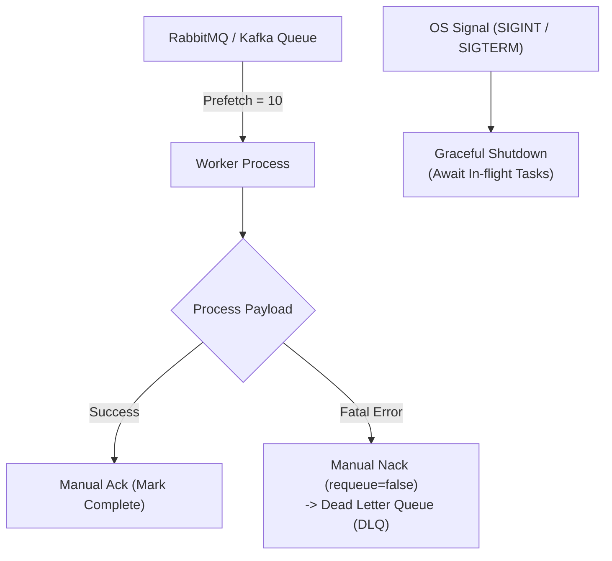

This monorepo provides 5 independent worker templates engineered for resilient asynchronous background processing (e.g. email delivery, video processing, data warehousing, cross-service event orchestration).

---

## 🎯 4 Core Worker Design Patterns

Every worker implementation follows 4 strict architectural pillars:

### 1. Quality of Service (QoS / Prefetch Count = 10)
Workers explicitly limit unacknowledged messages pulled into memory (default: 10). This prevents consumer exhaustion and out-of-memory errors during traffic spikes.

### 2. Manual Acknowledgment (Ack / Nack)
- ✅ **Ack**: Issued only when the task completes with 100% success.
- ❌ **Nack with DLQ**: On fatal or poison-pill errors, workers issue `Nack` with `requeue=false`, routing the corrupted message to a Dead Letter Queue (DLQ) without causing infinite re-processing loops.

### 3. Graceful Shutdown
Consumers listen for OS termination signals (`SIGINT`, `SIGTERM`):
1. Immediately unsubscribe from the queue to stop receiving new jobs.
2. Allow active in-flight handlers a grace period to complete.
3. Cleanly close channels and broker connections with zero data loss.

---

## 📦 5 Worker Implementations

| Template | Language | Messaging Driver | Concurrency Model |
|---|---|---|---|
| `template-worker-golang` | Go 1.22+ | `rabbitmq/amqp091-go` / Kafka | Goroutines Pool |
| `template-worker-java` | Java 17+ | Spring AMQP `@RabbitListener` | Thread Pool Executor |
| `template-worker-python` | Python 3.10+ | `aio-pika` / `pika` / Kafka | Asyncio Event Loop |
| `template-worker-typescript` | Node.js (TS) | `amqplib` / Kafka | Async Task Handlers |
| `template-worker-rust` | Rust 2021 | `lapin` / `rdkafka` | Tokio Async Runtime |
