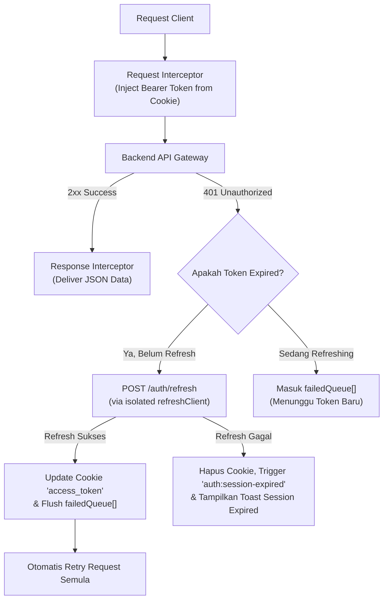

Template `template-react` adalah starter kit dashboard SaaS enterprise berbasis **React 19** dan **Vite**, dirancang untuk performa rendering tinggi, modularitas berbasis domain (*feature-driven modules*), manajemen autentikasi tangguh dengan Axios interceptor, serta kepatuhan penuh terhadap standar desain dan kualitas monorepo.

---

## 🚀 Tech Stack & Spesifikasi Kunci

| Komponen | Teknologi | Keterangan & Versi |
|---|---|---|
| **Framework UI** | React 19 | Concurrent features, hooks modern, compiler optimizations (`19.2+`) |
| **Build Tool & Bundler** | Vite 8 | Lightning-fast HMR, ES module native bundling (`8.1+`) |
| **Bahasa & Compiler** | TypeScript 6 | Strict type-safety, path aliases (`@/*`), `tsc -b` (`~6.0`) |
| **Styling Engine** | Tailwind CSS v4 | Zero-config CSS build via `@tailwindcss/vite` (`4.3+`) |
| **Enterprise UI Kit** | PrimeReact 10 | DataTable, Dialog, Toast, Form Inputs, Button (`10.9+`) |
| **UI Theme Preset** | Aura (`@primeuix/themes`) | Desain minimalis enterprise modern dengan CSS cascade layers |
| **State Management** | Zustand 5 | Atomic, zero-boilerplate store dengan mutasi minimalis (`5.0+`) |
| **Client Routing** | React Router v7 | Nested layouts, data loaders, protected route wrappers (`7.18+`) |
| **HTTP Client** | Axios 1.21+ | Auto-refresh token 401, concurrent request queue, global toast |
| **Port Development** | `5173` | Default URL: [http://localhost:5173](http://localhost:5173) |

---

## 🌐 Enterprise HTTP Client (Axios & Token Refresh)

Komunikasi REST API dipusatkan di `src/api/client.ts`. Axios instance ini dikonfigurasi untuk menangani siklus hidup autentikasi token JWT secara transparan, termasuk antrean request saat refresh token sedang berlangsung.



### 1. Inisialisasi Client & Konfigurasi Basis

Menggunakan konfigurasi `withCredentials: true` untuk pertukaran cookie aman (*HTTP-only refresh token*):

```typescript title="src/api/client.ts"
import axios, { AxiosInstance } from 'axios';

const BASE_URL =
  import.meta.env.VITE_API_BASE_URL ||
  import.meta.env.VITE_API_URL ||
  'http://localhost:3000';

export const api: AxiosInstance = axios.create({
  baseURL: BASE_URL,
  timeout: 15000,
  withCredentials: true,
  headers: {
    Accept: 'application/json',
    'Content-Type': 'application/json',
  },
});

// Dedicated unintercepted client untuk endpoint refresh mencegah infinite loop
const refreshClient: AxiosInstance = axios.create({
  baseURL: BASE_URL,
  timeout: 10000,
  withCredentials: true,
  headers: {
    Accept: 'application/json',
    'Content-Type': 'application/json',
  },
});
```

### 2. Request Interceptor: Injeksi Bearer Token

Setiap request otomatis menyematkan token akses dari cookie browser jika header `Authorization` belum terpasang:

```typescript title="src/api/client.ts"
api.interceptors.request.use(
  (config) => {
    if (!config.headers.Authorization) {
      const accessToken = getCookie('access_token');
      if (accessToken) {
        config.headers.Authorization = `Bearer ${accessToken}`;
      }
    }
    return config;
  },
  (error) => Promise.reject(error)
);
```

### 3. Response Interceptor: 401 Queue & Auto-Refresh

Ketika backend mengembalikan HTTP `401 Unauthorized`, response interceptor mengunci siklus refresh, menampung request paralel lainnya ke dalam antrean `failedQueue`, mengeksekusi rotasi token ke `/auth/refresh`, lalu melakukan *replay* otomatis pada request yang tertunda:

```typescript title="src/api/client.ts"
let isRefreshing = false;
let failedQueue: Array<{ resolve: (token: string | null) => void; reject: (err: unknown) => void }> = [];

const processQueue = (error: unknown, token: string | null = null) => {
  failedQueue.forEach((prom) => (error ? prom.reject(error) : prom.resolve(token)));
  failedQueue = [];
};

api.interceptors.response.use(
  (response) => response,
  async (error: AxiosError) => {
    const originalRequest = error.config as CustomAxiosRequestConfig | undefined;
    if (!originalRequest) return Promise.reject(error);

    const is401 = error.response?.status === 401;
    const isAuthEndpoint = originalRequest.url?.includes('/auth/refresh') || originalRequest.url?.includes('/auth/login');

    if (!is401 || originalRequest._retry || isAuthEndpoint) {
      return Promise.reject(error);
    }

    // Jika sedang dalam proses refresh, masukkan request ke antrean tunggu
    if (isRefreshing) {
      return new Promise<string | null>((resolve, reject) => {
        failedQueue.push({ resolve, reject });
      })
        .then((token) => {
          if (token && originalRequest.headers) {
            originalRequest.headers.Authorization = `Bearer ${token}`;
          }
          return api(originalRequest);
        })
        .catch((err) => Promise.reject(err));
    }

    originalRequest._retry = true;
    isRefreshing = true;

    try {
      const refreshResponse = await refreshClient.post('/auth/refresh');
      const newAccessToken = refreshResponse.data?.data?.tokens?.accessToken || getCookie('access_token');

      if (newAccessToken) {
        setCookie('access_token', newAccessToken);
        api.defaults.headers.common.Authorization = `Bearer ${newAccessToken}`;
        if (originalRequest.headers) {
          originalRequest.headers.Authorization = `Bearer ${newAccessToken}`;
        }
      }

      processQueue(null, newAccessToken);
      return api(originalRequest);
    } catch (refreshError) {
      processQueue(refreshError, null);
      removeCookie('access_token');
      window.dispatchEvent(new CustomEvent('auth:session-expired', { detail: refreshError }));
      return Promise.reject(refreshError);
    } finally {
      isRefreshing = false;
    }
  }
);
```

### 4. Global Toast Bridge & Penanganan Error

Untuk mencegah kode boilerplate toast berulang di setiap pemanggilan API, Axios interceptor secara otomatis menyiarkan event global `api:toast` pada kegagalan jaringan atau HTTP 4xx/5xx:

- **Deteksi HTTP 429 (Rate Limit Exceeded)**: Jika client melebihi kuota request, interceptor membaca header `Retry-After` dari respons backend dan secara otomatis menampilkan toast peringatan: `"Too many requests. Please try again after <detik> seconds."` dengan title `RATE_LIMIT_EXCEEDED`.
- **Network / Offline Fallback**: Menampilkan toast `Network Error` saat perangkat terputus dari koneksi internet atau gateway tidak terjangkau.
- **Opsi `skipToast`**: Jika sebuah pemanggilan API ingin menangani error secara kustom tanpa memunculkan toast otomatis, cukup sertakan opsi `{ skipToast: true }` pada konfigurasi request:
  ```typescript
  await apiClient.get('/users/check-email', { skipToast: true });
  ```

```typescript title="src/utils/toast.ts"
export interface ApiToastDetail {
  severity?: 'success' | 'info' | 'warn' | 'error';
  summary?: string;
  detail: string;
  life?: number;
}

export function dispatchToast(detail: ApiToastDetail): void {
  if (typeof window !== 'undefined') {
    window.dispatchEvent(new CustomEvent<ApiToastDetail>('api:toast', { detail }));
  }
}
```

### 5. Utilitas Idempotency & Resiliensi Mutasi (useIdempotencyKey)

Sesuai standar IETF `draft-ietf-httpapi-idempotency-key-header` dan aturan [Idempotency Protection](/standards/idempotency), template React menyediakan utilitas idempotency berbasis **Native Web Crypto API** (Zero-Bloat, tanpa package eksternal) serta hook lifecycle `useIdempotencyKey`:

- **Opsi `idempotencyKey` pada Axios**: Request interceptor membaca opsi `idempotencyKey: true` (otomatis UUID v4 baru) atau `idempotencyKey: 'custom-key'` dan menyuntikkannya ke header `Idempotency-Key` dan `X-Idempotency-Key`.
- **Convenience Methods**: Disediakan helper `api.idempotent.post()`, `api.idempotent.put()`, dan `api.idempotent.patch()`.
- **Resiliensi Browser F5 / Refresh**: Dengan parameter `scope` (contoh: `'checkout-order'`), key disimpan di `sessionStorage` dengan TTL 30 menit sehingga user yang me-refresh halaman tidak akan membuat mutasi duplikat.
- **Timeout & Retry-Safe**: Jika koneksi putus atau request timeout, key yang sama tetap dipertahankan saat tombol ditekan kembali. Key hanya otomatis diperbarui (`refreshKey()`) saat request sukses (HTTP 2xx).

```tsx title="Contoh Penggunaan useIdempotencyKey pada Form Checkout"
import React, { useState } from 'react';
import { Button } from 'primereact/button';
import { useIdempotencyKey } from '@/hooks/useIdempotencyKey';
import api from '@/api/client';

export const CheckoutForm: React.FC = () => {
  const [loading, setLoading] = useState(false);
  const { key, execute } = useIdempotencyKey({ scope: 'checkout-order' });

  const handleCheckout = async () => {
    setLoading(true);
    try {
      // execute() mempertahankan key jika error/timeout, dan otomatis merotasi key saat 2xx
      await execute(async (activeKey) => {
        return await api.post('/api/v1/orders', {
          items: [{ id: 'item-1', qty: 2 }],
        }, { idempotencyKey: activeKey });
      });
    } finally {
      setLoading(false);
    }
  };

  return (
    <div className="p-4 border rounded">
      <p className="text-xs text-gray-500 mb-2">Active Key: {key}</p>
      <Button
        label="Bayar Sekarang"
        icon="pi pi-check"
        loading={loading}
        onClick={handleCheckout}
      />
    </div>
  );
};
```

---

## ⚡ State Management Global

Aplikasi menggunakan **Zustand 5** untuk state terpusat yang ringan, bebas boilerplate reducers/actions, dan memiliki performa re-render terisolasi.

### 1. Definisi Store (Zustand / Pinia)

```typescript title="src/modules/auth/stores/authStore.ts"
import { create } from 'zustand';
import type { User } from '@/modules/users';
import { removeCookie } from '@/utils';
import type { AuthState } from '../types';

export const useAuthStore = create<AuthState>((set) => ({
  user: null,
  isAuthenticated: false,

  login: (userData: User) => {
    set({ user: userData, isAuthenticated: true });
  },

  logout: () => {
    removeCookie('access_token');
    set({ user: null, isAuthenticated: false });
  },
}));
```

### 2. Integrasi Store dalam Komponen

Komponen React dapat mengambil state atau method mutasi secara selektif untuk mencegah unnecessary re-renders:

```tsx title="src/components/layout/Header.tsx"
import React from 'react';
import { useAuthStore } from '@/modules/auth';

export const Header = () => {
  const user = useAuthStore((state) => state.user);
  const logout = useAuthStore((state) => state.logout);

  return (
    <header className="flex items-center justify-between p-4 border-b border-slate-200 dark:border-slate-800">
      <span className="text-sm font-medium">Masuk sebagai: {user?.name || 'Tamu'}</span>
      <button onClick={logout} className="text-sm text-red-500 hover:underline">
        Keluar
      </button>
    </header>
  );
};
```

---

## 🧭 Routing Deklaratif & Layout Modules

### 1. Konfigurasi Router & Nested Layouts

Menggunakan `createBrowserRouter` dari **React Router v7** dengan susunan layout bersarang (*nested layouts*):

```tsx title="src/main.tsx"
import { createBrowserRouter, RouterProvider } from 'react-router-dom';
import App from './App.tsx';
import AuthLayout from './layouts/AuthLayout.tsx';
import DashboardLayout from './layouts/DashboardLayout.tsx';
import { LoginPage } from './modules/auth';
import { DashboardPage } from './modules/dashboard';
import { UsersPage } from './modules/users';
import NotFound from './pages/NotFound.tsx';

const router = createBrowserRouter([
  {
    path: '/',
    element: <App />,
    children: [
      {
        path: '/',
        element: <DashboardLayout />,
        children: [
          { index: true, element: <DashboardPage /> },
          { path: 'users', element: <UsersPage /> }
        ]
      },
      {
        path: 'auth',
        element: <AuthLayout />,
        children: [
          { path: 'login', element: <LoginPage /> }
        ]
      },
      {
        path: '*',
        element: <NotFound />
      }
    ]
  }
]);
```

### 2. Struktur Modul Fitur (Feature-Driven Modules)

Setiap domain fitur dikelompokkan secara mandiri di `src/modules/<nama-fitur>/`:

```text
src/modules/users/
├── api/
│   └── usersApi.ts       # Endpoint Axios spesifik resource user
├── components/
│   └── UserAvatar.tsx    # Komponen visual domain user
├── pages/
│   └── UsersPage.tsx     # View entrypoint /users
├── types/
│   └── index.ts          # Interface User, UserFilter, dll.
└── index.ts              # Barrel export publik untuk modul
```

Contoh pemanggilan API per modul dengan Axios wrapper:

```typescript title="src/modules/users/api/usersApi.ts"
import { apiClient } from '@/api/client';
import type { PaginatedResponse } from '@/types';
import type { User } from '../types';

export const usersApi = {
  getAll: (page = 1, pageSize = 10) =>
    apiClient.get<PaginatedResponse<User>>(`/users?page=${page}&pageSize=${pageSize}`),

  getById: (id: string) =>
    apiClient.get<User>(`/users/${id}`),

  create: (data: Omit<User, 'id'>) =>
    apiClient.post<User>('/users', data),

  update: (id: string, data: Partial<User>) =>
    apiClient.put<User>(`/users/${id}`, data),

  delete: (id: string) =>
    apiClient.delete<void>(`/users/${id}`)
};
```

---

## 🎨 UI System: PrimeUI & Tailwind CSS v4

### 1. Aura Theme Preset & CSS Layer Order

Integrasi PrimeReact menggunakan preset desain modern **Aura** dari `@primeuix/themes`. Urutan cascade layer CSS diatur secara eksplisit agar utility class Tailwind v4 selalu memiliki prioritas spesifisitas tertinggi:

```tsx title="src/main.tsx"
import Aura from '@primeuix/themes/aura';
import { PrimeReactProvider } from 'primereact/api';

<PrimeReactProvider
  value={{
    theme: {
      preset: Aura,
      options: {
        darkModeSelector: '.dark',
        cssLayer: {
          name: 'primereact',
          order: 'tailwind-base, primereact, tailwind-utilities',
        },
      },
    },
  }}
>
  <RouterProvider router={router} />
</PrimeReactProvider>
```

### 2. Dark Mode Selector

Tema gelap (*Dark Mode*) dikendalikan menggunakan kelas CSS `.dark` pada elemen root document (`<html>`). Warna dan komponen PrimeReact (seperti `DataTable`, `Dialog`, `InputText`) secara instan bertransisi mengikuti skema warna dark mode.

---

## 🛡️ Pola Loading: Skeleton Loader vs Action Button

Sesuai aturan arsitektur monorepo (`frontend-loading.md`), terdapat standardisasi ketat terkait status pemuatan (*loading state*):

### 1. Skeleton Loader Wajib untuk Data Asinkron

❌ **DILARANG KERAS**: Menggunakan spinner berputar (*loading muter*) untuk memuat halaman, tabel `DataTable`, daftar item, atau kartu profil.
✅ **WAJIB SKELETON**: Setiap pemuatan data asinkron wajib merender placeholder **Skeleton** berukuran proporsional:

```tsx title="Contoh Skeleton pada DataTable"
import React from 'react';
import { DataTable } from 'primereact/datatable';
import { Column } from 'primereact/column';
import { Skeleton } from 'primereact/skeleton';

export const UserTableSkeleton = () => {
  const dummyRows = Array.from({ length: 5 }, (_, i) => ({ id: String(i) }));

  return (
    <DataTable value={dummyRows} className="p-datatable-sm">
      <Column header="Nama" body={() => <Skeleton width="70%" height="1.25rem" />} />
      <Column header="Email" body={() => <Skeleton width="90%" height="1.25rem" />} />
      <Column header="Peran" body={() => <Skeleton width="40%" height="1.25rem" />} />
      <Column header="Aksi" body={() => <Skeleton shape="circle" size="2rem" />} />
    </DataTable>
  );
};
```

### 2. Button Spinner Interaktif (Pengecualian Spinner Muter)

✅ Spinner berputar **HANYA** diizinkan di dalam elemen tombol aksi (`<Button loading={isSubmitting}>`) saat aksi pengguna sedang diproses (Submit form, Hapus item, Simpan perubahan):

```tsx title="src/modules/auth/pages/LoginPage.tsx"
import { Button } from 'primereact/button';

<Button 
  type="submit" 
  label="Sign in" 
  loading={isSubmitting} 
  className="w-full bg-indigo-600 hover:bg-indigo-700 border-none mt-2" 
/>
```

---

## ⚡ Real-Time Streaming: Hooks `useWebSocket` & `useSSE`

Template React menyediakan custom hooks real-time native di `src/hooks/` yang teroptimasi penuh untuk **React 19** (kompatibel dengan React Compiler) dan **Next.js** (SSR-safe), bebas dari dependensi pihak ketiga (*Zero-Bloat* sesuai Monorepo Rule E):

- **`useWebSocket<TIn, TOut>`**: Full-duplex WebSocket hook dengan auto-reconnect (exponential backoff + jitter), heartbeat ping/pong watchdog, auto JSON parsing, dan unmount cleanup.
- **`useSSE<T>`**: Server-Sent Events hook reaktif dengan dukungan HTTP-only session cookie (`withCredentials: true`), custom event channels, dan tipe generik yang aman.

### 1. Contoh Penggunaan `useWebSocket`

```tsx title="src/modules/orders/pages/LiveOrdersPage.tsx"
import React from 'react';
import { useWebSocket } from '@/hooks';

interface OrderEvent {
  orderId: string;
  amount: number;
  status: 'PENDING' | 'CONFIRMED' | 'DELIVERED';
}

export const LiveOrdersPage: React.FC = () => {
  const { status, isConnected, data, send } = useWebSocket<OrderEvent>('ws://localhost:3000/api/v1/orders/ws', {
    heartbeat: {
      interval: 30000,
      pongTimeout: 5000,
      message: { type: 'ping' },
    },
    autoReconnect: {
      retries: 5,
      delay: 1000,
      maxDelay: 30000,
    },
    onMessage: (message) => {
      console.log('Incoming live order:', message);
    },
  });

  const sendSubscription = () => {
    send({ action: 'subscribe', topic: 'orders' });
  };

  return (
    <div className="p-4">
      <div className="flex items-center gap-2 mb-4">
        <span className={`inline-block w-3 h-3 rounded-full ${isConnected ? 'bg-green-500' : 'bg-red-500'}`} />
        <span>Status: {status}</span>
      </div>
      {data && (
        <div className="border p-4 rounded-lg bg-surface-50 dark:bg-surface-900">
          <p>Order ID: {data.orderId}</p>
          <p>Total: ${data.amount}</p>
          <p>Status: {data.status}</p>
        </div>
      )}
    </div>
  );
};
```

### 2. Contoh Penggunaan `useSSE`

```tsx title="src/modules/notifications/components/LiveNotificationFeed.tsx"
import React from 'react';
import { useSSE } from '@/hooks';

interface NotificationPayload {
  id: string;
  title: string;
  timestamp: string;
}

export const LiveNotificationFeed: React.FC = () => {
  const { status, isConnected, data } = useSSE<NotificationPayload>('http://localhost:3000/api/v1/notifications/stream', {
    withCredentials: true,
    events: ['order_status', 'system_alert'],
    onMessage: (payload, event) => {
      console.log(`Received SSE event [${event.type}]:`, payload);
    },
  });

  return (
    <div className="notification-stream">
      {isConnected ? (
        <span className="text-xs text-green-600 font-medium">● Streaming Connected</span>
      ) : (
        <span className="text-xs text-muted-color">Connecting... ({status})</span>
      )}
      {data && <p className="mt-2 text-sm">{data.title}</p>}
    </div>
  );
};
```

---

## ⚙️ Variabel Lingkungan & Konfigurasi

```ini title=".env"
# URL Gateway Backend REST API
VITE_API_BASE_URL=http://localhost:3000
```

---

## 🛠️ Perintah Pengembangan & Quality Gates

```bash title="Terminal"
cd template-react

# Install dependensi
npm install

# Menjalankan preflight audit & start local dev server (port 5173)
npm run dev

# Verifikasi type check TypeScript (tsc -b)
npm run typecheck

# Menjalankan static linter ESLint dengan auto-fix
npm run lint

# Format berkas source code via Prettier
npm run format

# Menjalankan verifikasi keamanan mandiri (npm audit + typecheck)
npm run preflight

# Build bundle produksi teroptimasi
npm run build

# Preview build produksi secara lokal
npm run preview
```
