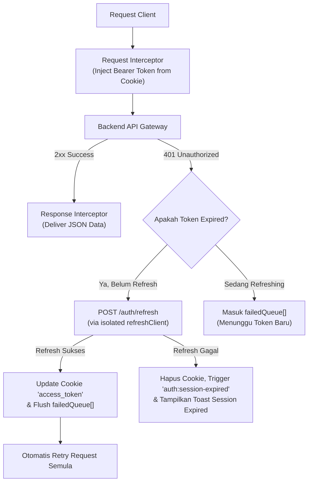

Template `template-vue` adalah starter kit dashboard SaaS enterprise berbasis **Vue 3** dan **Vite**, dirancang untuk performa tinggi dengan Single File Components (`<script setup lang="ts">`), modularitas domain (*feature-driven modules*), manajemen autentikasi tangguh dengan Axios interceptor, serta integrasi mulus dengan PrimeVue Aura dan Tailwind CSS v4.

---

## 🚀 Tech Stack & Spesifikasi Kunci

| Komponen | Teknologi | Keterangan & Versi |
|---|---|---|
| **Framework UI** | Vue 3 | Reactivity engine, `<script setup lang="ts">`, SFC compiler (`3.5+`) |
| **Build Tool & Bundler** | Vite 8 | Lightning-fast HMR, `vite-plugin-vue-devtools` (`8.1+`) |
| **Bahasa & Compiler** | TypeScript 6 | Strict type-safety, path aliases (`@/*`), `vue-tsc -b` (`~6.0`) |
| **Styling Engine** | Tailwind CSS v4 | Zero-config CSS build via `@tailwindcss/vite` (`4.3+`) |
| **Enterprise UI Kit** | PrimeVue 4 | DataTable, Dialog, Toast, Form Inputs, Button (`4.5+`) |
| **UI Theme Preset** | Aura (`@primeuix/themes`) | Desain minimalis enterprise modern dengan CSS cascade layers |
| **State Management** | Pinia 3 | Setup stores composable (`defineStore`), zero mutation boilerplate (`3.0+`) |
| **Client Routing** | Vue Router 5 | Nested layouts, dynamic imports, navigation guards (`5.1+`) |
| **HTTP Client** | Axios 1.21+ | Auto-refresh token 401, concurrent request queue, global toast |
| **Port Development** | `5173` | Default URL: [http://localhost:5173](http://localhost:5173) |

---

## 🌐 Enterprise HTTP Client (Axios & Token Refresh)

Komunikasi REST API dipusatkan di `src/api/client.ts`. Axios instance ini dikonfigurasi untuk menangani siklus hidup autentikasi token JWT secara transparan, termasuk antrean request saat refresh token sedang berlangsung.



### 1. Inisialisasi Client & Konfigurasi Basis

Menggunakan konfigurasi `withCredentials: true` untuk pertukaran cookie aman (*HTTP-only refresh token*):

```typescript title="src/api/client.ts"
import axios, { AxiosInstance } from 'axios';

const BASE_URL =
  import.meta.env.VITE_API_BASE_URL ||
  import.meta.env.VITE_API_URL ||
  'http://localhost:3000';

export const api: AxiosInstance = axios.create({
  baseURL: BASE_URL,
  timeout: 15000,
  withCredentials: true,
  headers: {
    Accept: 'application/json',
    'Content-Type': 'application/json',
  },
});

// Dedicated unintercepted client untuk endpoint refresh mencegah infinite loop
const refreshClient: AxiosInstance = axios.create({
  baseURL: BASE_URL,
  timeout: 10000,
  withCredentials: true,
  headers: {
    Accept: 'application/json',
    'Content-Type': 'application/json',
  },
});
```

### 2. Request Interceptor: Injeksi Bearer Token

Setiap request otomatis menyematkan token akses dari cookie browser jika header `Authorization` belum terpasang:

```typescript title="src/api/client.ts"
api.interceptors.request.use(
  (config) => {
    if (!config.headers.Authorization) {
      const accessToken = getCookie('access_token');
      if (accessToken) {
        config.headers.Authorization = `Bearer ${accessToken}`;
      }
    }
    return config;
  },
  (error) => Promise.reject(error)
);
```

### 3. Response Interceptor: 401 Queue & Auto-Refresh

Ketika backend mengembalikan HTTP `401 Unauthorized`, response interceptor mengunci siklus refresh, menampung request paralel lainnya ke dalam antrean `failedQueue`, mengeksekusi rotasi token ke `/auth/refresh`, lalu melakukan *replay* otomatis pada request yang tertunda:

```typescript title="src/api/client.ts"
let isRefreshing = false;
let failedQueue: Array<{ resolve: (token: string | null) => void; reject: (err: unknown) => void }> = [];

const processQueue = (error: unknown, token: string | null = null) => {
  failedQueue.forEach((prom) => (error ? prom.reject(error) : prom.resolve(token)));
  failedQueue = [];
};

api.interceptors.response.use(
  (response) => response,
  async (error: AxiosError) => {
    const originalRequest = error.config as CustomAxiosRequestConfig | undefined;
    if (!originalRequest) return Promise.reject(error);

    const is401 = error.response?.status === 401;
    const isAuthEndpoint = originalRequest.url?.includes('/auth/refresh') || originalRequest.url?.includes('/auth/login');

    if (!is401 || originalRequest._retry || isAuthEndpoint) {
      return Promise.reject(error);
    }

    if (isRefreshing) {
      return new Promise<string | null>((resolve, reject) => {
        failedQueue.push({ resolve, reject });
      })
        .then((token) => {
          if (token && originalRequest.headers) {
            originalRequest.headers.Authorization = `Bearer ${token}`;
          }
          return api(originalRequest);
        })
        .catch((err) => Promise.reject(err));
    }

    originalRequest._retry = true;
    isRefreshing = true;

    try {
      const refreshResponse = await refreshClient.post('/auth/refresh');
      const newAccessToken = refreshResponse.data?.data?.tokens?.accessToken || getCookie('access_token');

      if (newAccessToken) {
        setCookie('access_token', newAccessToken);
        api.defaults.headers.common.Authorization = `Bearer ${newAccessToken}`;
        if (originalRequest.headers) {
          originalRequest.headers.Authorization = `Bearer ${newAccessToken}`;
        }
      }

      processQueue(null, newAccessToken);
      return api(originalRequest);
    } catch (refreshError) {
      processQueue(refreshError, null);
      removeCookie('access_token');
      window.dispatchEvent(new CustomEvent('auth:session-expired', { detail: refreshError }));
      return Promise.reject(refreshError);
    } finally {
      isRefreshing = false;
    }
  }
);
```

### 4. Global Toast Bridge & Penanganan Error

Untuk mencegah kode boilerplate toast berulang di setiap pemanggilan API, Axios interceptor secara otomatis menyiarkan event global `api:toast` pada kegagalan jaringan atau HTTP 4xx/5xx:

```typescript title="src/utils/toast.ts"
export interface ApiToastDetail {
  severity?: 'success' | 'info' | 'warn' | 'error';
  summary?: string;
  detail: string;
  life?: number;
}

export function dispatchToast(detail: ApiToastDetail): void {
  if (typeof window !== 'undefined') {
    window.dispatchEvent(new CustomEvent<ApiToastDetail>('api:toast', { detail }));
  }
}
```

> **Opsi `skipToast`**: Jika sebuah pemanggilan API ingin menangani error secara kustom tanpa memunculkan toast otomatis, cukup sertakan opsi `{ skipToast: true }` pada konfigurasi request:
> ```typescript
> await apiClient.get('/users/check-email', { skipToast: true });
> ```

---

## ⚡ State Management Global

Aplikasi menggunakan **Pinia 3** dengan pola **Setup Stores** (`defineStore` berbasis Composition API), memberikan *type-inference* sempurna dan kode modular yang bersih.

### 1. Definisi Store (Zustand / Pinia)

```typescript title="src/modules/auth/stores/authStore.ts"
import { defineStore } from 'pinia';
import { computed, ref } from 'vue';
import type { User } from '@/modules/users';
import { removeCookie } from '@/utils';

export const useAuthStore = defineStore('auth', () => {
  const user = ref<User | null>(null);
  const isAuthenticated = computed(() => !!user.value);

  function login(userData: User) {
    user.value = userData;
  }

  function logout() {
    removeCookie('access_token');
    user.value = null;
  }

  return { user, isAuthenticated, login, logout };
});
```

### 2. Integrasi Store dalam Komponen

Komponen Vue mengonsumsi store langsung dalam `<script setup lang="ts">` dengan reaktivitas native:

```vue title="src/components/layout/Header.vue"
<script setup lang="ts">
import { useAuthStore } from '@/modules/auth';

const authStore = useAuthStore();
</script>

<template>
  <header class="flex items-center justify-between p-4 border-b border-slate-200 dark:border-slate-800">
    <span class="text-sm font-medium">Masuk sebagai: {{ authStore.user?.name || 'Tamu' }}</span>
    <button @click="authStore.logout" class="text-sm text-red-500 hover:underline">
      Keluar
    </button>
  </header>
</template>
```

---

## 🧭 Routing Deklaratif & Layout Modules

### 1. Konfigurasi Router & Nested Layouts

Menggunakan `createRouter` dari **Vue Router 5** dengan pemisahan tata letak halaman (*nested layouts*) dan *lazy-loading*:

```typescript title="src/router/index.ts"
import { createRouter, createWebHistory } from 'vue-router';

const router = createRouter({
  history: createWebHistory(),
  routes: [
    {
      path: '/',
      component: () => import('@/layouts/DashboardLayout.vue'),
      children: [
        {
          path: '',
          name: 'Dashboard',
          component: () => import('@/modules/dashboard/pages/DashboardPage.vue')
        },
        {
          path: 'users',
          name: 'Users',
          component: () => import('@/modules/users/pages/UsersPage.vue')
        }
      ]
    },
    {
      path: '/auth',
      component: () => import('@/layouts/AuthLayout.vue'),
      children: [
        {
          path: 'login',
          name: 'Login',
          component: () => import('@/modules/auth/pages/LoginPage.vue')
        }
      ]
    },
    {
      path: '/:pathMatch(.*)*',
      name: 'NotFound',
      component: () => import('@/pages/NotFound.vue')
    }
  ]
});

export default router;
```

### 2. Struktur Modul Fitur (Feature-Driven Modules)

Setiap domain fitur dikelompokkan secara mandiri di `src/modules/<nama-fitur>/`:

```text
src/modules/users/
├── api/
│   └── usersApi.ts       # Endpoint Axios spesifik resource user
├── components/
│   └── UserAvatar.vue    # Komponen visual domain user
├── pages/
│   └── UsersPage.vue     # View entrypoint /users
├── types/
│   └── index.ts          # Interface User, UserFilter, dll.
└── index.ts              # Barrel export publik untuk modul
```

Contoh pemanggilan API per modul dengan Axios wrapper:

```typescript title="src/modules/users/api/usersApi.ts"
import { apiClient } from '@/api/client';
import type { PaginatedResponse } from '@/types';
import type { User } from '../types';

export const usersApi = {
  getAll: (page = 1, pageSize = 10) =>
    apiClient.get<PaginatedResponse<User>>(`/users?page=${page}&pageSize=${pageSize}`),

  getById: (id: string) =>
    apiClient.get<User>(`/users/${id}`),

  create: (data: Omit<User, 'id'>) =>
    apiClient.post<User>('/users', data),

  update: (id: string, data: Partial<User>) =>
    apiClient.put<User>(`/users/${id}`, data),

  delete: (id: string) =>
    apiClient.delete<void>(`/users/${id}`)
};
```

---

## 🎨 UI System: PrimeUI & Tailwind CSS v4

### 1. Aura Theme Preset & CSS Layer Order

Integrasi PrimeVue menggunakan preset desain modern **Aura** dari `@primeuix/themes`. Urutan cascade layer CSS diatur secara eksplisit agar utility class Tailwind v4 selalu memiliki prioritas spesifisitas tertinggi:

```typescript title="src/main.ts"
import Aura from '@primeuix/themes/aura';
import PrimeVue from 'primevue/config';
import ToastService from 'primevue/toastservice';

app.use(PrimeVue, {
  theme: {
    preset: Aura,
    options: {
      darkModeSelector: '.dark',
      cssLayer: {
        name: 'primevue',
        order: 'tailwind-base, primevue, tailwind-utilities',
      },
    },
  },
});
app.use(ToastService);
```

### 2. Dark Mode Selector

Tema gelap (*Dark Mode*) dikendalikan menggunakan kelas CSS `.dark` pada elemen root document (`<html>`). Komponen PrimeVue (seperti `DataTable`, `Dialog`, `InputText`) secara instan bertransisi mengikuti skema warna dark mode.

---

## 🛡️ Pola Loading: Skeleton Loader vs Action Button

Sesuai aturan arsitektur monorepo (`frontend-loading.md`), terdapat standardisasi ketat terkait status pemuatan (*loading state*):

### 1. Skeleton Loader Wajib untuk Data Asinkron

❌ **DILARANG KERAS**: Menggunakan spinner berputar (*loading muter*) untuk memuat halaman, tabel `DataTable`, daftar item, atau kartu profil.
✅ **WAJIB SKELETON**: Setiap pemuatan data asinkron wajib merender placeholder **Skeleton** berukuran proporsional:

```vue title="Contoh Skeleton pada DataTable"
<script setup lang="ts">
import Column from 'primevue/column';
import DataTable from 'primevue/datatable';
import Skeleton from 'primevue/skeleton';

const dummyRows = Array.from({ length: 5 }, (_, i) => ({ id: String(i) }));
</script>

<template>
  <DataTable :value="dummyRows" class="p-datatable-sm">
    <Column header="Nama">
      <template #body><Skeleton width="70%" height="1.25rem" /></template>
    </Column>
    <Column header="Email">
      <template #body><Skeleton width="90%" height="1.25rem" /></template>
    </Column>
    <Column header="Peran">
      <template #body><Skeleton width="40%" height="1.25rem" /></template>
    </Column>
    <Column header="Aksi">
      <template #body><Skeleton shape="circle" size="2rem" /></template>
    </Column>
  </DataTable>
</template>
```

### 2. Button Spinner Interaktif (Pengecualian Spinner Muter)

✅ Spinner berputar **HANYA** diizinkan di dalam elemen tombol aksi (`<Button :loading="isSubmitting">`) saat aksi pengguna sedang diproses (Submit form, Hapus item, Simpan perubahan):

```vue title="src/modules/auth/pages/LoginPage.vue"
<script setup lang="ts">
import Button from 'primevue/button';
import { ref } from 'vue';

const isSubmitting = ref(false);
</script>

<template>
  <Button 
    type="submit" 
    label="Sign in" 
    :loading="isSubmitting" 
    class="w-full bg-indigo-600 hover:bg-indigo-700 border-none mt-2" 
  />
</template>
```

---

## ⚙️ Variabel Lingkungan & Konfigurasi

```ini title=".env"
# URL Gateway Backend REST API
VITE_API_BASE_URL=http://localhost:3000
```

---

## 🛠️ Perintah Pengembangan & Quality Gates

```bash title="Terminal"
cd template-vue

# Install dependensi
npm install

# Menjalankan preflight audit & start local dev server (port 5173)
npm run dev

# Verifikasi type check TypeScript (vue-tsc -b)
npm run typecheck

# Menjalankan static linter ESLint dengan auto-fix
npm run lint

# Format berkas source code via Prettier
npm run format

# Menjalankan verifikasi keamanan mandiri (npm audit + typecheck)
npm run preflight

# Build bundle produksi teroptimasi
npm run build

# Preview build produksi secara lokal
npm run preview
```
