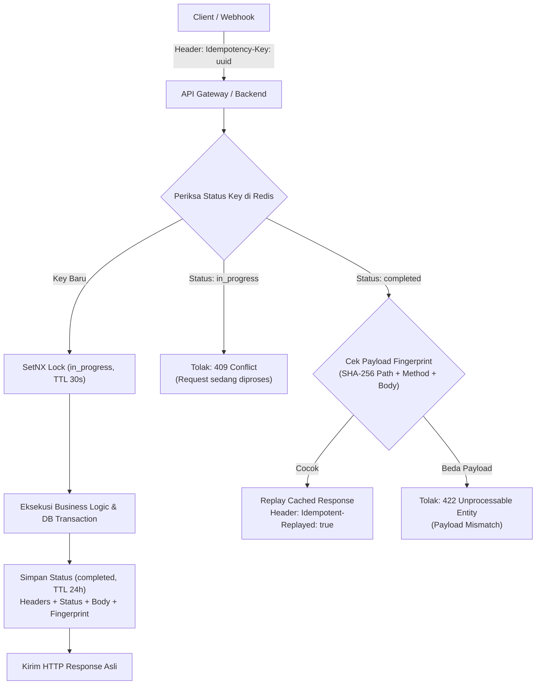

Dalam sistem terdistribusi, kegagalan jaringan atau timeout sering kali memicu retry otomatis dari client (browser, mobile app, atau webhook gateway). Tanpa proteksi idempotency, retry pada operasi mutasi (misalnya pembayaran, pemotongan saldo, order creation, atau pemindahan dana) dapat mengakibatkan **double charge** atau data duplikat.

Seluruh 5 template backend di monorepo ini (`template-golang`, `template-express`, `template-fastapi-async`, `template-java`, dan `template-rust`) menerapkan standar idempotency yang seragam mengacu pada spesifikasi **IETF draft-ietf-httpapi-idempotency-key-header**.

---

## 🎯 Siklus Hidup Request Idempotent



---

## 📋 Standar Header HTTP

| Header | Tipe | Deskripsi |
|---|---|---|
| `Idempotency-Key` | Request Header | Identifier unik string (UUID v4 disarankan, 1–256 karakter) yang dihasilkan oleh client. |
| `X-Idempotency-Key` | Request Header | Fallback alternatif kompatibilitas header jika client tidak mendukung header standar. |
| `Idempotent-Replayed` | Response Header | Bernilai `true` saat response diambil dari cache replay, bukan eksekusi ulang. |
| `X-Idempotency-Replayed` | Response Header | Fallback alternatif header replay kompatibilitas. |

---

## 🛡️ 4 Mekanisme Keamanan Utama

### 1. Atomic Distributed Locking (`in_progress`)
Sebelum mengeksekusi logika bisnis atau membuka transaksi database, backend mengeksekusi operasi atomik Redis:
```text
SET idempotency:{userId}:{key} {"status":"in_progress", ...} NX EX 30
```
- Jika key sudah ada dan berstatus `in_progress`, server langsung mengembalikan status **`409 Conflict`** (`IDEMPOTENCY_CONFLICT` / `CODE_IDEMPOTENCY_IN_FLIGHT`) untuk mencegah eksekusi paralel ganda (*race condition*).
- Kunci `in_progress` memiliki TTL pendek (30 detik). Jika koneksi client terputus sebelum request selesai, lock otomatis terlepas.

### 2. Payload Fingerprinting (SHA-256)
Untuk mencegah serangan penipuan atau bug di mana client menggunakan kembali key yang sama untuk request data yang sama sekali berbeda:
- Backend menghitung hash SHA-256 dari gabungan:
  $$\text{Fingerprint} = \text{SHA256}(\text{userId} + \text{method} + \text{path} + \text{rawBody})$$
- Jika request baru membawa key yang berstatus `completed` namun payload datanya berbeda dari fingerprint awal, server menolak dengan **`422 Unprocessable Entity`** (`IDEMPOTENCY_PAYLOAD_MISMATCH`).

### 3. Automatic Response Replay
Jika request membawa key yang berstatus `completed` dan fingerprint cocok 100%:
- Server **tidak menjalankan ulang transaksi database atau logika bisnis**.
- Server langsung mengembalikan status code, headers (misal `Content-Type`), dan body JSON persis sama seperti response pertama kali.
- Server menyematkan header `Idempotent-Replayed: true`.

### 4. Automatic Unlock on 5xx Failures
Jika selama proses eksekusi terjadi error internal server (HTTP 5xx, koneksi database timeout, atau panic):
- Middleware secara otomatis menghapus lock (`DEL idempotency:...`) agar client dapat mencoba kembali (*retry safely*) tanpa tertahan oleh lock lama.

---

## 💻 Implementasi di Seluruh 5 Backend

### 1. Go (`template-golang`)
Diterapkan via middleware `idempotency.New()` pada route Fiber:

```go title="internal/app/http.go"
import "golang/pkg/idempotency"

// Pasang middleware idempotency pada rute mutasi sensitif
orders := api.Group("/orders", idempotency.New(idempotency.Config{
    Storage:     idempotency.NewRedisStorage(redisClient),
    Lifetime:    24 * time.Hour,
    LockTimeout: 30 * time.Second,
    Required:    true,
}))
orders.Post("/", orderHandler.CreateOrder)
```

### 2. Express.js (`template-express`)
Diterapkan via middleware `idempotency()` pada router Express:

```typescript title="src/modules/orders/routes.ts"
import { Router } from 'express'
import { idempotency, RedisIdempotencyStorage } from '../../middleware/idempotency'
import { orderController } from './controller'

const router = Router()

// Proteksi mutasi dengan kewajiban header Idempotency-Key
router.post(
  '/',
  idempotency({
    storage: new RedisIdempotencyStorage(),
    required: true,
    lifetimeSeconds: 86400,
    lockTimeoutSeconds: 30
  }),
  orderController.createOrder
)

export default router
```

### 3. FastAPI (`template-fastapi-async`)
Diterapkan via `IdempotencyMiddleware` global atau dependency helper `require_idempotency_key`:

```python title="main.py"
from middleware.idempotency import IdempotencyMiddleware, RedisIdempotencyStorage

# Tambahkan middleware idempotency terdistribusi ke aplikasi
app.add_middleware(
    IdempotencyMiddleware,
    storage=RedisIdempotencyStorage(),
    lifetime_seconds=86400,
    timeout_seconds=30
)
```

Untuk mewajibkan header pada endpoint tertentu:

```python title="modules/orders/routes.py"
from fastapi import APIRouter, Depends
from middleware.idempotency import require_idempotency_key

router = APIRouter(prefix="/orders", tags=["Orders"])

@router.post("", dependencies=[Depends(require_idempotency_key)])
async def create_order(request: OrderCreate):
    return await order_service.create_order(request)
```

### 4. Spring Boot (`template-java`)
Diterapkan via filter servlet `IdempotencyFilter` dan anotasi kustom `@RequireIdempotencyKey`:

```java title="com/example/template/java/order/controller/OrderController.java"
@RestController
@RequestMapping("/api/orders")
public class OrderController {

  @PostMapping
  @RequireIdempotencyKey
  @Transactional
  public ResponseEntity<BaseResponse<OrderResponse>> createOrder(
      @Valid @RequestBody OrderRequest request) {
    OrderResponse response = orderService.createOrder(request);
    return ResponseEntity.ok(BaseResponse.success("Order created", response));
  }
}
```

### 5. Rust Axum (`template-rust`)
Diterapkan via middleware `idempotency_layer` dengan `IdempotencyStore`:

```rust title="src/main.rs"
use axum::{middleware, routing::post, Router};
use std::sync::Arc;
use template_rust::pkg::idempotency::{idempotency_layer, IdempotencyStore};

let idempotency_store = Arc::new(IdempotencyStore::default());

let app = Router::new()
    .route("/api/orders", post(create_order))
    .layer(middleware::from_fn(move |req, next| {
        idempotency_layer(idempotency_store.clone(), req, next)
    }));
```
