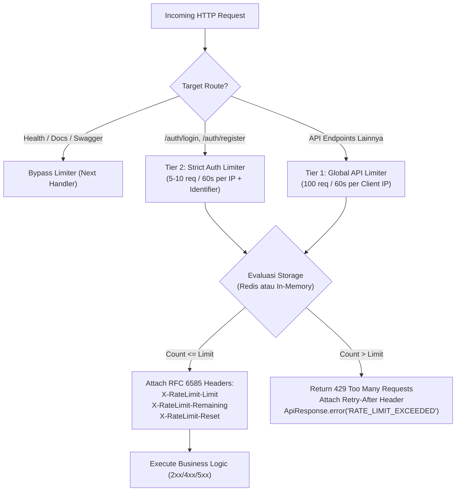

Untuk mencegah serangan *Denial of Service (DoS)*, *brute force*, dan *credential stuffing*, seluruh template backend monorepo (`template-express`, `template-fastapi-async`, `template-golang`, `template-java`, `template-rust`) menerapkan arsitektur **Dual-Tier Rate Limiter** yang mematuhi standar **RFC 6585**.

---

## 🚦 Arsitektur Dual-Tier Rate Limiting



---

## ⚡ Dua Tingkatan Proteksi (Tiers)

### 1. Tier 1: Global API Limiter
- **Tujuan**: Mencegah *traffic surge*, *runaway client polling*, dan serangan DoS umum pada endpoint publik.
- **Konfigurasi Default**: `100 request / 60 detik` per IP client.
- **Pengecualian (Whitelist)**:
  - Route pemeriksaan kesiapan sistem: `/health`, `/`
  - Route dokumentasi interaktif: `/docs`, `/swagger`, `/openapi.json`, `/v3/api-docs`

### 2. Tier 2: Strict Auth Limiter
- **Tujuan**: Menghentikan serangan tebak password (*brute force*) dan *credential stuffing* pada alur otentikasi.
- **Konfigurasi Default**: `5 - 10 request / 60 detik`.
- **Target Endpoint**: `/auth/login`, `/auth/register`.
- **Key Generator Komposit**: Menggabungkan IP + Path/Email (contoh: `rl:auth:<ip>:<path>` atau `<ip>:<email>`) sehingga upaya login berulang ke satu akun dari IP yang sama diblokir dengan cepat.

---

## 📋 Header Standar RFC 6585

Setiap respons HTTP yang diproses oleh middleware rate limiter menyertakan metadata transparansi kuota bagi client:

| Header | Deskripsi | Contoh Nilai |
|---|---|---|
| `X-RateLimit-Limit` | Kuota maksimum yang diizinkan dalam satu window | `100` |
| `X-RateLimit-Remaining` | Sisa kuota request sebelum window reset | `84` |
| `X-RateLimit-Reset` | Timestamp Unix (Epoch detik) saat window di-reset | `1732093560` |
| `Retry-After` | Jumlah detik client harus menunggu (*hanya saat HTTP 429*) | `45` |

---

## 📦 Standar Response HTTP 429 (Too Many Requests)

Ketika batas kuota terlampaui, backend mengembalikan status HTTP `429 Too Many Requests` dengan format envelope standar `ApiResponse`:

```json
{
  "success": false,
  "message": "Too many requests. Please try again after 45 seconds.",
  "error": {
    "code": "RATE_LIMIT_EXCEEDED"
  },
  "data": null
}
```

Client frontend (React dan Vue) membaca header `Retry-After` ini secara otomatis dan memunculkan toast peringatan dengan countdown detik.

---

## 🛡️ Penyimpanan Hybrid (Redis + In-Memory Fallback)

1. **Distributed Mode (Redis)**:
   - Digunakan saat `RATE_LIMIT_STORAGE=redis` dan Redis aktif.
   - Menggunakan atomik `INCR` dan `EXPIRE` untuk menjaga sinkronisasi kuota lintas ratusan replika pod di Kubernetes.
2. **In-Memory Fallback**:
   - Jika koneksi Redis down atau tidak dikonfigurasi, middleware **DILARANG CRASH**.
   - Sistem secara mulus *fallover* ke storage lokal berbasis in-memory map dengan thread-safe lock / concurrent mutex dan pembersihan record kadaluwarsa secara berkala.

---

## ⚙️ Ringkasan Variabel Lingkungan

```ini title=".env"
# Mengaktifkan/menonaktifkan rate limiting
RATE_LIMIT_ENABLED=true

# Storage driver: memory atau redis
RATE_LIMIT_STORAGE=memory

# Global Limiter: 100 requests per 60 detik
RATE_LIMIT_MAX=100
RATE_LIMIT_WINDOW_SECONDS=60

# Strict Auth Limiter: 5-10 requests per 60 detik
RATE_LIMIT_AUTH_MAX=5
RATE_LIMIT_AUTH_WINDOW_SECONDS=60
```
