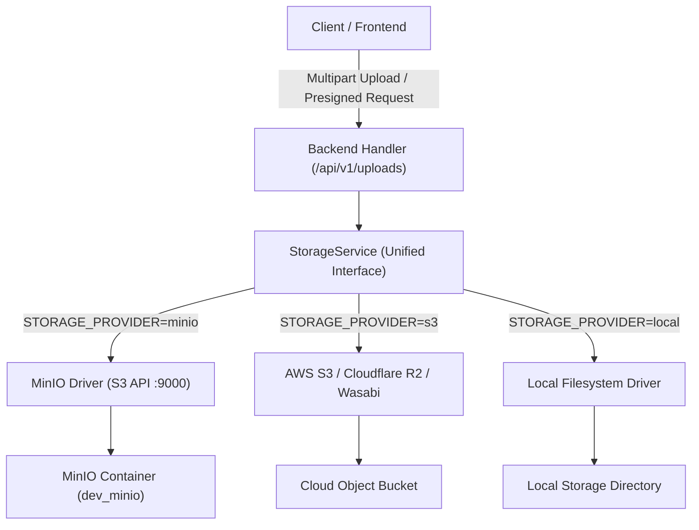

Seluruh backend template di monorepo (`template-express`, `template-fastapi-async`, `template-golang`, `template-java`, `template-rust`) menerapkan arsitektur **Unified Object Storage Driver**. Arsitektur ini memungkinkan aplikasi berganti provider penyimpanan file (MinIO, AWS S3, Cloudflare R2, atau Local Disk) hanya melalui konfigurasi variabel lingkungan tanpa mengubah satu baris pun kode bisnis.

---

## 🏛️ Desain Arsitektur & Driver Agnostic



---

## 📋 Kontrak Operasi Standar (Storage Contract)

Seluruh service backend mengekspos interface penyimpanan file yang seragam:

1. **`upload(key, content, contentType, isPublic)`**:
   - Mengunggah file biner ke direktori/bucket target.
   - Mengembalikan metadata objek:
     ```json
     {
       "key": "avatars/usr-123.png",
       "url": "http://localhost:9000/app-uploads/avatars/usr-123.png",
       "size": 15420,
       "contentType": "image/png"
     }
     ```
2. **`download(key)`**:
   - Mengambil konten file dalam bentuk binary buffer/stream.
   - Mengembalikan error semantik `FILE_NOT_FOUND` jika objek tidak ada.
3. **`delete(key)`**:
   - Menghapus file secara aman dan idempoten.
4. **`getUrl(key)`**:
   - Mengembalikan URL publik file (baik via direct S3 URL maupun CDN).
5. **`getPresignedUploadUrl(key, contentType, expiresInSeconds)`**:
   - Menghasilkan URL presigned aman untuk *Direct-to-S3 Upload* dari browser/frontend.
   - Mencegah bottleneck bandwidth backend pada pengunggahan file berukuran besar (video, dataset, audio).
6. **`getPresignedDownloadUrl(key, expiresInSeconds)`**:
   - Menghasilkan URL download berbatas waktu (misal: 15 menit) untuk berkas privat/sensitif.
7. **`exists(key)`**:
   - Memeriksa keberadaan file di storage secara efisien (*HEAD request*).

---

## 🛡️ Keamanan & Proteksi Path Traversal

Driver `local` wajib memvalidasi bahwa path target tidak keluar dari root direktori penyimpanan:
- Memverifikasi canonical path (`Path.canonicalize()` / `path.resolve()` / `filepath.Clean()`).
- Jika path mengandung segmen traversal (`../`, `..\`) atau mencoba mengakses file sistem di luar root, request langsung ditolak dengan status HTTP `400 Bad Request` (`VALIDATION_ERROR`).

---

## ⚙️ Variabel Lingkungan Standar

| Variabel | Pilihan Nilai / Default | Keterangan |
|---|---|---|
| `STORAGE_PROVIDER` | `minio` \| `s3` \| `local` | Driver penyimpanan yang aktif |
| `STORAGE_LOCAL_PATH` | `storage/uploads` | Path direktori untuk driver `local` |
| `S3_ENDPOINT` | `http://localhost:9000` | URL endpoint S3 / MinIO |
| `S3_REGION` | `us-east-1` | Wilayah / region bucket S3 |
| `S3_BUCKET` | `app-uploads` | Nama bucket penyimpanan |
| `S3_ACCESS_KEY` | `minioadmin` | Access key / API key |
| `S3_SECRET_KEY` | `minioadminpassword` | Secret key credential |
| `S3_FORCE_PATH_STYLE` | `true` | Wajib `true` untuk MinIO & emulator S3 |
| `S3_USE_SSL` | `false` | Gunakan `true` untuk produksi HTTPS |
| `STORAGE_PUBLIC_URL` | `http://localhost:9000/app-uploads` | Base URL untuk akses file publik |

---

## 🧪 Pengujian Terisolasi dengan Testcontainers

Untuk memastikan kompatibilitas penuh dengan penyimpanan cloud di lingkungan CI/CD:
- Setiap template menyertakan pengujian integration storage (`storage.test`) berbasis **Testcontainers MinIO**.
- Tes secara otomatis membuat bucket uji sementara, melakukan upload, download, pengecekan presigned URL, dan verifikasi penghapusan.
- Jika Docker daemon tidak tersedia (misal di lingkungan build sandbox terbatas), runner pengujian secara cerdas beralih ke mock atau melewati container tanpa memicu kegagalan build.
