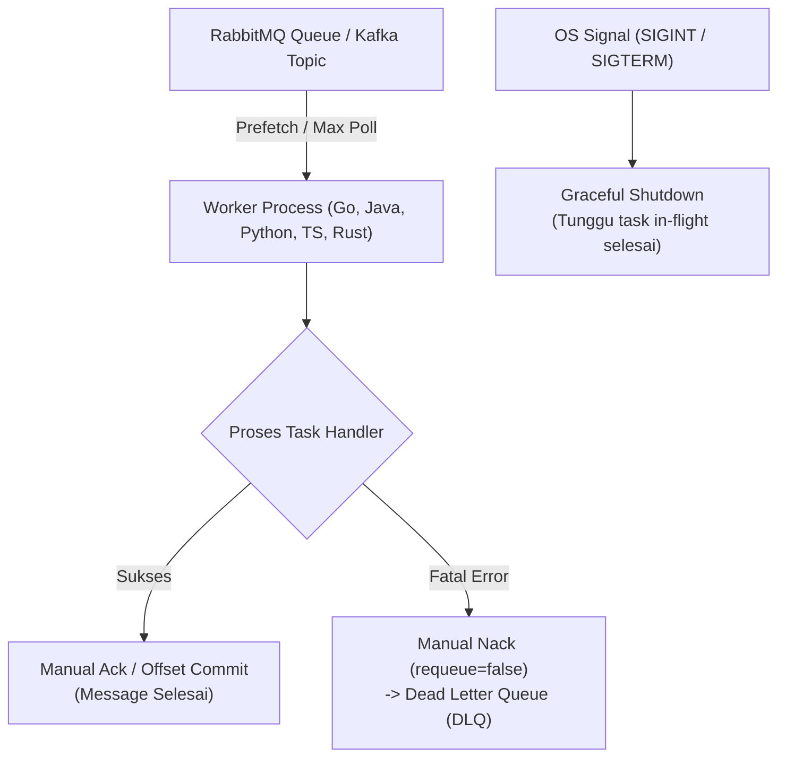

Monorepo ini menyediakan 5 implementasi worker mandiri yang dirancang untuk memproses tugas-tugas berat di latar belakang (*asynchronous job processing*) seperti pengiriman email, kalkulasi analitik, pemrosesan media, atau sinkronisasi data antar-service.

Setiap worker mendukung arsitektur **Dual Message Broker**: Anda dapat beralih antara antrean **RabbitMQ (AMQP 0.9.1)** atau event streaming **Apache Kafka** hanya dengan mengubah variabel lingkungan `MESSAGE_BROKER=rabbitmq` atau `MESSAGE_BROKER=kafka`.

---

## 🎯 4 Pilar Pola Desain Worker

Setiap template worker menerapkan 4 pola standar arsitektur:



### 1. Quality of Service (QoS / Fair Dispatch)
Setiap worker membatasi jumlah pesan unacknowledged yang ditarik dari antrean secara bersamaan (default: 1 sampai 10). Ini mencegah satu worker kelebihan beban (*out of memory*) ketika ribuan tugas masuk secara bersamaan ke antrean.

### 2. Manual Message Acknowledgment (Ack / Nack) & Offset Commit
- ✅ **Ack / Commit**: Dikirim hanya saat payload pesan telah berhasil diproses secara tuntas oleh fungsi handler bisnis.
- ❌ **Nack dengan DLQ**: Jika pesan mengalami error fatal atau payload JSON korup, worker mengirim `Nack` dengan `requeue=false` (atau meneruskan ke Dead Letter Exchange) agar pesan dipindahkan ke Dead Letter Queue (DLQ) untuk investigasi tanpa memicu *infinite retry loop*.

### 3. Graceful Shutdown & Sinyal OS
Setiap worker mendengarkan sinyal terminasi OS (`SIGINT`, `SIGTERM`). Saat menerima sinyal:
1. Worker berhenti menerima pesan baru dari antrean/topic.
2. Worker memberikan jeda waktu (*grace period*) agar pesan yang sedang berjalan selesai diproses.
3. Worker menutup channel broker dan koneksi socket secara tertib tanpa kehilangan data in-flight.

### 4. Structured JSON Logging
Sesuai aturan global monorepo (`logging.md`), dilarang keras menggunakan fungsi print mentah (`console.log`, `fmt.Println`, `print()`, `System.out.println`, `println!`). Semua worker menggunakan logger JSON terstruktur.

---

## 📦 Matriks 5 Template Worker

| Template | Bahasa | Driver RabbitMQ | Driver Apache Kafka | Model Konkurensi |
|---|---|---|---|---|
| `template-worker-golang` | Go 1.22+ | `rabbitmq/amqp091-go` | `segmentio/kafka-go` | Goroutines Pool & Channels |
| `template-worker-java` | Java 17+ | Spring AMQP `@RabbitListener` | Spring Kafka `@KafkaListener` | Thread Pool Task Executor |
| `template-worker-python` | Python 3.10+ | `pika` (BlockingConnection) | `kafka-python-ng` | Event Loop / Callbacks |
| `template-worker-typescript` | Node.js (TS) | `amqplib` | `kafkajs` | Async Task Handlers |
| `template-worker-rust` | Rust 2021 | `lapin` (AMQP 0.9.1) | `rskafka` | Tokio Async Runtime (< 15MB RAM) |

---

## 🔄 Format Standar Message Envelope

Seluruh template backend dan worker berbagi skema payload JSON yang seragam:

```json
{
  "id": "msg-9b1deb4d-3b7d-4bad-9bdd-2b0d7b3dcb6d",
  "type": "USER_NOTIFICATION",
  "data": {
    "userId": "123",
    "title": "Welcome",
    "message": "Your registration was successful"
  },
  "timestamp": 1700000000000
}
```
