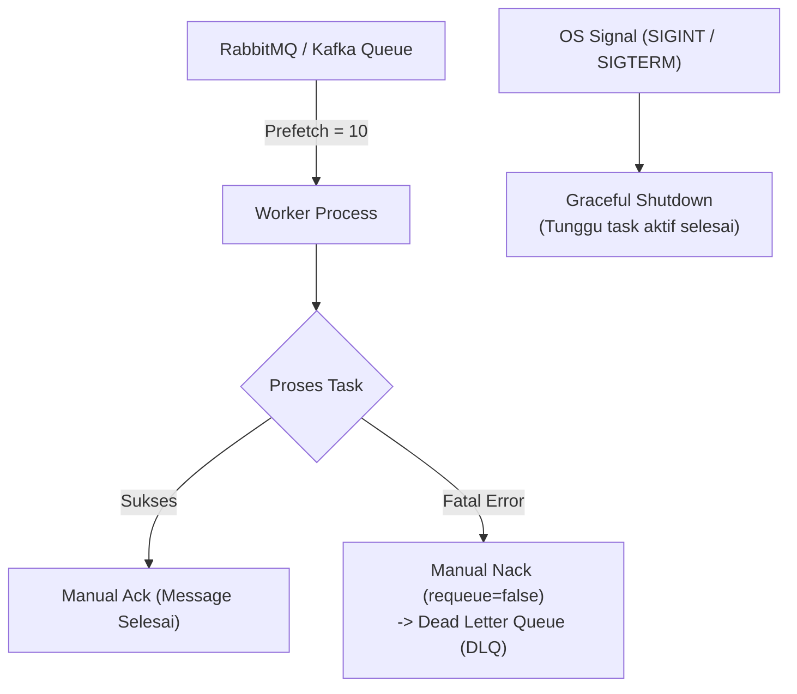

Monorepo ini menyediakan 5 implementasi worker mandiri yang dirancang untuk memproses tugas-tugas berat di latar belakang (*asynchronous job processing*) seperti pengiriman email, kalkulasi analitik, pemrosesan video, atau sinkronisasi data antar-service.

---

## 🎯 4 Pilar Pola Desain Worker

Setiap template worker menerapkan 4 pola standar arsitektur:

### 1. Quality of Service (QoS / Prefetch Count = 10)
Setiap worker membatasi jumlah pesan unacknowledged yang ditarik dari queue secara bersamaan (default: 10). Ini mencegah satu worker kelebihan beban (*out of memory*) ketika ribuan tugas masuk ke queue.

### 2. Manual Message Acknowledgment (Ack / Nack)
- ✅ **Ack**: Dikirim hanya saat payload pesan telah berhasil diproses secara tuntas.
- ❌ **Nack dengan DLQ**: Jika pesan mengalami error fatal atau payload korup, worker mengirim `Nack` dengan `requeue=false` agar pesan dipindahkan ke Dead Letter Exchange/Queue (DLX/DLQ) untuk investigasi tanpa memicu *infinite retry loop*.

### 3. Graceful Shutdown
Worker mendengarkan sinyal terminasi OS (`SIGINT`, `SIGTERM`). Saat menerima sinyal:
1. Worker berhenti menerima pesan baru dari queue.
2. Worker memberikan jeda waktu (grace period) agar pesan yang sedang diproses selesai.
3. Worker menutup channel dan koneksi secara aman tanpa kehilangan data.

---

## 📦 Daftar 5 Template Worker

| Template | Bahasa | Driver Messaging | Konkurensi |
|---|---|---|---|
| `template-worker-golang` | Go 1.22+ | `rabbitmq/amqp091-go` / Kafka | Goroutines Pool |
| `template-worker-java` | Java 17+ | Spring AMQP `@RabbitListener` | Thread Pool Executor |
| `template-worker-python` | Python 3.10+ | `aio-pika` / `pika` / Kafka | Asyncio Event Loop |
| `template-worker-typescript` | Node.js (TS) | `amqplib` / Kafka | Async Task Handlers |
| `template-worker-rust` | Rust 2021 | `lapin` / `rdkafka` | Tokio Async Runtime |
